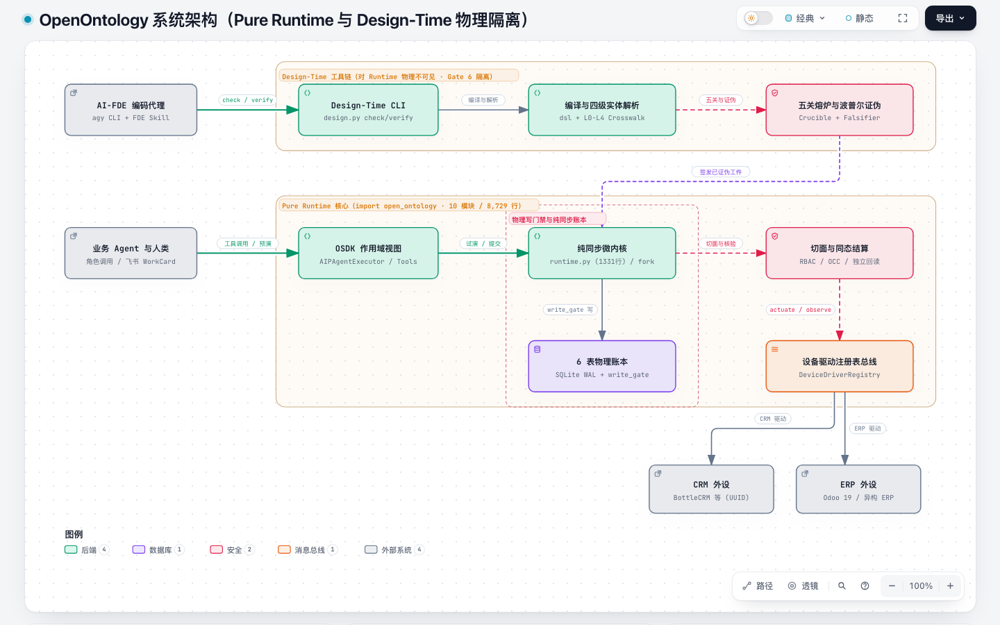

# OpenOntology · 业务本体、治理运行时与可替换工具

受 Palantir Ontology + AIP 启发的轻量业务本体运行时。核心依赖 Python 标准库 `sqlite3` + `pydantic`；测试使用 `pytest`，浏览器验收另需 Playwright。外部集成通过 Python 适配器及 Quarkus / Apache Camel 工程完成。

> **核心原则：业务纯洁性是依赖边界，不是词汇禁令。**
> 主干为 **Agent → Ontology → Tool**。业务蓝图表达对象、关系、规则与合法动作，不依赖 ERP、传输协议、宿主会话或 Aspect。运行时与外围执行层负责实现这些业务定义。
>
> **透明 Aspect 目标架构**：工具调用连线上可织入审计、溯源和执行保障；业务无需主动上报事件或携带技术字段。溯源能力保留并分层，不能为了纯洁性全部删除。

**架构入口：[docs/ARCHITECTURE.md](docs/ARCHITECTURE.md)（M2 平台宪法）。** 看板领域与自举规程见 [docs/TASK_BOARD.md](docs/TASK_BOARD.md)，跨文档词汇见 **[GLOSSARY.md](GLOSSARY.md)**，核心概念与 Palantir 对照见 [docs/PALANTIR_AND_OPEN_ONTOLOGY.md](docs/PALANTIR_AND_OPEN_ONTOLOGY.md)，实施指南见 [docs/USE_CASES_IMPLEMENTATION.md](docs/USE_CASES_IMPLEMENTATION.md)。历史设计档案保存于 [docs/plans/](docs/plans/)。



> 交互式架构图（浏览器可交互查看视图、图例与源码行号定位）：[docs/assets/openontology-architecture.html](docs/assets/openontology-architecture.html) ｜ 源 JSON：[docs/assets/openontology-architecture.json](docs/assets/openontology-architecture.json)

> **实施状态（`WO-01 ~ WO-27B` 持续演进）**：系统已定型为 **“10 模块 Java 式 Pure Runtime 微内核 + 零耦合适配/安全/持久化/指挥台生产运行壳 + `javac` 式 Design-Time CLI + 外部 CLI AI-FDE”**，并已完成双异构开源 ERP 与国产模型全栈联调实证：
> * **Pure Runtime 10 模块 JVM 核**：`import open_ontology` 严格仅加载 **10 个纯运行时模块**；`open_ontology/runtime.py` **1,328 行**（硬预算 `<= 1,335`）；`open_ontology/__init__.py` 零 `__getattr__` 后门；`tests/test_architecture_boundaries.py` **Gate 1–8** 铁笼锁死（其中 **Gate 5** 双守卫 `schema.sql` + `schema_pg.sql` 6 表纯同步无 M2 挂起态，**Gate 6** 禁加载 `design/induction/workshop/console_server/mcts/mpc` 及外围扩展壳/`psycopg`，**Gate 7** 锁死 `std_*` 标准域常识细腰零横向交叉导入，**Gate 8** 永久锁定 `FunctionDef` / `EditFunctionDef` / `ActionDef` 动力学三分法正交隔离与声明式 DSL 反 xtUML 纯洁性）。
> * **现代四视角交互指挥台（`open_ontology/console_server.py` · `WO-26`）**：服务化驱动 `web/` 提供 Model / Runtime / World / Device 四视角、沙盘预演与冲正、WorkCard 工单流转及 H2R/RLS 隔离演示。
> * **单一源码标准本体与单调定制插件（`WO-27A` / `WO-27B`）**：7 大 `examples/std_*_ontology.py`（核心/CRM/O2C/P2P/P2M/R2R/H2R）以 Python `OntologySpec`（`@spec.edit_function` + `spec.declare_action`）为唯一源码，经 `export_spec_blueprint` 单向投影 JSON 蓝图，并经 `apply_overlay_to_spec` 无损叠加 `overlay.json + custom_edits.py` 客户定制 `EditFunctionDef` / `FunctionDef` / `InvariantDef` 插件。
> * **标准 MCP Server 生产运行壳（`open_ontology/mcp_server.py`）**：纯 Python stdlib 实现 JSON-RPC 2.0，同时支持 **stdio** 与 **Streamable HTTP (`POST /mcp`)**，服务端钉死 `Actor` 与 `ScopedView` 身份权限契约，安全接入 Hermes / 各类 MCP 客户端。
> * **生产安全双壳（`autonomy.py` & `reconciliation.py`）**：`AutonomyRampController` 提供 **`SHADOW` / `COPILOT_ESCALATE` / `AUTO_UNDER_CEILING`** 三级自治度影子爬坡与追加式账本；`SagaReconciler` 落地网络写后超时失联 **Observe-Before-Retry**（先只读回读物理终态再裁决提交/回滚/人工兜底），彻底杜绝盲重试重复下账。
> * **真实 PostgreSQL 16 生产底座（`open_ontology/postgres_backend.py` + `open_ontology/schema_pg.sql` + `docker/postgres/`）**：PL/pgSQL 跨 schema 物理写门禁触发器、追加式审计防删、跨连接/跨进程并发 OCC，且保留 `fork()` 零锁纯 `:memory:` 反事实推演沙盘。
> * **零内核污染外挂 MDM 插件（`open_ontology/mdm_plugin.py` + `examples/steel_mdm_plugin.py`）**：`MDMSidecarPlugin` 通过 MCP / HTTP 与 L0–L4 `CrosswalkTable` 热刷新及幂等 `WorkCard` 协调跨系统主数据；河北钢厂两死结插件落地物理料仓 `SteelStorageBin` **`BIN_EXACT` 精确溯源 vs 品牌 FIFO** 及旁路散码**前松 `PROVISIONAL` 不卡地磅、关账/付款前硬拦**。
> * **双异构真实开源 ERP × 国产模型全栈实证**：欧洲 **Odoo 19** 与中国 **华夏 ERP（`jshERP`, `docker/jsherp/`）**均已由中国可用国产模型 **`deepseek-v4.1-flash`** 零提示盲考反编译薄驱动并通过隐藏世界差分证伪（`agy_fde_live_odoo19_protocol_benchmark.py` / `agy_fde_live_jsherp_protocol_benchmark.py`）；全栈双企钢贸实验室 `examples/live_b2b_steel_trade_lab.py` 实测真实华夏 ERP `:19999` + 真实 Odoo 19 `:8069` + 克隆 BottleCRM + 真实 PG16 `:15432` + 双端隔离 `hermes`（`deepseek/deepseek-v4.1-flash`）仅经 **5 原语 REA 常识信封**（`commonsense_exchange.py`）跨企互操作，4/4 场景 `235.85s` 零报错通过。**Model · 领域模型** / **World · 世界状态（Workspace）** 术语、M1 `WorkCard`（`$t_1$` 防幻读重算 + SoD 分离）及版本档案详见 `_state.md`。

## 快速开始

```bash
cd /Users/guci/work/open-ontology
pip install -r requirements.txt

# 1. 全量离线回归（排除需外部容器与视频构建的用例）
/Users/guci/miniforge3/bin/pytest --ignore=tests/test_agent_value_mcts.py -k "not odoo and not camel and not jsherp and not video_artifact_quality" -q

# 2. 架构边界 Gate 1–7、生产安全双壳、PG16、MDM 插件、标准域 MCP 与双企实验室核心套件
/Users/guci/miniforge3/bin/pytest \
  tests/test_architecture_boundaries.py \
  tests/test_docs_consistency.py \
  tests/test_postgres_backend.py \
  tests/test_autonomy_and_reconciliation.py \
  tests/test_commonsense_interop_and_mcp.py \
  tests/test_mdm_sidecar_and_steel_plugin.py \
  tests/test_b2b_steel_trade_lab.py -v

# 3. 启动真实 PostgreSQL 16 容器底座（docker/postgres）与华夏 ERP（docker/jsherp）
docker compose -f docker/postgres/docker-compose.yml up -d
docker compose -f docker/jsherp/docker-compose.yml up -d

# 4. javac 式 Design-Time 静态检查与 Popperian 差分证伪 CLI
/Users/guci/miniforge3/bin/python3 -m open_ontology.design check --blueprint ... --device ... --seed ...
/Users/guci/miniforge3/bin/python3 -m open_ontology.design verify --blueprint ... --device ... --resolution-spec ...

# 5. 典型领域、国产 AI-FDE 与全栈异构 B2B 实验室
python3 -m examples.live_mcp_domestic_agent_demo            # Streamable HTTP MCP + 隔离 Hermes (deepseek-v4.1-flash)
python3 -m examples.agy_fde_live_odoo19_protocol_benchmark # 真实 Odoo 19 盲考反编译基准
python3 -m examples.agy_fde_live_jsherp_protocol_benchmark # 真实华夏 ERP (jshERP) 盲考反编译基准
python3 -m examples.steel_mdm_plugin                       # 河北钢厂 BIN_EXACT 溯源 + 前松 PROVISIONAL MDM 插件
python3 -m examples.live_b2b_steel_trade_lab               # 全栈异构双企 B2B 钢贸实验室（jshERP + Odoo 19 + BottleCRM + PG16 + Hermes）

# 5. 真实 Quarkus/Camel 工程（离线编译）
cd camel-sync
PATH="/opt/homebrew/opt/openjdk@17/libexec/openjdk.jdk/Contents/Home/bin:/opt/homebrew/opt/maven/bin:$PATH" \
  mvn -o package -DskipTests
# 产物：target/quarkus-app/quarkus-run.jar
```

Camel E2E 测试会自动离线构建 `quarkus-run.jar`，然后每条测试真实拉起：

```text
Python Ontology HTTP Server  +  Java quarkus-run.jar  +  erp_north / erp_south
```

## 结构（Pure Runtime · Design-Time · 显式扩展）

| 层次 | 文件 | 职责 |
|---|---|---|
| Pure Runtime 入口 | `open_ontology/__init__.py` | 142 行纯运行时导出（零 `__getattr__`，默认仅加载 10 模块 / 8,781 行） |
| Pure Runtime 存储 | `open_ontology/schema.sql` | 5 张纯业务核心表 + 1 张 `ontology_write_gate` 写门禁触发器（仅 `COMMITTED/REVERTED/REJECTED`） |
| Pure Runtime 声明 | `open_ontology/spec.py` | `Actor` / `ObjectType` / `ObjectProperty` / `AutoID` / 动力学三分法（`FunctionDef` / `EditFunctionDef` / `ActionDef`）/ 不变量注册器 |
| Pure Runtime 沙箱 | `open_ontology/sandbox.py` | `EditBatch` 内存推演、`ObjectDiff` 与逆向补丁 |
| Pure Runtime 微内核 | `open_ontology/runtime.py` | **1,328 行**（`<= 1,335`）：`put_object` / `simulate` / `submit` / `fork` 管线；与 MCTS/Design/外围运行壳零耦合 |
| Pure Runtime 切面 | `open_ontology/aspects.py` | 6 大系统调用切面：列脱敏 / 角色与主权门禁 / 幂等与 OCC / 被拒审计 / 自动化反射 / 忙闲回调 |
| Pure Runtime 同态结算 | `open_ontology/settlement.py` | `SourceBridge` 与 `HomomorphicSettlementAspect`：无锁三阶段「预测 → 外部驱动 → 独立回读核验 → 原子提交或零污染拒收」 |
| Pure Runtime 设备总线 | `open_ontology/drivers.py` | `DeviceDriverRegistry` / `MountedDevice`：多外设路由、热插拔、`CROSS_DEVICE_WRITE_FORBIDDEN` 单写红线与共享主数据合并 |
| Pure Runtime 摄入与查询 | `open_ontology/ingestion.py`、`query.py` | `SnapshotIngestionDriver` 快照摄入与多源列拼接（MDO）；`ObjectSet` 集合代数、`pivot`、`aggregate` |
| Pure Runtime OSDK | `open_ontology/osdk.py` | 只读 `describe_tbox` / `resolve_scoped_names`、LLM Tool Schema 导出、`AIPAgentExecutor` 与确定性 Diff 评测 |
| 生产壳：标准 MCP Server | `open_ontology/mcp_server.py` | 1,020 行纯 stdlib MCP 运行壳（stdio + Streamable HTTP `POST /mcp`，服务端钉死 `Actor` / `ScopedView`） |
| 生产壳：自治爬坡与 Saga 对账 | `open_ontology/autonomy.py`、`reconciliation.py` | `AutonomyRampController`（`SHADOW` / `COPILOT_ESCALATE` / `AUTO_UNDER_CEILING`）+ `SagaReconciler` 写后失联先回读恢复 |
| 生产壳：PostgreSQL 16 底座 | `open_ontology/postgres_backend.py`、`schema_pg.sql` | 跨 schema 同构 6 表、PL/pgSQL 物理写门禁触发器与跨进程 OCC（`open_postgres_runtime`），容器配置见 `docker/postgres/` |
| 生产壳：外挂 MDM Sidecar | `open_ontology/mdm_plugin.py` | `MDMSidecarPlugin`：零内核污染 L0–L4 `CrosswalkTable` 增量对账、热刷新与幂等 `WorkCard` 分派 |
| Design-Time 裁判 CLI | `open_ontology/design.py` | `python -m open_ontology.design check \| verify`：`javac` 式静态编译对齐 + 只读 `?mode=ro` 探测 + `JUnit` 沙箱证伪 |
| Design-Time 归纳与解析 | `open_ontology/induction/` | `export_spec_blueprint` 单向投影、`apply_overlay_to_spec`（支持 `overlay.json + custom_edits.py`）、L0–L4 `CrosswalkTable`、`SymbolicCrucible`、`DifferentialFalsifier` |
| 显式扩展：规划器 | `open_ontology/mcts.py`、`mpc.py` | 按需导入 `OntologyMCTSPlanner`（纯内存 `fork()` 树搜索）与无状态 `ClosedLoopMPCController` |
| 显式扩展：目录与视图 | `open_ontology/workspaces.py`、`model_views.py` | `WorkspaceDescriptor` + `workspaces.json` 清单、`takeover_workspace`、`describe_behavior` / `describe_openapi` |
| 显式扩展：指挥台与传输 | `open_ontology/console_server.py`、`workshop.py`、`workshop_ui.py`、`http_server.py` | 现代四视角指挥台服务壳（`web/`）、实时投影 `DeviceDriverRegistry` 状态、拓扑大图与 HTTP 传输边界 |
| 外部 AI-FDE 工作流 | `skills/openontology-fde/SKILL.md` | 领域无关 AI-FDE 隔离探库、产物撰写与自愈证伪规程（搭配 `agy` / `opencode` CLI） |
| 标准薄本体与跨企常识细腰 | `examples/std_core_ontology.py`、`std_crm_ontology.py`、`std_o2c_ontology.py`、`std_p2p_ontology.py`、`commonsense_exchange.py` | 行业标准骨架、REA 5 原语（`AccountingEntity` / `BusinessParty` / `TradeResource` / `TradeCommitment` / `FulfillmentEvent`）+ M1 `WorkCard` + 跨企信封白名单；受 Gate 7 零交叉隔离保护 |
| 内部执行边界 | `open_ontology/execution/` | 实例级能力绑定与透明可选观察 |
| 全栈集成、MDM 插件与示例 | `examples/`、`camel-sync/` | `live_b2b_steel_trade_lab.py`、`steel_mdm_plugin.py`、`agy_fde_live_jsherp_protocol_benchmark.py`、`agy_fde_live_odoo19_protocol_benchmark.py`、`live_mcp_domestic_agent_demo.py`、`camel-sync/`（Quarkus + Camel） |

## 五张纯业务表

`ontology_registry`、`ontology_objects`、`ontology_links`、`ontology_action_runs`、`ontology_overlay`，外加物理门禁表 `ontology_write_gate`。

## Model / World（Workspace）术语

| 概念 | 说明 |
|---|---|
| **Model · 领域模型** | 可复用的 `model_id` 定义包：TBox（类型/字段/关系/约束）+ Behavior（动作/函数/自动化契约） |
| **World · 世界状态**（代码兼容别名 `Workspace · 工作空间`） | 绑定模型引用、ABox 事实、Runtime 与演化历史的隔离业务世界实例（含持久化主世界与 `fork()` 平行沙盘），代码以 `workspace_id` 标识 |
| **业务对象地址** | `workspace_id / object_type / object_id`；聚合根对象 ID 不等于业务世界（工作空间）ID |

`instance_id` / `?instance=` / `register_instance` 等旧拼写与 `workspace_id` / `?workspace=` 双栈兼容，指向同一份底层条目。完整词汇与身份边界见 [GLOSSARY.md](GLOSSARY.md)。

## 核心机制

1. **物理写门禁**：对象、关系、overlay 的 INSERT/UPDATE/DELETE 由 SQLite `BEFORE` 触发器直接 `RAISE(ABORT, 'GOVERNANCE_VIOLATION: ...')`。只有 `OntologyRuntime` 在同一个事务里临时开门，异常时连同开门一起回滚。
2. **Append-only 业务审计**：`ontology_action_runs` 上禁止 DELETE，历史动作不可篡改。
3. **状态置入**：`put_object(obj)` 按 `properties_json` 的 SHA256 内容指纹判断，内容未变时静默跳过且不递增 `version`；写入包含 `ObjectProperty` 字段的对象时自动同步 `ontology_links` 关系三元组。`ingest_object(obj)` 是兼容别名。
4. **`ObjectProperty` 自动三元组同步、参照完整性与 `AutoID` 表单推导**：`ObjectProperty[Target]` 与 `ObjectProperty[tuple[Target, ...]]` 在动作提交及 `put_object` 时自动增删 `ontology_links` 三元组，并在 `simulate_action` / `submit_action` 两路径强制校验引用目标存在性（缺失即抛 `InvariantError(..., code="TARGET_NOT_FOUND")`）；`AutoID` 与 `ObjectProperty` 在 `describe_tbox` / `describe_behavior` 中导出 `auto_generated`、`property_kind: "object"`、`range`、`multiple`，直接推导只读系统编号输入框与单/多选下拉列表。
4. **字段级主权（`__owned__`）**：
   - `__owned__ = True`：整个类型由 Ontology 原生拥有，外部快照不得提供该类型。
   - `__owned__ = {"assignee": None, "ops_note": None}`：类型整体 source-backed，但字典中的字段归 Ontology 自有。
   - 动作修改自有字段时，同时更新对象行与 `ontology_overlay`；改回默认值会自动清理 overlay。
5. **快照重索引 `load_snapshot`**：单事务内替换 source-backed 底表，再按 overlay 重新覆盖自有字段；若快照会让某个 overlay 失去基础对象，抛 `ReindexConflictError` 并完整回滚（防孤儿保护）。
6. **主权边界强校验**：每个 Action 声明 `affects_source`。编辑计划同时触碰 source 与 ontology 两侧 → `MIXED_AUTHORITY`；触碰 source 却声明 `False` → `UNDECLARED_SOURCE_WRITE`；只碰 ontology 却声明 `True` → `MISDECLARED_SOURCE_WRITE`。
7. **RLS 行级安全**：`Actor.can_access(tags)` 强制 `region:north` 等安全标签；查询按可见性过滤，直接读取越权对象抛 `PermissionDeniedError`。
8. **Action 永不直接写库**：Action 只操作 `EditBatch`，读得到自己刚暂存的修改（read-your-own-writes），结束后编译成可序列化、可逆转的 `ObjectDiff`。
9. **模拟零写入**：`simulate_action` 返回 `valid / diff / read_versions / error`，数据库版本与行数完全不变。
10. **原子提交 + 乐观锁**：`submit_action` 幂等（同一 `run_id` 只执行一次），校验 `read_versions` 后在单事务内改对象、改关系、写业务审计记录。
11. **被拒企图审计**：业务不变量或主权边界失败时，对象/关系零改动，但必须持久化一条 `status='REJECTED'` 的审计记录（含 `error_code` / `error_message`），随后抛出 `InvariantError`。
12. **纯同步审批门控 + M1 统一 `WorkCard` 协同（零 M2 挂起态）**：M2 内核不设审批挂起态或队列。需要复核或人工决策的场景在前置校验直接抛出 `APPROVAL_REQUIRED_*`（记 `REJECTED` 审计并零写库），在 M1 通过 **`WorkCard`**（`open_work_card` / `claim_work_card` / `complete_work_card`）显式建卡协调：强制职责分离（SoD，禁止自审）、完成防静默写，并在 `$t_1$` 核批后基于实时最新世界状态防幻读重算再提交（若已有关联工单未完成同样阻断）。
13. **时光机回滚**：`revert_action` 取原 diff 的 `inverted()` 逆向恢复对象与关系（受 `revert_roles` 控制），原运行标记 `REVERTED`，新增一条回滚运行记录。
14. **ObjectSet 集合代数**：`search_set` / `union` / `intersect` / `subtract` / `pivot`（正向或反向群跳转，两端 RLS 过滤）/ `aggregate`（分组计数与求和）/ `filter_aggregation`。
15. **OSDK / AIP**：`export_llm_tools` 导出 OpenAI Tool JSON Schema；`AIPAgentExecutor` 统一分派 `query_objects / call_function / simulate_action / submit_action / pivot / aggregate`（需要规划工具时显式注入 `planner_factory=OntologyMCTSPlanner`）；`run_eval_suite` 对模型决策产生的 `ObjectDiff` 做确定性评分。
16. **纯内存反事实分叉、多外设驱动总线与闭环滚动时域**：`runtime.fork()` 强制返回 `world_mode="counterfactual"`、`source_bridge=None` 的纯 `:memory:` 沙盘；主 `OntologyRuntime` 在 `world_mode="coupled"` 下通过 `DeviceDriverRegistry` + `SourceBridge` + `HomomorphicSettlementAspect` 走三阶段无锁同态回读核销，且受**单动作单写设备红线（`CROSS_DEVICE_WRITE_FORBIDDEN`）**保护；无状态 `ClosedLoopMPCController`（`open_ontology.mpc`）与 `OntologyMCTSPlanner`（`open_ontology.mcts`）作为显式扩展按需协同。
17. **标准薄本体 + 单调 Overlay + 四级实体解析 Crosswalk + `agy` CLI AI-FDE**：`std_core` / `std_crm` / `std_o2c` 提供行业共享骨架与闭集角色，只增不破 `CustomerOverlay` 拦截任何弱化标准契约或角色拼写错误（`UNKNOWN_ROLE` / `OVERLAY_BREAKS_STANDARD_CONTRACT`）；`resolution.py` 以 L0–L4 四级漏斗生成 `CrosswalkTable`（硬键精确合并、`CONFLICTING_HARD_KEY` 刚性阻断、L4 灰区交由 Steward `WorkCard` 拍板）；外部 `agy` CLI 在只读隔离工作区结合 `python -m open_ontology.design check | verify` 自主探库并经五关 Crucible + 覆盖率差分 `DifferentialFalsifier` 证伪签发。

## 任务看板本体

`examples/kanban.py` 是一块**纯业务**的任务看板：看板 `Board`、成员 `Member`、卡片 `Card`（固定 6 态 `status`）、评论 `CardComment`：

- **固定 6 态流**：`todo` → `ready` → `doing` → `done` / `blocked` / `triage`，状态语义与允许跳转收口于 `STATUS_SPECS`。
- **证据必须带数字**：`record_outcome` 收单时强制要求证据，且每条证据的值必须含数字，否则抛 `EVIDENCE_WITHOUT_NUMBER`。「数字必须来自实际运行」从此是机器护栏，不是提示词里的口头要求。
- **前置未齐不许认领**；父卡完成后子卡自动从 `todo` 提升到 `ready`；反复失败进 `blocked`，反复阻塞超过上限升级 `triage`。
- **Agent 统一走 `Actor -> OSDK -> ActionDef`**：CodeBuddy 等外部智能体直接持有 `Actor` 身份，通过 `AIPAgentExecutor` / `ActionDef` 与世界模型交互，不在内核层单独维护 `AgentHost` 或 A2A 联结设备适配器。

## HTTP 传输边界

`open_ontology/http_server.py` 使用标准库 `ThreadingHTTPServer`：

```text
GET  /api/health                    -> {"ok": true}
POST /api/snapshot                  -> runtime.load_snapshot(objects, links)
GET  /api/action-runs?status=...    -> {"runs": [...]}
GET  /api/objects/{object_type}     -> [objects...]
```

该文件做业务 JSON 与 HTTP 的传输绑定，不负责供应商 ERP 调用。业务定义不依赖它；HTTP 本身属于平台适配，不能因承载业务内容就称为“零技术概念”。

## 钢厂主数据两大死结破局

`examples/steel_mdm_demo.py` 用纯业务本体解开钢铁行业 MDM 两个死结：

**死结一：采购随合同建散码**

- 老 ERP 的 4 个 `ContractSKU` 不合并、不改码。
- `map_legacy_sku_to_spec` 只写 `canonical_spec_id` / `mapped_by` 到 `ontology_overlay` 并建立 `sku_maps_to_spec` 边。
- `load_snapshot` 重刷 `ContractSKU` / `Manufacturer` 底表后，归并关系 100% 存活；`MaterialSpec` / `MaterialLot` 完全自有，不受影响。
- 增量建码 `register_contract_sku` 硬护栏：不绑现有规格、也不申请新规格 → `UNMAPPED_PHYSICAL_SPEC` + REJECTED 审计；灰分/硫分超阈值挂高档规格 → `SPEC_QUALITY_MISMATCH`；新物理品种 → `APPROVAL_REQUIRED_NEW_MATERIAL_SPEC` 阻断并创建 M1 `WorkCard`，由 `mdm_steward` 审批 `$t_1$` 重算后创建新 `MaterialSpec` 与散码。

**死结二：采购按规格、生产按厂家**

- `receive_material_lot` 建立 `MaterialLot` 高维批次桶，同时挂 `lot_has_spec` / `lot_produced_by` / `lot_billed_as` 三条正交边。
- MES 只按厂家报工：`consume_by_brand_fifo(brand_id, tons)` 自动按 `lot_id` FIFO 扣减该厂家的多个规格批次。
- `reconcile_multi_view_ledger` 同时输出三本账：
  - 成本科按厂家品牌（`BRAND-1` 150 吨 / 280,000 元）
  - 采购 & ERP 报产按物理规格（`SPEC-A` 100 吨 / 200,000 元 + `SPEC-B` 50 吨 / 80,000 元）
  - 财务税务按原始发票散码（`ERP-SKU-9001` 100 吨 + `ERP-SKU-9003` 50 吨）
  - 三本账总吨数与总成本 100% 恒等，`balanced=True`。
- `ObjectSet + pivot + aggregate` 可从品牌批次直接跳转到规格/散码并汇总消耗吨数。
- `revert_action` 可整体撤回投料，库存恢复如初。

## 标准 O2C 订单到收款全流程

`examples/o2c_ontology.py`（PIM · 继承自 `examples/business_ontology.py` 四大商业原型）只描述业务：

- `Customer`（`MasterEntity` 主数据 · 混合主权）：信用额度 + `risk_tier` / `credit_hold_note`（列级脱敏）自有治理字段。
- `ReceivableBalance`（`BalanceLedger` 存量台账 · 热行 OCC 解耦）：独立承载 `ar_balance_cents` 应收占用，声明账证 $\Delta$ 守恒配平规则。
- `SalesOrder` / `Delivery` / `Invoice`（`ProcessDocument` 流程单据）：显式声明 `__initial_statuses__` 与 `__transitions__` 状态机合法跃迁边；`account_rep` / `fulfillment_note` / `carrier_note` 归 Ontology 自有。
- `ReceivableVoucher`（`EventVoucher` 事件凭证 · `__append_only__=True`）：开票记账增加与收款核销冲减不可篡改流水。
- 对象属性（`ObjectProperty`）：`ReceivableBalance.customer`、`SalesOrder.customer`、`Delivery.order`、`Invoice.order`、`Invoice.customer`、`ReceivableVoucher.ledger`、`ReceivableVoucher.customer`、`ReceivableVoucher.order`。
- 只读函数：`diagnose_o2c_bottlenecks`（信用超限草稿 / 未发货确认单 / 漏开票 / 未收款发票）与 `evaluate_credit_exposure`。
- 治理动作：`confirm_sales_order`、`ship_order_delivery`、`issue_and_post_invoice`、`record_customer_payment`、`annotate_o2c_governance`。
- 硬规则：未发货严禁开票（`CANNOT_INVOICE_UNSHIPPED_ORDER` + REJECTED 审计）；超信用额度且非 `finance_director` 抛 `APPROVAL_REQUIRED_CREDIT_LIMIT_EXCEEDED` 并通过 `WorkCard` 协办特批重算；付款金额必须与发票精确一致。

`examples/odoo_o2c_adapter.py`（PSM）把业务动作翻译成真实 Odoo 19：

```text
confirm_sales_order    -> sale.order.action_confirm
ship_order_delivery    -> stock.picking.action_assign
                           stock.move.quantity + picked
                           stock.picking.button_validate
issue_and_post_invoice -> account.move(move_type=out_invoice, sale_line_ids)
                           account.move.action_post
record_customer_payment-> account.payment.register create
                           account.payment.register.action_create_payments
```

每一步写回后立即从真实 `erp_north` 回查：

```text
sale.order.state == 'sale'
stock.picking.state == 'done'
account.move.state == 'posted'
account.move.amount_residual == 0 / payment_state == 'paid'
```

`sync_from_odoo` 会重刷真实 Odoo 的客户、订单、交货单、发票状态，`Customer.risk_tier`、`SalesOrder.account_rep` 等 `overlay` 自有治理属性 100% 存活。

## 真 Apache Camel 集成总线

`camel-sync/` 是真实的 Quarkus 3.15.1 + Camel 4.8.0 工程：

```text
POST /camel/ingest    -> direct:ingest
    OdooJsonBean 从 erp_north + erp_south 抽取客户/订单
    -> 归一化为业务快照 -> POST /api/snapshot

POST /camel/writeback -> direct:writeback
    -> bean 拉取 /api/action-runs?status=COMMITTED
    -> split(body())
    -> choice()
         when body[region] == 'north' -> direct:writeback-north
         when body[region] == 'south' -> direct:writeback-south
    -> 真实 Odoo action_cancel / action_draft + action_confirm
    -> 回查 sale.order.state 验证

GET /camel/stats      -> ingest_count / north_writebacks / south_writebacks
                         / processed_run_ids / last_error
```

- 上行快照与下行回写均通过 Java `HttpClient`，显式 `HTTP_1_1`。
- CDI Bean 使用 `@ApplicationScoped @Named("odooSync")`，路由通过 `.to("bean:odooSync?method=...")` 调用。
- `onException` + `direct:writeback-unknown` 提供错误响应与死信通道。
- `timer:autoSync` 路由可通过 `camel.sync.auto.enabled=true` 开启。
- 幂等：同一 `run_id` 只回写一次，`processed_run_ids` 可在 `/camel/stats` 查看。

## 测试覆盖

下列分项为核心与特色回归套件说明；当前 `WO-27B` 工作区离线全量回归实测 **`697 passed, 6 skipped, 81 deselected`**（`/Users/guci/miniforge3/bin/python3 -m pytest --ignore=tests/test_agent_value_mcts.py -k "not odoo and not camel and not jsherp and not video_artifact_quality and not test_group_" -q`），详见 `_state.md`：

- `tests/test_architecture_boundaries.py`：**Gate 1 – Gate 8** 零例外架构门禁（M1 AST 白名单、M2 零反向引用、动态词表/供应商词封杀、虚构 `Starship` 领域盲测、SQLite & PG16 纯同步 6 表无退役符号门禁、Runtime 严格收口 10 模块白名单且不加载任何外围扩展/生产壳及 `psycopg`、`std_*` 标准域常识细腰零交叉导入门禁 **Gate 7**，以及动力学三分法正交隔离与声明式 DSL 纯洁门禁 **Gate 8**）。
- `tests/test_kinetic_split_and_overlay_on_spec.py`：`FunctionDef` / `EditFunctionDef` / `ActionDef` 动力学三分法、`export_spec_blueprint` 单一源码投影及 `apply_overlay_to_spec` 客户自定义插件（`custom_edit_functions` / `custom_functions` / `custom_invariants`）单调验证。
- `tests/test_postgres_backend.py`：PostgreSQL 16 跨 schema 同构 6 表、PL/pgSQL `BEFORE` 物理写门禁触发器、追加式防删审计、双连接并发 OCC 与 `fork()` 沙盘孤立测试。
- `tests/test_autonomy_and_reconciliation.py`：`AutonomyRampController` 三级自治度爬坡（`SHADOW` / `COPILOT_ESCALATE` / `AUTO_UNDER_CEILING`）与 `SagaReconciler` 写后失联三分支注入实测。
- `tests/test_commonsense_interop_and_mcp.py`：`OntologyMCPServer` stdio / Streamable HTTP 协议、身份防覆盖安全、5 原语 REA 常识信封跨企白名单防泄漏及钢铁贸易争议三幕回归。
- `tests/test_mdm_sidecar_and_steel_plugin.py`：`MDMSidecarPlugin`（SQLite + Live PG16）增量 L1/L4 幂等消歧与河北钢厂 `SteelStorageBin` 料仓级 `BIN_EXACT` 精确溯源 / `PROVISIONAL` 散码前后松紧联防。
- `tests/test_b2b_steel_trade_lab.py`：`live_b2b_steel_trade_lab.py` 全栈 4 场景确定性离线镜像测试与跨企信封不泄漏校验（真实多容器运行 4/4 全绿，`235.85s`）。
- `tests/test_device_registry_and_design_cli.py`：`DeviceDriverRegistry` 互斥/原子热替换/单写设备红线、`Workshop` 连接器实时状态投影、`open_ontology.design check | verify` 编译失败码与双外设隔离泥潭端到端独立仲裁。
- `tests/test_work_card_m1_architecture.py`：M1 统一 `WorkCard`（`$t_1$` 防幻读重算、SoD 职责分离、`HUMAN_TASK` 与耦合 `SourceBridge` 零脏写）。
- `tests/test_entity_resolution_and_closed_roles.py` & `tests/test_standard_ontology_and_overlay.py`：闭集角色防错、单调 `CustomerOverlay` 不破坏标准契约、L0–L4 四级 `CrosswalkTable` 实体解析与硬键冲突阻断。
- `tests/test_docs_consistency.py`：Archify 架构图资产存在与引用校验、活文档与 `Gate 7` / 生产壳锚点及零退役符号漂移门禁。
- `tests/test_open_ontology.py`：纯内核基础测试（写门禁、append-only、内容指纹幂等、RBAC、RLS、沙箱 RYOW、diff 逆转、零写入模拟、原子提交、幂等提交、并发冲突、时光机回滚、业务不变量、Tool Schema、AIP 分派、评测器、注册表持久化、字段级主权/overlay/快照防孤儿/主权边界/被拒审计/`ObjectSet` 代数、`ObjectProperty` 自动三元组同步与 `TARGET_NOT_FOUND` 参照完整性/`AutoID` 元模型投影，以及零 IT 概念污染断言）。
- `tests/test_odoo_dual_erp.py` & `tests/test_odoo_o2c.py` & `tests/test_camel_odoo_e2e.py` & `tests/test_steel_mdm.py`：真实双 Odoo 19 集成、标准 O2C、Quarkus/Camel E2E 与钢厂 MDM 全链路回归。

## 运行环境

- Python 3.11 & 3.13、`pydantic`、`pytest`、`psycopg[binary]`
- Java 17：`/opt/homebrew/opt/openjdk@17/libexec/openjdk.jdk/Contents/Home`（Maven `/opt/homebrew/opt/maven`）
- 真实 PostgreSQL 16：`127.0.0.1:15432`（`docker/postgres/docker-compose.yml`）
- 真实华夏 ERP（`jshERP`）：`http://127.0.0.1:19999/jshERP-boot`（`docker/jsherp/docker-compose.yml`）
- 真实 Odoo 19：`http://localhost:8069`（数据库 `erp_north` / `erp_south` / `odoo_demo`，PG 容器 `odoo-demo-db` 5433）
- 真实本地 `hermes` CLI + BottleCRM（`vendor_crm/bottlecrm.sqlite3` 只读基准镜像）

Odoo 主密码优先读取 `ODOO_MASTER_PASSWORD`，其次 `odoo-demo-master-2026`，最后兼容实际容器默认的 `admin`。
