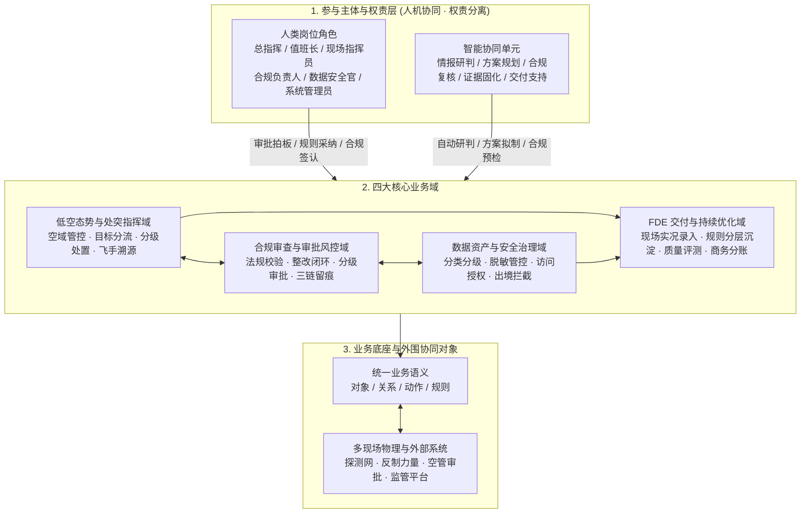
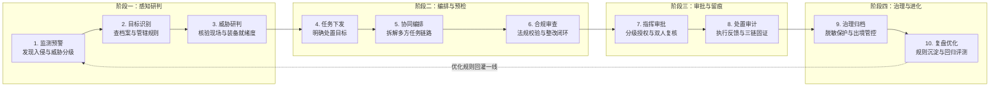

# 全链路低空无人机防御与治理平台 · 业务架构文档

> 本文档剥离具体软件工程与技术实现细节，仅从**业务目标、组织角色、业务域划分、端到端闭环流程与治理规则**五个维度，梳理该平台所承载的完整业务架构。

---

## 1. 业务定位与核心价值

本平台面向**机场净空区、关键基础设施、重点园区**等低空安全防护场景，构建了一套集**“态势处置 + 合规风控 + 数据治理 + 交付复制”**于一体的低空安防运营与治理体系。

其核心业务主张可以概括为三点：

1. **从“只看不管”走向“研判—决策—处置”闭环**：把空域态势、目标识别、协同处置、人类审批与证据固化串成受控闭环，确保每一次黑飞处置既及时有效，又合规可溯。
2. **以“强内控与双人复核”守住安全红线**：将高风险物理反制与敏感数据操作纳入严格的权责分离体系，AI 与自动化系统仅负责情报研判与方案提议，最终执行权严格掌握在对应人类岗位手中。
3. **沉淀可复用的行业治理基线，支撑 ISV 快速交付**：通过将“通用风控治理逻辑”与“具体客户现场的空域、装备、组织实况”解耦，支持服务商（ISV）在不同客户现场快速落地并复制运营。

---

## 2. 业务架构全景图

---

## 3. 组织角色与权责矩阵

平台围绕“**决策权、复核权、执行权、审计权、数据管理权**”五权分离原则设置人类岗位，并与智能协同单元形成明确的职责边界：

| 角色类别 | 具体岗位 / 单元 | 核心业务职责 | 审批与操作边界 |
| :--- | :--- | :--- | :--- |
| **指挥决策岗** | 总指挥 | 全局低空防卫最高指挥；极端风险决策拍板 | 拥有最高审批权；负责极危动作（如定向能处置）审批及双人复核第一签 |
| **指挥决策岗** | 值班长 | 7×24 小时常态监视、告警研判调度与常规处突 | 负责中/高危动作审批（如电子干扰、空域升降级），接收系统异常与审批结果通知 |
| **现场执行岗** | 现场指挥员 | 带领外场处置分队执行机动拦截与现场取证 | 负责现场类、中低风险处置审批（如网捕拦截）与现场执行反馈 |
| **合规风控岗** | 合规负责人 | 对照法律法规把关处置合规性与问题整改 | 负责极危动作双人复核第二签、数据出境审批及合规整改闭环签认 |
| **数据治理岗** | 数据安全官（DSO） | 统筹平台数据资产定级、敏感保护与合规使用 | 负责数据资产分类分级认定、脱敏策略审批、数据访问授权签发 |
| **运营支撑岗** | 系统管理员 | 平台日常运维、账户角色配置与基础能力管理 | 负责系统配置与运维保障，不替代业务指挥与合规审批决策 |
| **智能协同单元** | 研判 / 规划 / 合规 / 交付等智能体 | 承担高频监视、意图拆解、预案生成、合规初筛与证据整理 | **只提议、不越权**：仅低风险动作可按规则自动执行，中高危与动能反制禁止全自动 |

---

## 4. 四大核心业务域拆解

### 4.1 域一：低空态势与处突指挥域（一线主战业务）
聚焦“发现黑飞 → 辨明身份 → 匹配力量 → 依法处置”的实时业务闭环：
- **现场防护基线管理**：按客户现场建立空域分区（禁飞 / 严管 / 限飞 / 适飞四级网格）、重点保护目标、探测设备网络与反制力量台账，并动态评估平台处突就绪度。
- **目标敌友分流（Friend-or-Foe）**：对照授权报备台账与飞手飞行计划，将低空目标分为三类路径——**白名单报备目标**自动放行（不告警、不干扰）、**未授权目标**强制人工研判、**黑名单/高威胁目标**直接升级处置。
- **分级响应与处突执行**：依据威胁分值与空域等级匹配处置动作（光电跟瞄、证据固化、调派反制单元、空域管控升降级、电子干扰、网捕拦截、极端情况定向能处置），并在事后生成遥控信号定位与执法取证溯源单。

### 4.2 域二：合规审查与审批风控域（安全闸门）
确保所有智能体建议与人工处突行动在法律与内控框架内运行：
- **多法规合规评估与整改**：围绕《网络安全法》《数据安全法》《个人信息保护法》《密码法》《关键信息基础设施安全保护条例》以及等保 2.0、数据分类分级国标（GB/T 43697）开展检查，不合规项登记为“合规发现”并推进整改闭环。
- **分层审批与风险阻断**：
  - **低风险动作**（如光电锁定、证据上链、发布通报）：按授权规则自动执行；
  - **中/高风险动作**（如电子干扰、空域调级）：路由至对应角色位审批，角色不符一律拦截；
  - **极高风险及动能处置**：严禁全自动，强制执行“总指挥 + 合规负责人”双人复核。
- **全链路三链审计**：将**过程轨迹**（看到了什么、调用了什么）、**决策审批**（谁批准、依据什么、何时签认）与**司法证据**（原始取证与固化锚点）三链关联，支持完整回放与合规出证。

### 4.3 域三：数据资产与安全治理域（数据要素管控）
保障多源探测数据、操控者实名档案与处突报告在存储、流转与共享环节的安全可控：
- **资产台账与血缘追踪**：将分散在定位、频谱、光电、空管、监管与调度系统中的数据纳入统一台账，按四级密级与三级重要程度定级并落实责任人，同时可视化追踪数据上下游流向。
- **质量评估与敏感防护**：按完整性、准确性、一致性、及时性、唯一性五维指标监控数据质量；扫描未编目敏感字段，并通过脱敏策略实现个人信息与重要位置信息的遮蔽保护。
- **最小必要授权与出境管控**：遵循“默认拒绝、目的限定、有效期受控”原则管理数据访问授权；对涉及跨境传输的数据流核验法律依据与审批单，缺失审批单即刻拦截。

### 4.4 域四：FDE 交付复制与持续优化域（平台进化与商业闭环）
支撑平台从单一示范现场向多客户、多行业复制扩展：
- **客户实况与装备录入**：ISV 交付人员可将客户真实的组织编制、业务流程、考核指标及当地探测反制装备编配关系录入平台，由系统自动诊断盲区、战力错配与组织效率瓶颈，反哺处置编排优化。
- **三层规则沉淀与飞轮进化**：日常审批决策、诊断结论与处置过程持续回流提炼，经人工复核采纳后沉淀为规则资产，并严格区分三层复用边界：
  1. **通用治理层**（跨行业复用的内控底线，如实名留痕、双人复核、越权拦截）；
  2. **行业参考层**（低空防卫领域的专用策略，如黑飞升级、禁飞区响应）；
  3. **客户定制层**（针对特定客户现场差异化的业务规则）。
- **交付运营与商业化分账**：平台内部同时预置了项目交付与商业结算对象模型（覆盖商机、需求、方案、物料清单、工单、合同、计费、账单、回款及多方分账台账），为后续承载 ISV 商业化运营与服务结算留出业务接口。

---

## 5. 端到端核心业务闭环（十步流程归并）

平台将一线作战、内控合规与后台进化统一收口为 10 个首尾相接的业务环节，在逻辑上可归并为四大阶段：

---

## 6. 业务架构设计评估（从纯业务视角看优劣）

1. **核心优势：风控与治理逻辑极为完整**
   平台没有把低空防御做成单纯的“雷达告警看板”，而是把**“权责隔离 + 分级审批 + 证据留痕 + 数据合规 + 规则沉淀”**做成了业务主干，非常契合机场、军警、能源等强监管客户对**安全可控与责任可追溯**的真实诉求。
2. **结构短板：把“三种不同角色的业务视图”强行压成了一条线性流程**
   目前“10 步闭环”把**一线处突指挥**（第 1、4、7 步）、**数据安全治理**（第 6、9 步）与**平台方法论/复盘运营**（第 2、3、10 步）串联在同一条主线上。在实际业务运转中，它们属于**不同岗位、不同频率**的工作流：
   - **处突流**是分钟/秒级的（告警 → 研判 → 审批 → 处置 → 存证）；
   - **数据安全与合规流**是天/周级的（定级 → 脱敏 → 授权 → 出境审查）；
   - **ISV 交付与商业运营流**是项目周期级的（现场录入 → 规则沉淀 → 工单与分账）。
   未来若要正式投入一线使用，建议按**“作战指挥工作台 / 合规与数据治理台 / 交付与运营中心”**三条业务线拆开独立流转，而在底层共享同一套业务对象与审计账本。
