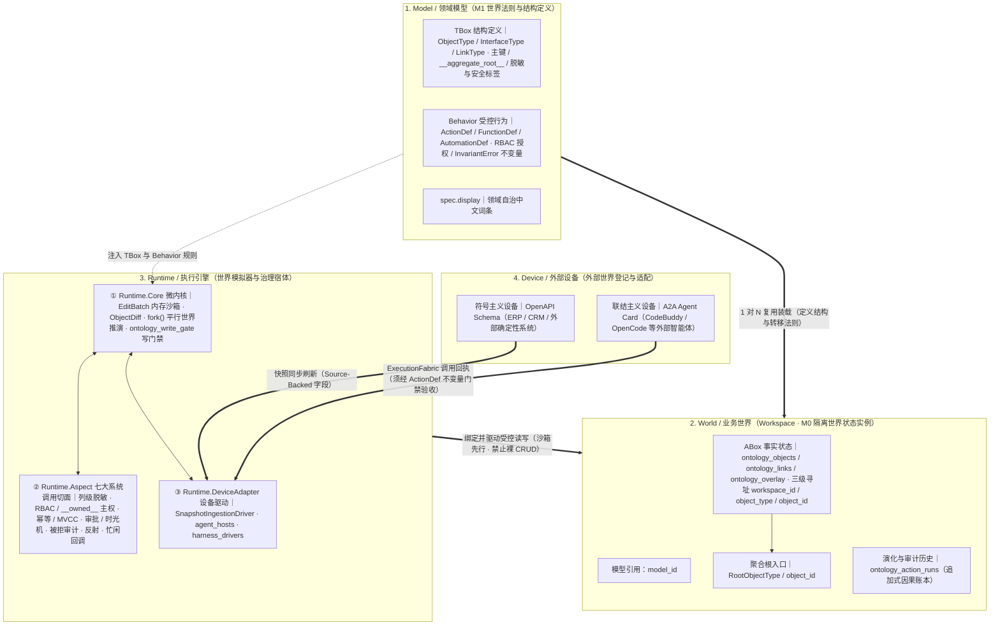
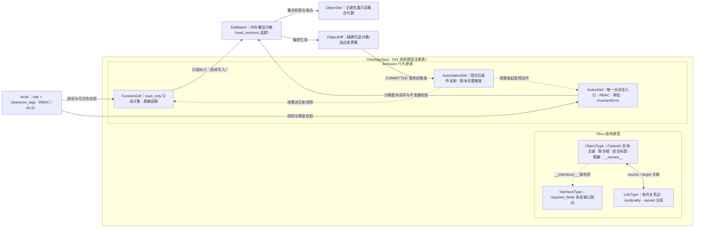
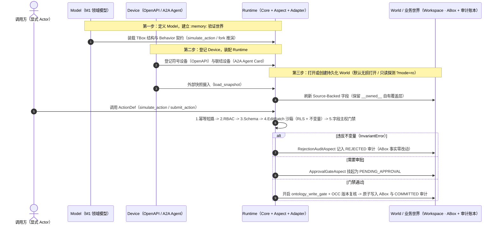

# OpenOntology 架构设计规范 (M2 Architecture Constitution)

> **元模型定位（OMG MOF M2）**：本文仅定义跨领域通用的平台元模型、微内核、治理切面、设备适配与展示协议约束，不包含任何特定行业或具体业务本体的规则。
> * 本项目自举（Dogfooding）所使用的 M1 任务看板模型（`task_board`）及 M0 协同与收单规程，独立定义于 **[docs/TASK_BOARD.md](TASK_BOARD.md)**。
> * 实现进度、测试水位与部署范围见 `_state.md` / `Board.state`；规范中的目标不是线上已经升级的证明。旧代码标识符仅在第 6 节说明兼容关系。

---

## 1. 领域模型、业务世界、执行引擎与外部设备

> **符号世界模型三元组**：`Model`（领域模型 / 世界法则） + `Runtime`（执行引擎 / 模拟器） + `World`（业务世界 / 世界状态实例，代码兼容别名 `Workspace`）共同构成完整的 **Symbolic World Model（符号世界模型）**。

| 概念 | 职责（M2 语义） | 不是什么 |
|---|---|---|
| **Model / 领域模型** | 定义世界结构（TBox）、关系、声明式约束与状态转移法则（Behavior），可被多个业务世界复用 | 不是具体对象数据，也不因启动执行而变成事实 |
| **World / 业务世界**<br>（代码兼容别名 `Workspace`） | 绑定模型引用、事实状态（ABox）、Runtime 与演化审计历史，提供隔离的业务世界实例（含主世界与 `fork()` 平行沙盘世界） | 不是单个业务对象，也不是源代码工作目录 |
| **Runtime / 执行引擎** | 执行模型定义的查询、动作、治理切面、持久化和平行沙盘推演 | 不是额外一份业务事实 |
| **Device / 外部设备** | 登记与适配外部系统（OpenAPI）、工具和智能体（A2A Agent） | 不是未经校验即可进入事实图的可信数据 |

四种职责不意味着四个完全正交、必须各自独立管理生命周期的业务资源。指挥台界面可以按这四种视角组织展示，但不能由四个标签页反推出四套割裂的资源账本。



### 1.1 定义、事实与行为（TBox · Behavior · ABox）

```text
Model <model_id>（M1 可复用领域定义 / 世界法则）
├─ TBox：ObjectType、字段、InterfaceType、LinkType、声明式约束与类型元数据
└─ Behavior：ActionDef、FunctionDef、AutomationDef、角色授权与操作契约

World <world_id / workspace_id>（M0 隔离业务世界）
├─ 模型引用：<model_id>
├─ ABox：具体对象实例、属性值、关系断言事实
│  └─ <RootObjectType> / <object_id>（世界内的聚合根对象）
├─ Runtime 绑定：Core + Aspect + DeviceAdapter
└─ 演化与审计历史（ontology_action_runs）
```

* **TBox** 描述类型与关系结构定义，**ABox** 描述个体与事实断言；两者是元层次区分，不是知识激活流程的两个阶段。
* **Behavior** 决定事实如何受控变化，不能全部硬塞入静态结构 TBox。此处借用 TBox/ABox 做逻辑投影，不承诺 OWL 推理机或任意 Python 校验函数的逻辑序列化。
* 业务世界（代码标识符 `Workspace`）本质上是 `模型引用 + ABox + Runtime 绑定 + 执行历史`，不是把同一份模型或数据库换名复制两遍。
* 当前 `OntologyRuntime(spec, db_path)` 绑定单个模型与单个存储。同一模型复用于多个业务世界（工作空间）是核心能力；单个引擎同时装载多个不同模型不属于现阶段承诺。
* 模型随 Python 代码模块发布即可；现阶段不建设独立模型发布服务、不引入外部 RDF/OWL 存储，也不因逻辑分层拆分底层业务表。

#### 1.1.1 Ontology 核心原语规范（ObjectType · LinkType · InterfaceType · FunctionDef · ActionDef · AutomationDef）

在 OpenOntology（`open_ontology/spec.py`、`sandbox.py`、`query.py`）中，一个领域本体模型由以下 M2 核心原语共同构成：

| 层次分类 | 核心原语 | 声明入口 / 载体 | 核心职责与 M2 治理约束 |
|---|---|---|---|
| **模型容器** | **`OntologySpec`** | `spec = OntologySpec()` | 模型定义注册表（目标别名 `model_id`），统一登记对象、关系、接口、函数、动作、自动化规则及自身 `spec.display` 展示词条。 |
| **TBox 结构** | **`ObjectType`** | 继承 `ObjectType` 并用 `@spec.object_type` 登记 | Pydantic 强类型领域实体基类（`extra="forbid"`），声明业务字段与类型级元数据，实例化后作为带版本号的节点存入工作空间 ABox。 |
| **TBox 结构** | **`InterfaceType`** | `spec.interface(name, required_fields=...)` | 跨对象类型的多态接口契约；实现该接口的 `ObjectType` 必须在 `__interfaces__` 中显式声明，并在注册时强校验 `required_fields` 齐全。 |
| **TBox 结构** | **`LinkType`** | `spec.link_type(name, source, target, ...)` | 有向强类型关系边声明：`source` → `target`、基数 `cardinality`（`one-to-one` / `one-to-many` / `many-to-one` / `many-to-many`）及 `owned` 连边主权标记。 |
| **Behavior 行为** | **`FunctionDef`** | `@spec.function(name, params=...)` | 严格只读计算（`read_only=True`）：接收强类型 Pydantic `params`，在注入列级脱敏的沙箱内执行查询/聚合，任何暂存写变更一律丢弃。 |
| **Behavior 行为** | **`ActionDef`** | `@spec.action(name, params=..., allowed_roles=...)` | **唯一合法的状态变迁入口**：声明 RBAC 角色授权、条件审批规则（`approval_rule` / `approver_roles`）、`affects_source`、`post_approval` 两段式钩子，并在处理器内以 `InvariantError` 强制业务不变量。 |
| **Behavior 行为** | **`AutomationDef`** | `@spec.automation(name, watch_object_type=..., condition=...)` | 提交后事件驱动条件反射：监听目标 `ObjectType` 变更，满足 `condition(obj)` 时由 `AutomationReflexAspect` 按对象版本号去重触发 `handler(runtime, obj, actor)`。 |
| **安全与沙箱** | **`Actor`** | `Actor(actor_id, role, clearance_tags)` | 显式零信任调用方身份：`role` 参与 RBAC 与列级脱敏判断，`clearance_tags`（或通配符 `"*"`）驱动 RLS 行级可见性过滤。 |
| **集合代数** | **`ObjectSet`** | `query.py`（`ObjectSet` / `AggregationResult`） | 按主键去重、保持源顺序的只读对象集合容器，支撑集合检索、链式遍历与聚合计算。 |
| **内存沙箱** | **`EditBatch` / `ObjectDiff`** | `sandbox.py`（`EditBatch` / `ObjectDiff`） | 动作与函数执行的内存叠加沙箱（支持 read-your-own-writes 与读版本追踪 `read_versions`）；执行后编译生成精确可逆的 `ObjectDiff`（`ObjectChange` + `LinkChange`），支撑预演、原子提交与时光机冲正。 |

**各核心原语的关键契约约束**：
1. **`ObjectType` 的 7 项类级元数据**：`__primary_key__`（主键字段，默认 `"id"`）、`__title__`（标题字段）、`__aggregate_root__`（显式聚合根标记，默认 `False`）、`__owned__`（字段主权标记：`bool | dict[str, Any]`）、`__interfaces__`（实现的接口名元组）、`__security_tag_fields__`（自动派生 `field:value` 行级安全标签的字段元组）与 `__masked_fields__` / `__mask_defaults__`（列级脱敏白名单 `{字段名: (明文角色, ...)}` 与自定义掩码值）。
2. **`FunctionDef` 与 `ActionDef` 的严格隔离**：所有业务查询与计算封装在 `FunctionDef`（读出口脱敏开启、物理表零变更）；所有写入封装在 `ActionDef`（读出口脱敏关闭、先经 `EditBatch` 沙箱与 `InvariantError` 校验再编译 `ObjectDiff`，禁止跳过 `ActionDef` 直接执行裸 CRUD）。
3. **两段式动作与自动化闭环**：当 `ActionDef` 挂起为 `PENDING_APPROVAL` 并经 `approve_action` 批准后，若声明了 `post_approval(batch, params)` 钩子，仅对其新增增量再做主权校验并合并落库；每次 `COMMITTED` 落库后，内核自动委托 `evaluate_automations` 评估匹配的 `AutomationDef`。



### 1.2 身份寻址与聚合根元数据

业务对象的完整三级地址在代码与存储契约中为 **`workspace_id / object_type / object_id`**（其中 `workspace_id` 即业务世界身份 `world_id`）：

* `workspace_id` 标识隔离业务世界（工作空间）；`object_type / object_id` 标识该世界内的具体业务对象，严禁将聚合根对象 ID 混同为业务世界 / 工作空间 ID。
* 不同业务世界允许存在相同的 `object_id`；跨世界按对象寻址出现多命中歧义时，必须显式返回候选并拒绝盲取第一个命中。
* 代码中的文件系统路径参数（如 `workdir` 或历史命名的 `workspace_root`）仅表示本地代码工作目录，不等于业务世界身份 `workspace_id`（`world_id`）。

`ObjectType.__aggregate_root__` 是默认 `False` 的显式**类型级元数据**，由各 M1 模型作者按领域语义显式声明：
* 严禁按图入度、类型名称、主键命名或是否存在连边自动猜测聚合根；
* 该标记用于世界导航与入口暴露，不因此自动改变或扩张动作级事务边界。

“列出所有业务世界 / 工作空间”必须同时按调用方 `Actor` 列出每个世界内有权可见的聚合根对象（`object_type`、`object_id`、脱敏后的 `title`）：
* 必须严格区分 **“模型未声明根类型”**、**“已声明根类型但当前无可见根对象”**、**“仅在目录登记尚未加载（`not_loaded`）”** 与 **“存储不可读/损坏（`unavailable`）”** 四种状态；不可读根集绝不能伪装成空列表。
* 根对象枚举必须走既有受控查询路径（遵守 RLS 行级过滤与列级脱敏），严禁裸 SQL 旁路读取，也不得通过异常消息回显原始敏感值或静默截断结果集。

### 1.3 标准三步工作流与只读探测铁律

1. **定义 Model，建立内存验证世界**：声明对象、关系、动作与不变量，在 `:memory:` Runtime 上验证状态转移与沙盘推演。
2. **登记 Device，装配 Runtime**：登记外部符号系统（OpenAPI）与联结设备（A2A Agent），装配存储、治理切面与适配器。
3. **打开或创建 World（Workspace）**：将模型绑定至持久化存储形成生产业务世界。
   * **默认无损打开**：已有合法数据库默认原样重开，绝不重跑建表播种；只有显式指定单库作用域的 `reset` 才允许清库重建；半成品或外来异构库必须在预检阶段报错拒绝，禁止静默修补覆盖。
   * **跨库探测零副作用**：按目录或对象 ID 扫描 SQLite 文件必须使用经 RFC 3986 标准转义的只读文件 URI（`Path.resolve().as_uri() + "?mode=ro"`），防止路径中的 `#`、`?`、`%` 等保留字符截断只读参数或在旁路误建空文件；查找失败只抛异常，绝不自动建目录、建库或写入种子数据。
   * 纯内存业务世界仅在进程生命周期内有效，不得伪装为跨重启可恢复的持久世界。



---

## 2. 工程模块的物理边界 (Microkernel Decomposition)

代码仓库围绕**四类核心工程模块**及**内核外围通用支撑层**组织，现阶段不引入 Kafka 等重型中间件，长耗时协同由 M1 状态机与设备适配层承接：

```text
┌──────────────────────────────────────────────────────────────────────┐
│ 用户程序 / Model (User Programs) —— M1 可复用领域定义与纯沙箱行为    │
│   examples/*_ontology.py · （历史包内 M1 模块：kanban.py / dev_factory.py）│
│   每个业务 Model 自带对象/关系/动作/不变量 + spec.display 中文词条   │
├══════════════════════════════════════════════════════════════════════┤
│ Runtime 核心三层（支撑工作空间确定性执行与外部互联）：               │
│                                                                      │
│ ① 微内核 / Runtime.Core (Microkernel) —— 状态页表与虚拟现实沙箱      │
│   spec.py     M2 元模型原语（对象/关系/接口/动作/函数/自动化声明）   │
│   sandbox.py  内存编辑沙箱 EditBatch 与可逆 ObjectDiff               │
│   runtime.py  系统调用主干：写门禁 / 版本 / 模拟 / 提交 / 切面委托   │
│   query.py    ObjectSet 集合代数与聚合                               │
│   schema.sql  5 张业务治理表 + 1 张写门禁表（:memory: 与文件同构）   │
├──────────────────────────────────────────────────────────────────────┤
│ ② 系统调用切面 / Runtime.Aspect (Syscall Aspects) —— 确定性治理铁笼  │
│   aspects.py                                                         │
│   ColumnMaskingAspect          读出口列级脱敏投影                    │
│   SecurityAndAuthorityAspect   RBAC / 字段主权门禁（__owned__）      │
│   IdempotencyAndOCCAspect      幂等短路 / MVCC 乐观锁                │
│   ApprovalGateAspect           审批软中断 / 批准恢复 / 时光机回滚    │
│   RejectionAuditAspect         不变量被拒企图入账                    │
│   AutomationReflexAspect       提交后条件反射与版本去重              │
│   IdleAwareCallbackAspect      忙闲感知回调（忙时入队、闲时 FIFO）   │
├──────────────────────────────────────────────────────────────────────┤
│ ③ 设备驱动 / Runtime.DeviceAdapter (Device Drivers)                  │
│   ingestion.py        SnapshotIngestionDriver 快照摄入与多源列拼接   │
│   agent_hosts.py      CodeBuddy · OpenCode 联结宿主适配与回执解析    │
│   harness_drivers.py  可插拔机械臂协议与限流故障转移                 │
│   examples/*adapter.py  Odoo · CRM · SaaS 外部协议桥接               │
├══════════════════════════════════════════════════════════════════════┤
│ 内核外围 M2 通用支撑与传输边界（领域无关，零具体行业语义）：         │
│   mcts.py              基于 fork() 的蒙特卡洛树搜索规划器            │
│   osdk.py              受控 LLM 工具 Schema 导出、执行器与评测套件   │
│   execution/fabric.py  JSON 调用边界与非干涉观察织入 ExecutionFabric │
│   workspaces.py / model_views.py  工作空间目录与 TBox/Behavior 投影  │
│   workshop.py / workshop_ui.py / http_server.py                      │
│                        指挥台 HTTP 传输边界与双标准设备目录承载      │
└──────────────────────────────────────────────────────────────────────┘
```

**判据（新增代码该放哪）**：

| 问题 | 归属模块 |
|---|---|
| 它描述某个具体业务领域的类型、关系或沙箱内状态转移规则吗？ | **用户程序**（独立 M1 Model 模块） |
| 它是所有工作空间共享的对象页表、沙箱 `EditBatch`/`ObjectDiff` 或 `fork()` 骨架吗？ | **微内核**（`Runtime.Core`） |
| 它是对每次读写/提交无条件生效的权限、脱敏、幂等、审批、审计或回调切面吗？ | **系统调用切面**（`Runtime.Aspect`） |
| 它适配外部 OpenAPI 系统快照、A2A Agent 宿主进程或外部协议通信吗？ | **设备驱动**（`Runtime.DeviceAdapter`） |
| 它是领域无关的树搜索规划、工具导出、工作空间目录或 HTTP/UI 通用展示协议吗？ | **内核外围 M2 支撑与传输边界** |

**微内核行数预算与依赖方向约束**：
* **微内核行数预算**：`open_ontology/runtime.py` 不得超过 **1400 行**（`test_runtime_line_budget` 硬门禁）。超出预算时必须审视逻辑是否属于 `aspects.py`、驱动层或外围支撑层，严禁放宽预算阈值。
* **单向依赖铁律**：切面（`aspects.py`）与设备驱动只能通过微内核既定入口（`spec` / `_write_gate()` / `_apply_diff()` / `get_action_run()` / `load_snapshot` / `submit_action`）工作，严禁反向 `import` `runtime.py`（`test_aspects_module_is_self_contained`），也不得绕过治理管线直改底层表。微内核除保留 `SnapshotIngestionDriver` 快照门面委托外，不得新增对外部协议驱动或 HTTP 传输层的静态依赖；历史位于包内的 `kanban.py`、`dev_factory.py` 严禁进入 `open_ontology/__init__.py` 导出表。

---

## 3. 认知降维与虚拟现实沙盘推演的四大支柱 (Core Pillars)

### 3.1 语义层（Semantic Layer）：结构化长期记忆与字段主权
* **对象与多态接口（`ObjectType` & `InterfaceType`）**：基于 Pydantic 声明主键（`__primary_key__`）、标题（`__title__`）、聚合根（`__aggregate_root__`）、安全标签（`__security_tag_fields__`）与列脱敏白名单（`__masked_fields__`）。这些均属模型层 TBox 元数据；实例属性值属于工作空间 ABox。
* **属性主权边界（Ownership & Authority Boundary）**：
  * **外部同步属性（Source-Backed Fields）**：由快照摄入驱动从外部 ERP/SaaS 同步刷新（`runtime.load_snapshot` / `runtime.load_mdo_snapshots`，实现在 `ingestion.py`）；外部重索引与本地未决补丁冲突时抛出 `ReindexConflictError` 并原子回滚。
  * **模型自有属性（兼容标记 `__owned__`）**：事实值存储在工作空间受控层（含 `ontology_overlay` 补丁），外部快照重刷时自动重放保留，支撑对遗留 SaaS 的“寄居吸纳 → 平滑接管 → 一键拔除（Unplug）”。

### 3.2 动力学层（Kinetic Layer）：沙箱先行与确定性治理管线
* **禁止裸 CRUD 与防误用写门禁**：
  * 业务状态变更必须且只能通过具名 `ActionDef` 提交；`FunctionDef` 为严格只读计算（暂存变更一律丢弃）。
  * `schema.sql` 中的 `ontology_write_gate` 触发器提供**同一连接内的防裸写工程护栏（Accidental-CRUD Guardrail）**，防止业务或驱动代码误发裸 SQL 篡改事实表；它不是隔离同进程恶意特权代码的安全沙箱。全部 5 张业务治理表均受门禁触发器保护：`ontology_objects` / `ontology_links` / `ontology_overlay` 与 `ontology_registry` 的 `INSERT / UPDATE / DELETE`、`ontology_action_runs` 的 `INSERT / UPDATE` 只在门禁打开的事务内放行，而 `ontology_action_runs` 的 `DELETE` 无条件禁止（追加式账本）。
* **沙箱先行（Sandbox-First Execution）**：
  1. 动作处理器仅读写内存叠加沙箱 `EditBatch`，不触碰物理 SQLite 或外部 `Device`；
  2. 执行后编译生成精确可逆的 `ObjectDiff`（字段前后值、连边增删）与读取版本集 `read_versions`；
  3. **`simulate_action`（干跑预演）** 与 **`submit_action`（正式提交）** 共享 100% 相同的**沙箱状态转移、RLS 行级可见性、字段主权与业务不变量计算路径**；幂等短路与物理写入时的 OCC 版本冲突复核仅在提交流程生效。
* **多级治理门禁的真实执行时序**：
  1. **幂等短路**（仅 `submit_action`：`IdempotencyAndOCCAspect.check_idempotent_run`）
  2. **RBAC 角色授权**（校验 `actor.role in action.allowed_roles`）
  3. **Pydantic 入参 Schema 校验**（构造强类型参数模型）
  4. **沙箱处理器执行**（期间按访问动态执行 **RLS 行级安全标签校验**——读不可见行隐藏、写无权限行抛错——以及领域 **`InvariantError` 业务不变量校验**；若在 `submit_action` 中违反不变量则由 `RejectionAuditAspect` 记录 `REJECTED` 审计并重抛）
  5. **字段主权门禁**（`SecurityAndAuthorityAspect` 校验变更未越界混写 Source-Backed 与 `__owned__` 字段）。若动作声明了 `post_approval` 钩子，则第一段 `handler` 的 diff 先受检，钩子执行后再由 `SecurityAndAuthorityAspect.check_post_approval_authority` **只针对钩子追加出来的增量**（新对象/新连边，以及既有对象在钩子前后的字段差）复检：两段各自只允许落在**一个**主权平面上，钩子增量自身跨平面即抛 `MIXED_AUTHORITY`，而合并后的整份 diff 不参与跨平面比对（同平面两段式提交是合法的）。
  6. **审批软中断或 OCC 原子提交**：需审批时挂起为 `PENDING_APPROVAL`（对象表零改动）；无需审批（或后续 `approve_action` 批准）时，在写门禁事务内执行 **OCC 乐观并发版本复核（`ConcurrencyConflictError`）** 并原子写入对象、连边与 `COMMITTED` 审计记录。
* **显式 `Actor` 零信任约束**：面向 HTTP 路由、指挥台 UI、工作空间枚举或外部 Agent 的一切查询与 `FunctionDef` 调用，必须显式传入真实调用方 `Actor`，严禁在外部可达入口依赖缺省 `system` 角色绕过 RLS 或列级脱敏。
* **读出口脱敏的作用面**：`EditBatch` 可注入读脱敏回调，但只有**只读** `FunctionDef` 批处理会注入；动作批处理永不脱敏，确保暂存 diff 只会写入真实值，绝不会把 `***MASKED***` 落库。

### 3.3 虚拟现实沙盘推演与时光机（Simulation & Time-Travel）
* **隔离分叉（`runtime.fork()`）**：复用同一 `OntologySpec`，通过 SQLite backup 将当前业务世界事实与历史克隆至独立 `:memory:` 实例形成平行沙盘世界（非操作系统页级零拷贝，但与原世界物理隔离）。
* **蒙特卡洛树搜索（`OntologyMCTSPlanner`）**：在 `fork()` 平行世界沙盘上枚举候选动作序列并自动剪枝违反 `InvariantError` 的分支，择优后再受控提交回主业务世界。
* **因果账本与逆向冲正（`runtime.approve_action` / `runtime.revert_action`，委托 `aspects.ApprovalGateAspect`）**：基于持久化 `ObjectDiff` 与版本号执行带冲突检测的精确逆向回滚，并支持提交后 `evaluate_automations` 条件反射与版本级去重。

### 3.4 指挥台四展示视角与领域无关图形协议（4-View Command Center）
* **指挥台展示视角**（一级标签升级为 `Model / Runtime / World / Device`，代码与 HTTP 兼容映射见第 6 节）：
  1. **Model / 领域模型视角**（`Model · 领域模型`）：查看结构 TBox、Behavior 操作契约及 `/topology` 全景矢量图（对象、关系、动作、函数及可选自动化规则）；
  2. **Runtime / 执行引擎视角**（`Runtime · 算力与治理宿体`）：查看运行宿体配置（`:memory:` / `.sqlite3`、已挂载的七大 `Aspect` 与适配器）；
  3. **World / 业务世界视角**（`World · 业务世界`，代码兼容别名 `Workspace`）：选择业务世界及聚合根入口，查看 ABox 事实，执行干跑、正式提交、`fork()` / MCTS 推演、审批与时光机回滚；
  4. **Device / 外部设备视角**（`Device · 外部世界(符号+联结)`）：分栏检视 **符号主义设备（OpenAPI Schema）** 与 **联结主义设备（A2A Agent Card）**。
* **展示词条自治（`OntologySpec.display`）**：内核 `ui_display.json` 仅保留跨领域通用界面词汇；各 M1 模型必须在自身 `spec.display` 中自带中文词条。TBox/ABox 为逻辑投影，不拆成两个一级标签页。

---

## 4. 外部世界双标准设备与三层职责分离 (Device & Tri-Layer Separation)

业务世界与外部世界交互时，在 M2 层严格分离以下三类职责：

| 层次 | 载体 / 模块 | 回答的 M2 核心问题 |
| :--- | :--- | :--- |
| **1. 业务世界的事实与历史** | `ontology_objects`、`ontology_links`、`ontology_overlay`、`ontology_action_runs` | 当前业务世界内哪些对象与关系事实成立？哪一次受控动作在何时由谁改变了它们？事实与审计逻辑分离，不复制两套业务库。 |
| **2. 外部设备契约与调用织入** | • **符号主义设备**：`OpenAPI Schema`（当前目录项 `SymbolicDeviceEntry`）<br>• **联结主义设备**：`A2A Agent Card`（当前目录项 `AgentCardDeviceEntry`）<br>• **调用织入与宿主适配**：`ExecutionFabric`、`agent_hosts.py` | 外部确定性系统暴露什么 RPC/快照契约？外部智能体具备什么角色与技能 Card？调用输入输出摘要与结构化回执（如 `HostResult`）是什么？ |
| **3. M1 领域动作验收门禁** | 各 M1 Model 在 `ActionDef` 中声明的强类型契约与 `InvariantError` 不变量 | 外部设备（尤其是概率性的联结主义 Agent）返回的建议或回执，是否满足该业务模型要求的确定性准入条件？（未通过门禁一律拒绝写入事实表并记入被拒审计。） |

---

## 5. M2 自动化架构红线门禁 (Architectural Fitness Functions)

以下 6 条 M2 平台不变量固化为自动化测试门禁，任何修改一旦违反即判定失败（特定 M1 业务模型的领域门禁归入各自模型文档与单测，如看板量化证据门禁见 `docs/TASK_BOARD.md`）：

1. **内核顶层导出纯洁性**：`open_ontology/__init__.py` 只允许导出 M2 内核、规划/工具与通用指挥台原语，严禁导出任何 M1 具体业务模型（如看板、研发工厂、冷链、钢厂）或具体外部业务适配器。
2. **内核词典零业务膨胀**：新增或修改 M1 业务模型必须在自身 `spec.display` 中携带中文标签，严禁修改 `open_ontology/ui_display.json`（`test_business_display_terms_live_in_their_own_spec`）。
3. **通用 UI 引擎零领域泄漏**：`open_ontology/workshop.py` 与 `open_ontology/workshop_ui.py` 严禁出现任何特定 M1 业务领域的私有字段名或专属流程图路由（`test_ui_kernel_has_no_board_domain_fields`、`test_m2_workshop_has_no_process_flow_pollution`）。
4. **数据库六表纯洁性与无损预检**：`open_ontology/schema.sql` 严格保持 5 张业务治理表加 1 张写门禁表，不混入行业私有列或外部消息队列表（`test_pure_business_ontology_has_no_it_outbox_or_lineage_concepts`）；无损重开已有 SQLite 文件前必须完整校验六表齐全，禁止静默修补半成品库。
5. **微内核行数预算**：`open_ontology/runtime.py` 不得超过 **1400** 行（`test_runtime_line_budget`）。
6. **切面零反向依赖**：`open_ontology/aspects.py` 不得 `import` 内核运行时，微内核不得重写已委托给切面的治理逻辑（`test_aspects_module_is_self_contained`、`test_kernel_delegates_to_aspects_not_reimplements`）。

---

## 6. 旧代码拼写的兼容范围

架构正文统一使用 **Model / World**（业务世界，作为符号世界模型中的 M0 世界状态实例）。下列现有代码标识符仅说明向后兼容映射，不代表另一套并列概念：

| 现有代码拼写 | 架构含义 / 渐进迁移方向 |
|---|---|
| `Workspace`、`workspace_id`、`workspaces.py` | 业务世界（`World`）在代码、HTTP 路由（`?workspace=`）与目录清单（`workspaces.json`）中的现行兼容标识符；与界面 `World · 业务世界` 指向同一实体 |
| `OntologySpec`、`ontology_id` | M1 领域模型定义容器与模型身份；保留代码兼容，目标别名 `model_id` |
| `OntologyRuntime` | 绑定单个模型与存储的 M2 执行引擎，不因术语收敛推倒重写 |
| `instance_id`、`?instance=` | 早期工作空间 / 业务世界身份与 HTTP 查询参数；与 `workspace_id` / `?workspace=` 双栈兼容（冲突参数显式报错） |
| `register_instance`、`get_instance` | `CommandCenterRegistry` 上的早期登记/查找方法；与 `register_workspace` / `get_workspace` 指向同一份底层条目 |
| `#tab-ontology`、`#tab-instance` | 兼容期保留的 DOM ID；界面展示已由早期的 `Workspace · 工作空间` 升级为 `World · 业务世界`（与 `Model · 领域模型` 对应） |
| `CommandCenterRegistry` | 当前同时承载模型目录、业务世界（工作空间）目录与符号/联结双设备表的内存注册中心；持久化清单由独立目录描述子承接 |
| `takeover_board_from_db` | M1 `task_board` 模型的按对象 ID 接管兼容入口；通用业务世界寻址由模型无关的 `takeover_workspace` 承接，见 [docs/TASK_BOARD.md](TASK_BOARD.md) |

架构演进直接原地修订对应层次的规范正文，严禁以“上文新口径、下文旧定义”的追加补丁方式制造阅读歧义。
