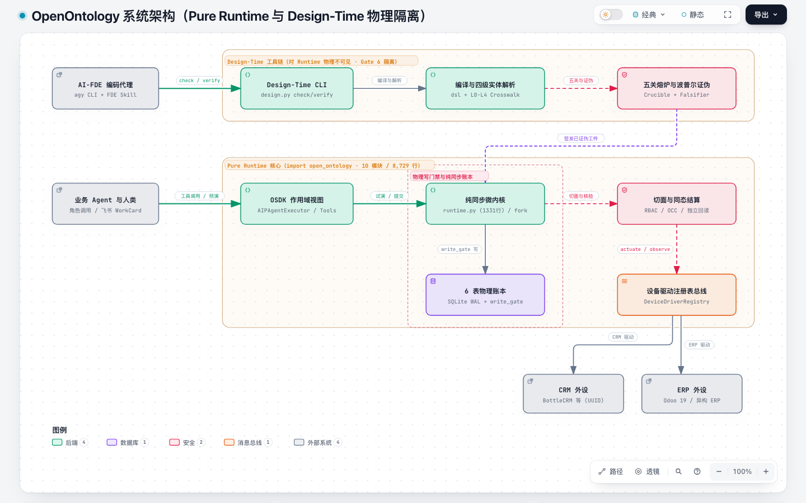
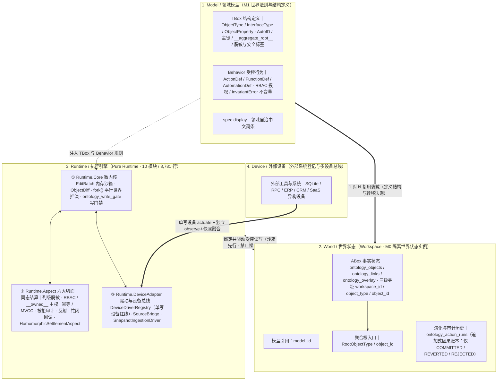
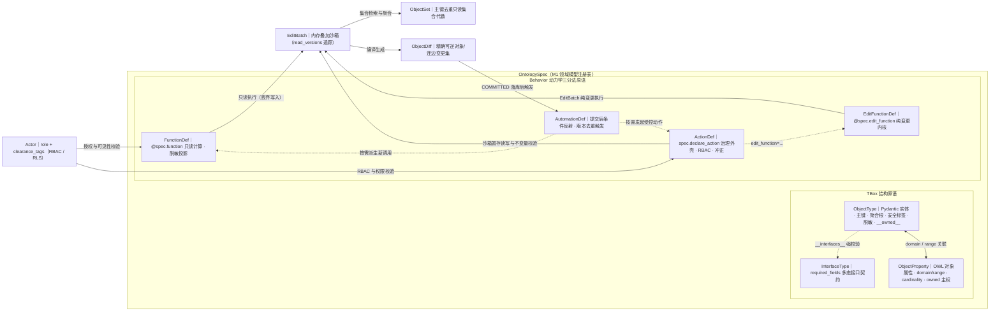
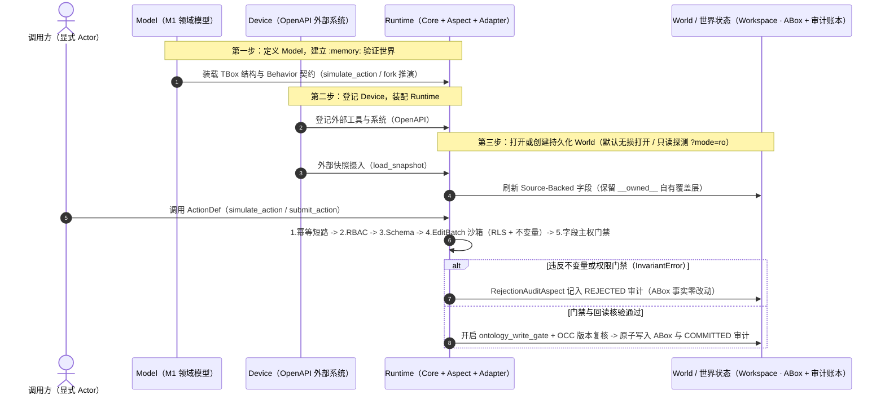

# OpenOntology 架构设计规范 (M2 Architecture Constitution)

> **元模型定位（OMG MOF M2）**：本文仅定义跨领域通用的平台元模型、微内核、治理切面、设备适配与展示协议约束，不包含任何特定行业或具体业务本体的规则。
> * 本项目自举（Dogfooding）所使用的 M1 任务看板模型（`task_board`）及 M0 协同与收单规程，独立定义于 **[docs/TASK_BOARD.md](TASK_BOARD.md)**。
> * 实现进度、测试水位与部署范围见 `_state.md` / `Board.state`；规范中的目标不是线上已经升级的证明。旧代码标识符仅在第 6 节说明兼容关系。

---

## 1. 认知本体论总纲与四大核心视角

> **认知本体论总纲**：智能体无法直接触碰**外部世界（External World）**，只能经由 `Device` 边界接收高维感官**现象（Phenomenon / Observation）**，并将其压缩接地为内部结构化的**世界状态（World State / 信念态 Belief State，即 `World`）**。**世界模型（World Model）**是所有内部状态的**元模型**——在联结主义中体现为神经网络突触权重，在 OpenOntology 符号主义中体现为 `Model`（领域模型：`TBox` 结构 + `Behavior` 因果转移法则）与 `Runtime`（确定性转移模拟器），共同与 `World` 状态实例构成完整的 **Symbolic World Model（符号世界模型）**。在付诸外部行动前，**规划器（Planner）**以当前世界状态为起点，用同一个世界模型在严格纯内存的**反事实空间（Counterfactual Space，`runtime.fork()` / `world_mode="counterfactual"`）**中推演可能未来，依据**价值函数（Value Function）**择优决策，并通过 `OntologyRuntime`（`world_mode="coupled"` + `SourceBridge`）默认执行“沙箱预测 → 外部驱动 → 独立只读回读核验 → 同态提交或零污染拒收”的滚动闭环。

| 概念 | 职责（M2 语义） | 不是什么 |
|---|---|---|
| **Model / 领域模型** | 定义世界模型的存在结构（TBox）、关系、声明式约束与因果状态转移法则（Behavior），作为所有内部状态的元模型可被多个世界状态实例复用 | 不是具体对象数据，也不因启动执行而变成事实 |
| **World / 世界状态**<br>（代码兼容别名 `Workspace`） | 外部现象经世界模型接地后的实然信念态：绑定模型引用、事实状态（ABox）、Runtime 与演化审计历史（与纯内存 `fork()` 反事实空间共享同一元模型） | **不是外部客观世界本身**，不是单个业务对象，也不是源代码工作目录 |
| **Runtime / 执行引擎** | 执行模型定义的查询、受控动作、治理切面、持久化与反事实沙盘推演 | 不是额外一份业务事实 |
| **Device / 外部设备** | 登记与适配外部世界源系统（OpenAPI）与现象观测连接器；外部智能体直接作为 `Actor` 通过 OSDK / `ActionDef` 与世界模型交互 | 不是未经校验即可进入事实图的可信数据 |

四种职责不意味着四个完全正交、必须各自独立管理生命周期的业务资源。指挥台界面可以按这四种视角组织展示，但不能由四个标签页反推出四套割裂的资源账本。

### 系统总体架构图（Archify 代码证据版）



> 交互式架构图（支持视图切换、暗/亮主题与源码行号溯源）：[openontology-architecture.html](assets/openontology-architecture.html) ｜ 声明式源定义：[openontology-architecture.json](assets/openontology-architecture.json)



### 1.1 定义、事实与行为（TBox · Behavior · ABox）

```text
Model <model_id>（M1 可复用领域定义 / 世界法则）
├─ TBox：ObjectType、DatatypeProperty/AutoID、InterfaceType、ObjectProperty、声明式约束与类型元数据
└─ Behavior：ActionDef、FunctionDef、AutomationDef、角色授权与操作契约

World <world_id / workspace_id>（M0 隔离业务世界）
├─ 模型引用：<model_id>
├─ ABox：具体对象实例、属性值、关系断言事实
│  └─ <RootObjectType> / <object_id>（世界内的聚合根对象）
├─ Runtime 绑定：Core + Aspect + DeviceAdapter
└─ 演化与审计历史（ontology_action_runs）
```

* **TBox** 描述类型与关系结构定义，**ABox** 描述个体与事实断言；两者是元层次区分，不是知识激活流程的两个阶段。
* **Behavior** 决定事实如何受控变化，不能全部硬塞入静态结构 TBox。此处借用 TBox/ABox 做逻辑投影，不承诺 OWL 推理机或任意 Python 校验函数的逻辑序列化。
* 业务世界（代码标识符 `Workspace`）本质上是 `模型引用 + ABox + Runtime 绑定 + 执行历史`，不是把同一份模型或数据库换名复制两遍。
* 当前 `OntologyRuntime(spec, db_path)` 绑定单个模型与单个存储。同一模型复用于多个业务世界（工作空间）是核心能力；单个引擎同时装载多个不同模型不属于现阶段承诺。
* 模型随 Python 代码模块发布即可；现阶段不建设独立模型发布服务、不引入外部 RDF/OWL 存储，也不因逻辑分层拆分底层业务表。

#### 1.1.1 Ontology 核心原语规范（ObjectType · ObjectProperty · AutoID · InterfaceType · FunctionDef · EditFunctionDef · ActionDef · AutomationDef）

在 OpenOntology（`open_ontology/spec.py`、`sandbox.py`、`query.py`）中，一个领域本体模型由以下 M2 核心原语共同构成：

| 层次分类 | 核心原语 | 声明入口 / 载体 | 核心职责与 M2 治理约束 |
|---|---|---|---|
| **模型容器** | **`OntologySpec`** | `spec = OntologySpec(extends=(...))` | 模型定义注册表（目标别名 `model_id`），支持通过 `extends` 导入继承抽象父本体的 `abstract_types`、接口、角色、不变量、跃迁不变量及 `spec.display` 展示词条。 |
| **TBox 结构** | **`ObjectType`** | 继承 `ObjectType` 并用 `@spec.object_type` 登记 | Pydantic 强类型领域实体基类（`extra="forbid"`），声明业务字段（含 `AutoID` 系统生成主键）与类型级元数据（含 `__abstract__` 抽象基类标记与 `__append_only__` 不可变追加门禁）；具体类型实例化后作为带版本号的节点存入工作空间 ABox。 |
| **TBox 结构** | **`InterfaceType`** | `spec.interface(name, required_fields=...)` | 跨对象类型的多态接口契约；实现该接口的 `ObjectType` 必须在 `__interfaces__` 中显式声明，并在注册时强校验 `required_fields` 齐全。 |
| **TBox 结构** | **`ObjectProperty`** | 字段注解 `ObjectProperty[Target]` / `ObjectProperty[tuple[Target, ...]]` 或 `spec.object_property(...)` | OWL 对象属性：声明有向强类型关系 `domain` → `range`、基数 `cardinality`（`one-to-one` / `one-to-many` / `many-to-one` / `many-to-many`）及 `owned` 连边主权标记；动作提交时自动同步关系三元组并强制引用完整性（`TARGET_NOT_FOUND`）。 |
| **Behavior 行为** | **`FunctionDef`** | `@spec.function(name, params=...)` | 严格只读计算（`read_only=True`）：接收强类型 Pydantic `params`，在注入列级脱敏的沙箱内执行查询/聚合，任何暂存写变更一律丢弃。 |
| **Behavior 行为** | **`EditFunctionDef`** | `@spec.edit_function(name, params=..., touched_object_types=...)` | **纯图灵完备变更内核**：只承载纯状态变更逻辑，在 `EditBatch` 沙箱内读写多个对象并校验业务规则抛 `InvariantError`；严禁耦合 RBAC、审批流或外部设备策略，可被多个治理外壳复用。 |
| **Behavior 行为** | **`ActionDef`** | `spec.declare_action(..., edit_function=...)` 或 `spec.declare_rule_action(...)` | **唯一合法的写治理外壳与入口**：绑定既定 `EditFunctionDef` 或零 `eval/exec` 声明式单次变更加法规则（`submission_criteria`），统一承载同步 RBAC 授权（`allowed_roles` / `revert_roles`）、`affects_source` 主权声明与可见性（协同审批由 M1 领域实体如 `WorkCard` 显式建模）。 |
| **Behavior 行为** | **`InvariantDef` / `TransitionInvariantDef`** | `@spec.invariant` / `@spec.transition_invariant` | 声明式公理门禁：前者校验后置快照终态，后者校验单次 `ObjectDiff` 状态跃迁合法性与守恒律；在模拟与同步提交时统一强制。 |
| **Behavior 行为** | **`AutomationDef`** | `@spec.automation(name, watch_object_type=..., condition=...)` | 提交后事件驱动条件反射：监听目标 `ObjectType` 变更，满足 `condition(obj)` 时由 `AutomationReflexAspect` 按对象版本号去重触发 `handler(runtime, obj, actor)`。 |
| **安全与沙箱** | **`Actor`** | `Actor(actor_id, role, clearance_tags)` | 显式零信任调用方身份：`role` 参与 RBAC 与列级脱敏判断，`clearance_tags`（或通配符 `"*"`）驱动 RLS 行级可见性过滤。 |
| **集合代数** | **`ObjectSet`** | `query.py`（`ObjectSet` / `AggregationResult`） | 按主键去重、保持源顺序的只读对象集合容器，支撑集合检索、链式遍历与聚合计算。 |
| **内存沙箱** | **`EditBatch` / `ObjectDiff`** | `sandbox.py`（`EditBatch` / `ObjectDiff`） | 动作与函数执行的内存叠加沙箱（支持 read-your-own-writes 与读版本追踪 `read_versions`）；执行后编译生成精确可逆的 `ObjectDiff`（`ObjectChange` + `LinkChange`），支撑预演、原子提交与时光机冲正。 |

**各核心原语的关键契约约束**：
1. **`ObjectType` 的类级元数据**：`__primary_key__`（主键字段，默认 `"id"`）、`__title__`（标题字段）、`__abstract__`（仅看当前类自身 `__dict__` 的抽象基类标记，不沿 MRO 自动传递）、`__append_only__`（只追加不可变事实标记，禁止 `Action` 对存量行执行改/删）、`__aggregate_root__`（显式聚合根标记，默认 `False`）、`__owned__`（字段主权标记：`bool | dict[str, Any]`）、`__interfaces__`（实现的接口名元组）、`__security_tag_fields__`（自动派生 `field:value` 行级安全标签的字段元组）与 `__masked_fields__` / `__mask_defaults__`（列级脱敏白名单 `{字段名: (明文角色, ...)}` 与自定义掩码值）；其中 `__interfaces__`、`__masked_fields__`、`__mask_defaults__` 与 `__owned__` 沿继承链自动合并。
2. **动力学三分法与单一源码单调覆层（`FunctionDef` / `EditFunctionDef` / `ActionDef`）**：所有只读查询与计算封装在 `FunctionDef`（读出口脱敏开启、物理表零变更）；纯变更算法下沉至 `EditFunctionDef`；所有外部可调用写入封装在 `ActionDef`（读出口脱敏关闭、先经前置 `submission_criteria` 门控再进入 `EditBatch` 与 `InvariantError` 校验并编译 `ObjectDiff`，禁止跳过 `ActionDef` 直接执行裸 CRUD）。标准领域模型以 Python `OntologySpec` 为单一源码，通过 `export_spec_blueprint` 投影声明式 `DeclarativeBlueprint`，并通过 `apply_overlay_to_spec` 无损叠加 `overlay.json` 规则与客户自定义插件（`overlay.json + custom_edits.py`，即只增不破的 `EditFunctionDef` / `FunctionDef` / `InvariantDef`）。
3. **同步提交与自动化闭环**：`ActionDef` 为纯同步确定性状态转移（不存在任何 M2 异步挂起态，协同审批或异常升级由 M1 实体状态机显式承载）；每次 `COMMITTED` 落库后，内核自动委托 `evaluate_automations` 评估匹配的 `AutomationDef`。



### 1.2 身份寻址与聚合根元数据

业务对象的完整三级地址在代码与存储契约中为 **`workspace_id / object_type / object_id`**（其中 `workspace_id` 即业务世界身份 `world_id`）：

* `workspace_id` 标识隔离业务世界（工作空间）；`object_type / object_id` 标识该世界内的具体业务对象，严禁将聚合根对象 ID 混同为业务世界 / 工作空间 ID。
* 不同业务世界允许存在相同的 `object_id`；跨世界按对象寻址出现多命中歧义时，必须显式返回候选并拒绝盲取第一个命中。
* 代码中的文件系统路径参数（如 `workdir` 或历史命名的 `workspace_root`）仅表示本地代码工作目录，不等于业务世界身份 `workspace_id`（`world_id`）。

`ObjectType.__aggregate_root__` 是默认 `False` 的显式**类型级元数据**，由各 M1 模型作者按领域语义显式声明：
* 严禁按图入度、类型名称、主键命名或是否存在连边自动猜测聚合根；
* 该标记用于世界导航与入口暴露，不因此自动改变或扩张动作级事务边界。

“列出所有业务世界 / 工作空间”必须同时按调用方 `Actor` 列出每个世界内有权可见的聚合根对象（`object_type`、`object_id`、脱敏后的 `title`）：
* 必须严格区分 **“模型未声明根类型”**、**“已声明根类型但当前无可见根对象”**、**“仅在目录登记尚未加载（`not_loaded`）”** 与 **“存储不可读/损坏（`unavailable`）”** 四种状态；不可读根集绝不能伪装成空列表。
* 根对象枚举必须走既有受控查询路径（遵守 RLS 行级过滤与列级脱敏），严禁裸 SQL 旁路读取，也不得通过异常消息回显原始敏感值或静默截断结果集。

### 1.3 标准三步工作流与只读探测铁律

1. **定义 Model，建立内存验证世界**：声明对象、关系、动作与不变量，在 `:memory:` Runtime 上验证状态转移与沙盘推演。
2. **登记 Device，装配 Runtime**：登记外部工具与系统（OpenAPI），装配存储、治理切面与适配器；外部 Agent 以 `Actor` 身份经 OSDK 接入。
3. **打开或创建 World（Workspace）**：将模型绑定至持久化存储形成生产业务世界。
   * **默认无损打开**：已有合法数据库默认原样重开，绝不重跑建表播种；只有显式指定单库作用域的 `reset` 才允许清库重建；半成品或外来异构库必须在预检阶段报错拒绝，禁止静默修补覆盖。
   * **跨库探测零副作用**：按目录或对象 ID 扫描 SQLite 文件必须使用经 RFC 3986 标准转义的只读文件 URI（`Path.resolve().as_uri() + "?mode=ro"`），防止路径中的 `#`、`?`、`%` 等保留字符截断只读参数或在旁路误建空文件；查找失败只抛异常，绝不自动建目录、建库或写入种子数据。
   * 纯内存业务世界仅在进程生命周期内有效，不得伪装为跨重启可恢复的持久世界。



---

## 2. 工程模块的物理边界 (Pure Runtime vs Design-Time Decomposition)

代码仓库围绕 **Pure Runtime 核心（JVM 执行面）**、**Design-Time 编译与波普尔证伪工具链（`javac + JUnit`）** 以及 **显式按需导入的可插拔生产运行壳层与扩展子包** 三层物理隔离组织；顶层包 `open_ontology/__init__.py`（142 行，严禁 `__getattr__` 隐式延迟后门）仅暴露 Pure Runtime，使 `import open_ontology` 的默认加载面收敛为 **10 个模块 / 8,781 行**：

```text
┌──────────────────────────────────────────────────────────────────────┐
│ Tier 0 · 用户程序 / Model —— M1 领域模型与只增不破客户覆层            │
│   examples/*_ontology.py（如 std_*_ontology / kanban · M1 协同 WorkCard）│
│   严格 AST 白名单 + Gate 7 标准常识细腰零横向互耦门禁                 │
├══════════════════════════════════════════════════════════════════════┤
│ Tier 1 · Pure Runtime 核心（import open_ontology · 10 模块 / 8,781行）│
│                                                                      │
│ ① 微内核 / Runtime.Core                                              │
│   __init__.py (142行)  纯运行时符号导出（零 __getattr__ 延迟后门）    │
│   spec.py              M2 元模型原语（Object/Property/Action/Invariant）│
│   sandbox.py           EditBatch 内存叠加沙箱与可逆 ObjectDiff         │
│   runtime.py (1,328行) 系统调用主干：write_gate / OCC / fork / 切面委托│
│   query.py             ObjectSet 集合代数与聚合                        │
│   schema.sql           5 张纯业务治理表 + 1 张写门禁表（:memory:同构） │
├──────────────────────────────────────────────────────────────────────┤
│ ② 系统调用切面与同态结算 / Runtime.Aspect                             │
│   aspects.py（六大切面）：                                            │
│     ColumnMaskingAspect · SecurityAndAuthorityAspect                 │
│     IdempotencyAndOCCAspect · RejectionAuditAspect                   │
│     AutomationReflexAspect · IdleAwareCallbackAspect                 │
│   settlement.py：SourceBridge + HomomorphicSettlementAspect          │
├──────────────────────────────────────────────────────────────────────┤
│ ③ 设备驱动总线与 OSDK / Runtime.DeviceAdapter & OSDK                 │
│   drivers.py   DeviceDriverRegistry / MountedDevice（单写设备红线）    │
│   ingestion.py SnapshotIngestionDriver 快照摄入与多源列拼接            │
│   osdk.py      受控 LLM 工具导出 · 只读 TBox 投影 · AIPAgentExecutor    │
├══════════════════════════════════════════════════════════════════════┤
│ Tier 2 · Design-Time 编译与波普尔证伪工具链（对 Runtime 物理不可见） │
│   open_ontology/design.py            python -m open_ontology.design   │
│                                      check（静态编译） / verify（证伪） │
│   open_ontology/induction/dsl.py     零 exec 声明式蓝图/投影/单调覆层   │
│                                      （export_spec_blueprint /           │
│                                      apply_overlay_to_spec）             │
│   open_ontology/induction/resolution.py  L0-L4 实体解析与 CrosswalkTable │
│   open_ontology/induction/phenomenon.py · crucible.py · falsifier.py   │
│   skills/openontology-fde/SKILL.md   外部独立 AI-FDE 只读隔离探索规程  │
├══════════════════════════════════════════════════════════════════════┤
│ Tier 3 · 显式按需导入的可插拔生产运行壳层与扩展子包                   │
│   生产运行壳层（零内核耦合，按需从各自模块显式导入）：               │
│     open_ontology.mcp_server        OntologyMCPServer（stdio / POST /mcp）│
│     open_ontology.autonomy          AutonomyRampController（三级影子爬坡）│
│     open_ontology.reconciliation    SagaReconciler（写后失联先回读对账）│
│     open_ontology.postgres_backend + schema_pg.sql（PG16 跨进程持久底座）│
│     open_ontology.mdm_plugin        MDMSidecarPlugin（L0-L4 外挂协调插件）│
│     open_ontology.console_server    四视角现代化交互指挥台服务端壳层   │
│   规划、指挥台与目录扩展：                                            │
│     open_ontology.mcts（OntologyMCTSPlanner）/ mpc（ClosedLoopMPCController）│
│     open_ontology.workshop / workshop_ui / workspaces / model_views /    │
│     http_server / webhooks / meta_admin / execution                    │
└──────────────────────────────────────────────────────────────────────┘
```

**判据（新增代码该放哪）**：

| 问题 | 归属模块 |
|---|---|
| 它描述某个具体业务领域的类型、关系或沙箱内状态转移规则吗？ | **用户程序**（独立 M1 Model 模块，严禁逆向依赖 Runtime） |
| 它是所有工作空间共享的对象页表、沙箱 `EditBatch`/`ObjectDiff` 或 `fork()` 骨架吗？ | **微内核**（`Runtime.Core`） |
| 它是对每次读写/提交无条件生效的权限、脱敏、幂等、审计、回调或同态结算切面吗？ | **系统调用切面与结算**（`aspects.py` / `settlement.py`） |
| 它是通用多设备挂载路由、单写设备隔离、跨设备共享主数据合并或快照摄入驱动吗？ | **设备驱动总线**（`drivers.py` / `ingestion.py`） |
| 它是静态蓝图编译、单调 Overlay、L0–L4 Crosswalk 解析、五关熔炉或差分证伪吗？ | **Design-Time 工具链**（`open_ontology.design` / `open_ontology.induction`） |
| 它是 MCP 运行壳、自治度爬坡、写后 Saga 对账、PG16 存储后端或外挂 MDM 协调插件吗？ | **显式可插拔生产运行壳层**（`mcp_server.py` / `autonomy.py` / `reconciliation.py` / `postgres_backend.py` / `mdm_plugin.py`） |
| 它是规划搜索（`mcts`/`mpc`）、Web 作战台（`workshop`）、工作空间目录或 HTTP 协议层吗？ | **显式可选扩展子包**（严禁进入 `open_ontology/__init__.py`） |

### 2.1 `DeviceDriverRegistry`（`open_ontology/drivers.py`）架构契约

`DeviceDriverRegistry` 作为纯 M2 多外设驱动总线，将多套异构外设 `SourceBridge` 聚合投影为单一契约给 `OntologyRuntime(world_mode="coupled")`，并强制执行四项不变量：
1. **声明互斥与防重**：同一活跃设备不得同时声明同对象类型既是专属（`owned_object_types`）又是共享（`shared_object_types`）；跨活跃（非 `UNPLUGGED`）设备的 `device_id`、`handled_actions` 与 `owned_object_types` 各自唯一（冲突即抛 `DUPLICATE_DEVICE_ID` / `DUPLICATE_ACTION_DRIVER` / `DUPLICATE_OWNED_OBJECT_DRIVER`）。
2. **原子热替换与 Fail-Closed 卸载**：`unmount()` 或 `set_status(..., "DEGRADED" / "UNPLUGGED")` 后该设备动作立即 fail-closed（抛 `GovernanceViolationError(code=UNBOUND_SOURCE_BRIDGE)`），不影响同总线上的其余 `MOUNTED` 设备；`replace()` 在任何冲突发生前快照回滚，保证切换原子性。
3. **单动作单写设备硬红线（`CROSS_DEVICE_WRITE_FORBIDDEN`，严禁伪造 2PC）**：单次 `ActionDef` 在 `actuate` 前扫描 `ObjectDiff` 触及的 `owned_object_types` 归属设备集合；只要触及 `>= 2` 台活跃外设或与当前路由 `handled_actions` 目标设备不一致，**在任何物理外写发生之前**即以 `CROSS_DEVICE_WRITE_FORBIDDEN` fail-closed 拒收，零部分写入（跨系统协同须拆分为单设备动作与 M1 状态机显式编排，不伪造跨库两阶段提交）。
4. **共享主数据融合与 `Workshop` 实时投影**：`observe()` / `observe_all()` 按主键合并跨设备 `shared_object_types`（默认确定性非空字段补全，支持 `shared_mergers` 注入）；`open_ontology.workshop` 可选绑定 `driver_registry` 并通过 `effective_connectors()` 实时投影 `MOUNTED -> CONNECTED`、`DEGRADED -> STANDBY`、`UNPLUGGED -> UNPLUGGED`，彻底消除运行时连接器清单与总线实际状态的“两张皮”。

### 2.2 Pure Runtime 与 Design-Time 物理隔离原则

* **单向不可见（Obliviousness）**：Runtime 核心对 `open_ontology.design`、`open_ontology.induction.*`、`workshop`、`mcts`、`mpc`、`workspaces` 与 `model_views` 完全不可见；即使 `AIPAgentExecutor`（`osdk.py`）内置了只读 `describe_tbox` / `resolve_scoped_names`（与 `model_views.py` 同源导出）以及可选 `planner_factory` 回调槽位，其在静态与运行态亦对 `model_views` 与 `mcts` 保持零导入。
* **外部 AI-FDE（`agy` CLI）与只读裁判沙盒**：设计期由外部独立编码代理（如 `agy` CLI 依据 `skills/openontology-fde/SKILL.md`）自主探查未知外部数据库并仅在可写目录 `out/` 中产出声明式映射、单调覆层与实体解析配置，绝不修改只读目标 ABI、需求规范与样本源库；随后由零 LLM 的确定性命令行裁判 **`python -m open_ontology.design check | verify`** 在临时沙箱副本上执行编译对齐、五关 `SymbolicCrucible` 与 `DifferentialFalsifier` 波普尔差分证伪（仅当 `verdict == "CORROBORATED"` 且退出码为 `0` 时方允许签发进入 Runtime）。

**微内核行数预算与依赖方向约束**：
* **微内核行数预算**：`open_ontology/runtime.py` 不得超过 **1,335 行**（现行 **1,328 行**，`test_5_runtime_line_budget_and_exports` 与 `test_4_decompiler_purity_runtime_budget_and_bottlecrm_untouched` 硬门禁）。超出预算时必须审视逻辑是否属于 `aspects.py`、驱动层、可插拔生产运行壳或外围扩展层，严禁放宽预算阈值。
* **单向依赖铁律**：切面（`aspects.py`）与设备驱动只能通过微内核既定入口（`spec` / `_write_gate()` / `_apply_diff()` / `get_action_run()` / `load_snapshot` / `submit_action`）工作，严禁反向 `import` `runtime.py`（`test_aspects_module_is_self_contained`），也不得绕过治理管线直改底层表。具体行业 `ObjectType` 子类（元数据治理本体除外）严禁进入内核导出表。

### 2.3 可插拔生产运行壳层契约（MCP · Autonomy · Saga · PostgreSQL · MDM Sidecar）

上述五大生产级能力全部以**独立可插拔运行壳**形态位于 `open_ontology` 外围子模块，经 **Gate 6** 验证与 10 模块 Pure Runtime 核心零耦合：
1. **标准 MCP 运行壳（`open_ontology/mcp_server.py` · `OntologyMCPServer`）**：基于 Python stdlib 实现 JSON-RPC 2.0 协议，同时提供 stdio 与 Streamable HTTP（`POST /mcp`）传输边界；在服务端硬钉死呼叫方 `Actor` 与 `ScopedView` 身份权限，屏蔽上游代理参数伪造风险，并将工具集合（`describe_tbox`、`query_objects`、`simulate_action`、`submit_action` 等）与受权 M1 领域动作投影为标准 MCP Tool契约。
2. **三级自治度影子爬坡门禁（`open_ontology/autonomy.py` · `AutonomyRampController`）**：为 Agent 生产切换提供冷启动可控开关，支持按角色与策略分流为 **`SHADOW`**（仅走沙箱预演并写入追加式影子账本 `SHADOW_RECORDED`，物理外设与持久化存储零写入）、**`COPILOT_ESCALATE`**（零隐式直写，生成/校验交由显式协作工单）与 **`AUTO_UNDER_CEILING`**（在指定量化上限内自动提交，超限或缺失指标立即 fail-closed 升级）。
3. **写后失联 Saga 先回读对账（`open_ontology/reconciliation.py` · `SagaReconciler`）**：封装 `SourceBridge`，应对耦合外设执行期间的网络超时、连接重置或 ACK 丢失。当 `actuate()` 抛出瞬态失联异常时，禁止直接盲目重试，而是**强制先调用 `observe()` 回读真实外部终态并逐项比对**：已落地外部则返回 `RECONCILED_REMOTE_COMMITTED` 无痛提升入主世界，确认未发生外部提交则返回 `RECONCILED_NOT_COMMITTED` 按需安全重放一次，终态仍模糊则转 `AMBIGUOUS_ESCALATED` 并挂载协调工单，保障至多一次精确语义。
4. **PostgreSQL 16 多进程持久底座（`open_ontology/postgres_backend.py` + `open_ontology/schema_pg.sql` · `open_postgres_runtime`）**：在独立数据库 schema 内复刻同构 6 表与 PL/pgSQL `BEFORE` 物理写门禁触发器及追加式审计防删守卫，支持跨连接/跨进程并发乐观锁（OCC）与幂等校验；同时保持 `runtime.fork()` 对 PostgreSQL 状态按纯内存 SQLite `:memory:`（`world_mode="counterfactual"`）瞬时克隆分叉，兼顾并发事务吞吐与无锁反事实搜索。
5. **零内核污染外挂 MDM 协调插件（`open_ontology/mdm_plugin.py` · `MDMSidecarPlugin`）**：以外部 Sidecar 身份消费多系统主数据批次并驱动增量 `L0–L4 CrosswalkTable` 对账：自动归并安全高置信匹配并热刷新领域映射，为需要 Steward 确认的 L4 灰区幂等分派单张人工审定工作卡（绝不重复刷单），待审定完成后锁定 `L0_CONFIRMED` 权威身份，全程零污染 M2 内核表结构。

---

## 3. 认知降维与虚拟现实沙盘推演的四大支柱 (Core Pillars)

### 3.1 语义层（Semantic Layer）：结构化长期记忆与字段主权
* **OWL 三位一体 TBox 原语（`ObjectType`、`DatatypeProperty / AutoID`、`ObjectProperty` & `InterfaceType`）**：
  * **`ObjectType`**：基于 Pydantic 声明主键（`__primary_key__`）、标题（`__title__`）、聚合根（`__aggregate_root__`）、安全标签（`__security_tag_fields__`）与列脱敏白名单（`__masked_fields__`）；实例属性值属于工作空间 ABox。
  * **`DatatypeProperty` 与 `AutoID`**：标量值属性与系统自动生成主键注解；`AutoID` 在模型投影（`describe_tbox` / `describe_behavior`）中导出 `auto_generated: True`，驱动界面生成只读系统编号控件，避免人工手填主键。
  * **`ObjectProperty`**：统一替代关系数据库外键命名（严禁使用跨对象 `_id` / `_key` 外键字段）与早期独立连边类型声明，通过 `ObjectProperty[Target]`、`ObjectProperty[Target] | None`、`ObjectProperty[tuple[Target, ...]]` 或独立 `spec.object_property(...)` 显式声明 `domain` → `range` 与基数；动作提交时，`EditBatch` / `OntologyRuntime` 自动同步 `ontology_links` 中的 `(source_id, property_name, target_id)` 三元组并在 `simulate_action` 与 `submit_action` 两路径强制执行参照完整性校验（目标缺失即抛 `InvariantError(code="TARGET_NOT_FOUND")`），同时在 Schema 投影中导出 `property_kind: "object"`、`range` 与 `multiple`，直接推导出界面单选/多选下拉列表。
* **属性主权边界（Ownership & Authority Boundary）**：
  * **外部同步属性（Source-Backed Fields）**：由快照摄入驱动从外部 ERP/SaaS 同步刷新（`runtime.load_snapshot` / `runtime.load_mdo_snapshots`，实现在 `ingestion.py`）；外部重索引与本地未决补丁冲突时抛出 `ReindexConflictError` 并原子回滚。
  * **模型自有属性（兼容标记 `__owned__`）**：事实值存储在工作空间受控层（含 `ontology_overlay` 补丁），外部快照重刷时自动重放保留，支撑对遗留 SaaS 的“寄居吸纳 → 平滑接管 → 一键拔除（Unplug）”。

### 3.2 动力学层（Kinetic Layer）：沙箱先行与确定性治理管线
* **禁止裸 CRUD 与防误用写门禁**：
  * 业务状态变更必须且只能通过具名 `ActionDef` 提交；`FunctionDef` 为严格只读计算（暂存变更一律丢弃）。
  * `schema.sql` 中的 `ontology_write_gate` 触发器提供**同一连接内的防裸写工程护栏（Accidental-CRUD Guardrail）**，防止业务或驱动代码误发裸 SQL 篡改事实表；它不是隔离同进程恶意特权代码的安全沙箱。全部 5 张业务治理表均受门禁触发器保护：`ontology_objects` / `ontology_links` / `ontology_overlay` 与 `ontology_registry` 的 `INSERT / UPDATE / DELETE`、`ontology_action_runs` 的 `INSERT / UPDATE` 只在门禁打开的事务内放行，而 `ontology_action_runs` 的 `DELETE` 无条件禁止（追加式账本）。
* **沙箱先行（Sandbox-First Execution）**：
  1. 动作处理器仅读写内存叠加沙箱 `EditBatch`，不触碰物理 SQLite 或外部 `Device`；
  2. 执行后编译生成精确可逆的 `ObjectDiff`（字段前后值、连边增删）与读取版本集 `read_versions`；
  3. **`simulate_action`（干跑预演）** 与 **`submit_action`（正式提交）** 共享 100% 相同的**沙箱状态转移、RLS 行级可见性、字段主权与业务不变量计算路径**；幂等短路与物理写入时的 OCC 版本冲突复核仅在提交流程生效。
* **多级治理门禁的真实执行时序**：
  1. **幂等短路**（仅 `submit_action`：`IdempotencyAndOCCAspect.check_idempotent_run`）
  2. **RBAC 角色授权**（校验 `actor.role in action.allowed_roles`）
  3. **Pydantic 入参 Schema 校验**（构造强类型参数模型）
  4. **沙箱处理器执行**（期间按访问动态执行 **RLS 行级安全标签校验**——读不可见行隐藏、写无权限行抛错——以及领域 **`InvariantError` 业务不变量校验**；若在 `submit_action` 中违反不变量则由 `RejectionAuditAspect` 记录 `REJECTED` 审计并重抛）
  5. **字段主权门禁**（`SecurityAndAuthorityAspect` 校验变更未越界混写 Source-Backed 与 `__owned__` 字段，同时校验全局与跃迁不变量）。
  6. **同步同态结算与 OCC 原子提交**：M2 内核不设异步挂起态，门禁通过后直接经 `HomomorphicSettlementAspect`（或独立模式下写门禁事务内）完成 **OCC 乐观并发版本复核（`ConcurrencyConflictError`）** 与同态回读核验，原子写入对象、连边与 `COMMITTED` 审计记录（协同挂起态由 M1 协同工作卡等域内实体承载）。
* **显式 `Actor` 零信任约束**：面向 HTTP 路由、指挥台 UI、工作空间枚举或外部 Agent 的一切查询与 `FunctionDef` 调用，必须显式传入真实调用方 `Actor`，严禁在外部可达入口依赖缺省 `system` 角色绕过 RLS 或列级脱敏。
* **读出口脱敏的作用面**：`EditBatch` 可注入读脱敏回调，但只有**只读** `FunctionDef` 批处理会注入；动作批处理永不脱敏，确保暂存 diff 只会写入真实值，绝不会把 `***MASKED***` 落库。

### 3.3 反事实空间推演、双世界同态结算与闭环规划（Counterfactual Space & Continual Planning）
* **同一世界模型下的运行模式边界（同构 6 表不变量）**：`OntologyRuntime` 通过显式 `world_mode`（`standalone` / `coupled` / `counterfactual`）复用同一套 6 表世界模型，并强制划分事实世界与想象空间的物理边界：
  * **`world_mode="standalone"`**：独立实然世界状态，无外部 `SourceBridge`，动作直接经 OCC 原子提交；
  * **`world_mode="coupled"`**：耦合实然世界状态，绑定 `SourceBridge`，凡触碰非自有（source-backed）对象的提交/冲正统一走 `HomomorphicSettlementAspect` 闭环；
  * **`world_mode="counterfactual"`**：反事实想象空间，严格强制 `db_path=":memory:"` 且 `source_bridge=None`，物理绝缘外部设备与磁盘状态。
* **反事实空间隔离分叉（`runtime.fork()`）**：复用同一 `OntologySpec`，通过 SQLite backup 将当前世界状态与历史克隆至独立 `:memory:` 且 `world_mode="counterfactual"` 的推演沙盘（与实然世界状态及外部设备物理隔离、零写入承诺）。
* **前瞻树搜索与价值函数评估（`OntologyMCTSPlanner`，位于显式扩展 `open_ontology.mcts`）**：**规划器（Planner）** 在 `fork()` 反事实空间上枚举候选动作序列，自动剪除违反 `InvariantError` 的非法分支与死局状态（`dead_end`），依据**价值函数（Value Function，`@spec.function` 显式效用算分与树节点 `Q(s, a)` 动作价值估计）**择优决策；核心运行时 `runtime.py` 与 `osdk.py` 零反向引用 `mcts`。
* **默认无锁三阶段同态结算（`HomomorphicSettlementAspect` 与 `SourceBridge` / `DeviceDriverRegistry`）**：彻底淘汰独立持久队列文件与 M2 异步挂起态，将“反事实预测 → 外部驱动 → 独立只读回读核验 → 原子提交或零污染拒收”内化为 `OntologyRuntime.submit_action` 与 `revert_action` 的唯一同步通道——Phase A 在纯内存沙箱推演预期差集 $\hat{\Delta}$ 并门控权限/业务前置守卫；Phase B 脱离写门禁调用单写设备 `SourceBridge.actuate` 并**丢弃写响应文本**，仅采信独立 `SourceBridge.observe` 回读到的物理终态；Phase C 逐项比对非自有字段与连边，一致则原子提升入主世界并记 `COMMITTED`，失配则主库事实零改动记 `REJECTED`（`DEVICE_STATE_MISMATCH`）并抛出 `DeviceStateMismatchError`；`coupled` 下的 `revert_action` 默认禁止自动反冲外部源（`SOURCE_REVERT_FORBIDDEN`），仅当 `SourceBridge(allow_source_revert=True)` 时走同态冲正闭环。
* **无状态滚动时域闭环规划器（`ClosedLoopMPCController`，位于显式扩展 `open_ontology.mpc`）**：直接驱动主 `OntologyRuntime` 执行“多步想象、单步承诺、独立核销、滚动重算”，不依赖本地待执行队列；若 `observe_fn` 揭示外部偏离预期，先执行 `load_snapshot` 刷新实然信念态再在线重规划（支持 `refresh_on_start=True` 马尔可夫冷重启恢复），并受 `max_replans` 与 `max_steps` 护栏封顶。
* **因果账本与逆向冲正（`runtime.revert_action`，委托 `HomomorphicSettlementAspect.settle_revert`）**：基于持久化 `ObjectDiff` 与版本号执行带 `revert_roles` 校验与冲突检测的精确逆向回滚，并支持提交后 `evaluate_automations` 条件反射与版本级去重。
* **指挥台运行视角**：`Runtime · 算力与治理宿体` 展示宿体配置与已挂载的六大 `aspects.py` 切面及 `HomomorphicSettlementAspect` 同态结算链路。

### 3.4 指挥台四展示视角与领域无关图形协议（4-View Command Center）
* **指挥台展示视角**（一级标签升级为 `Model / Runtime / World / Device`，代码与 HTTP 兼容映射见第 6 节）：
  1. **Model / 领域模型视角**（`Model · 领域模型`）：查看结构 TBox、Behavior 操作契约及 `/topology` 全景矢量图（对象、关系、动作、函数及可选自动化规则）；
  2. **Runtime / 执行引擎视角**（`Runtime · 算力与治理宿体`）：查看运行宿体配置（`:memory:` / `.sqlite3`、已挂载的治理切面与同态结算链路）；
  3. **World / 世界状态视角**（`World · 世界状态`，代码兼容别名 `Workspace`）：选择业务世界及聚合根入口，查看 ABox 事实，执行干跑、同步提交、`fork()` / MCTS 推演与时光机回滚；
  4. **Device / 外部设备视角**（`Device · 外部工具与设备`）：检视外部系统与工具契约（含绑定 `DeviceDriverRegistry` 后的实时设备状态）。
* **展示词条自治（`OntologySpec.display`）**：内核 `ui_display.json` 仅保留跨领域通用界面词汇；各 M1 模型必须在自身 `spec.display` 中自带中文词条。TBox/ABox 为逻辑投影，不拆成两个一级标签页。

---

## 4. 外部工具设备与三层职责分离 (Device & Tri-Layer Separation)

业务世界与外部系统及上游 Agent 交互时，在 M2 层严格分离以下三类职责：

| 层次 | 载体 / 模块 | 回答的 M2 核心问题 |
| :--- | :--- | :--- |
| **1. 业务世界的事实与历史** | `ontology_objects`、`ontology_links`、`ontology_overlay`、`ontology_action_runs` | 当前业务世界内哪些对象与关系事实成立？哪一次受控动作在何时由谁改变了它们？事实与审计逻辑分离，不复制两套业务库。 |
| **2. 外部设备总线与上游调用边界** | • **多外设总线**：`DeviceDriverRegistry` + `SourceBridge` / `SnapshotIngestionDriver`<br>• **上游 Agent 接入**：`Actor -> OSDK (AIPAgentExecutor) -> ActionDef` | 哪些外设权威接管各自 `owned_object_types` 与 `handled_actions`？上游智能体以什么 `Actor` 身份经作用域视图调用世界模型工具？ |
| **3. M1 领域动作验收门禁** | 各 M1 Model 在 `ActionDef` 与单调 Overlay 中声明的强类型契约与 `InvariantError` 不变量 | 外部输入（尤其是概率性 Agent 传入的参数）是否满足该业务模型要求的确定性准入条件？（未通过门禁一律拒绝写入事实表并记入被拒审计；复杂跨人协同以 M1 协同对象状态机显式承载。） |

---

## 5. M2 自动化架构红线门禁 (Architectural Fitness Functions)

仓库在 [test_architecture_boundaries.py](file:///Users/guci/work/open-ontology/tests/test_architecture_boundaries.py) 与各专项测试中固化了 **8 道 M2 结构性自动化门禁（Gate 1 – Gate 8）** 与配套纯洁性约束，任何修改一旦违反即失败：

1. **Gate 1（M1 本体 AST 导入白名单）**：自动发现仓库全部纯 M1 本体声明模块，严禁直接/间接/动态导入 `OntologyRuntime`、传输库、OS/IO 或外部驱动库，也严禁从 `open_ontology` 顶层混入非规范模块（`test_gate1_m1_ontologies_strict_ast_import_whitelist`）。
2. **Gate 2（M2 内核零反向引用 `examples` 与干净 IO / `ObjectType` 子类白名单）**：递归扫描 `open_ontology/**/*.py`，严禁静态或动态导入 `examples`（`design.py` 仅允许 `import_module` 加载命令行显式路径且禁止硬编码 `examples`），非传输适配器禁止网络/子进程 IO；运行时遍历 `ObjectType.__subclasses__()` 严禁内核夹带具体业务实体子类（自举元治理与平台元数据模块除外，`test_gate2_m2_zero_reverse_example_imports_no_business_objects_clean_io`）。
3. **Gate 3（动态 M1 结构词表反向扫描与供应商词禁令）**：动态采集全部 M1 本体注册词表，按词边界正则反向扫描 `open_ontology/**`（含 `drivers.py`、`design.py`、`induction/*` 与可插拔运行壳）及 `ui_display.json`，并封杀具体外部产品厂商耦合标识（`test_gate3_dynamic_m1_vocabulary_reverse_scan`）。
4. **Gate 4（M2 跨领域虚构盲测）**：使用完全虚构领域模型（`Starship / WarpCore / Sector`）端到端跑通 `OntologyRuntime`、`OntologyMCTSPlanner`、`describe_tbox` 与 `SymbolicCrucible`（`test_gate4_fictional_domain_blind_m2_contract`）。
5. **Gate 5（SQLite & PG16 纯同步 6 表无 M2 挂起态铁笼）**：双守卫校验 `open_ontology/schema.sql` 与 `open_ontology/schema_pg.sql` 均保持同构 5 张业务治理表加 1 张 `ontology_write_gate` 写门禁表、`ontology_action_runs.status` 约束仅允许 `('COMMITTED', 'REVERTED', 'REJECTED')`，且全仓 `open_ontology/**` 对任何已退役 M2 挂起/两相审批符号零命中（`test_gate5_pure_synchronous_non_suspending_m2_kernel`）。
6. **Gate 6（零例外 Runtime 对 Design-Time、可插拔运行壳与扩展层完全不可知）**：**0 例外** 校验全部核心 Runtime 模块（`spec.py`、`sandbox.py`、`runtime.py`、`aspects.py`、`settlement.py`、`drivers.py`、`ingestion.py`、`query.py`、`osdk.py`）与 `open_ontology/__init__.py`（严禁 `__getattr__`），断言其静态依赖闭包与干净子进程 `import open_ontology` 实测的 `sys.modules` **严格收口于 10 模块 Pure Runtime 白名单**，确保 `design`、`induction`、`mcp_server`、`autonomy`、`reconciliation`、`postgres_backend`、`mdm_plugin`、`psycopg`、`workshop`、`workshop_ui`、`console_server`、`meta_admin`、`workspaces`、`model_views`、`http_server`、`webhooks`、`mcts`、`mpc` 与 `subprocess` 完全未加载（`test_gate6_runtime_oblivious_to_design_time`）。
7. **Gate 7（标准领域模块常识细腰隔离与零横向互耦门禁）**：自动发现全部标准领域模型模块，强制不同行业标准本体只能依赖共性核心常识原语，严禁各标准域之间产生任何静态或动态交叉导入，并通过负向自测验证跨领域泄漏可被静态拦截（`test_gate7_standard_domain_modules_zero_cross_imports`）。
8. **Gate 8（动力学三分法正交隔离、旧动作装饰器退役与反 xtUML 声明式 DSL 纯洁门禁）**：全仓静态 AST 扫描禁止混用旧版单一动作装饰器入口，强制 `FunctionDef`（`@spec.function`）/`EditFunctionDef`（`@spec.edit_function`）/`ActionDef`（`spec.declare_action` / `spec.declare_rule_action`）正交隔离，并永久封杀声明式 DSL（`dsl.py`）引入 `while` / `for_each` / `modify_where` / `recurse` / `exec` / `eval` / `call_python` 等图灵完备控制流原语（`test_gate8_kinetic_trio_and_no_xtuml_dsl`）。
9. **配套微内核预算与展示/文档门禁**：`open_ontology/runtime.py <= 1,335` 行（现 `1,328` 行）；`aspects.py` 零反向导入 `runtime.py`；`ui_display.json` 零业务词膨胀、`workshop`/`workshop_ui` 零领域字段泄漏；`tests/test_docs_consistency.py` 锁定 Archify 架构图与活文档零退役符号漂移。

---

## 6. 旧代码拼写的兼容范围

架构正文统一使用 **Model / World**（业务世界，作为符号世界模型中的 M0 世界状态实例）。下列现有代码标识符仅说明向后兼容映射，不代表另一套并列概念：

| 现有代码拼写 | 架构含义 / 渐进迁移方向 |
|---|---|
| `Workspace`、`workspace_id`、`workspaces.py` | 世界状态实例（`World`）在代码、HTTP 路由（`?workspace=`）与目录清单（`workspaces.json`）中的现行兼容标识符；与界面 `World · 世界状态` 指向同一实体 |
| `OntologySpec`、`ontology_id` | M1 领域模型（世界模型法则）定义容器与模型身份；保留代码兼容，目标别名 `model_id` |
| `OntologyRuntime` | 绑定单个模型与存储的 M2 执行引擎，不因术语收敛推倒重写 |
| `instance_id`、`?instance=` | 早期工作空间 / 业务世界身份与 HTTP 查询参数；与 `workspace_id` / `?workspace=` 双栈兼容（冲突参数显式报错） |
| `register_instance`、`get_instance` | `CommandCenterRegistry` 上的早期登记/查找方法；与 `register_workspace` / `get_workspace` 指向同一份底层条目 |
| `#tab-ontology`、`#tab-instance` | 兼容期保留的 DOM ID；界面展示已由早期的 `Workspace · 工作空间` 升级为 `World · 世界状态`（与 `Model · 领域模型` 对应） |
| `CommandCenterRegistry` | 当前同时承载模型目录、业务世界（工作空间）目录与外部设备表（OpenAPI）的内存注册中心；持久化清单由独立目录描述子承接 |

架构演进直接原地修订对应层次的规范正文，严禁以“上文新口径、下文旧定义”的追加补丁方式制造阅读歧义。
