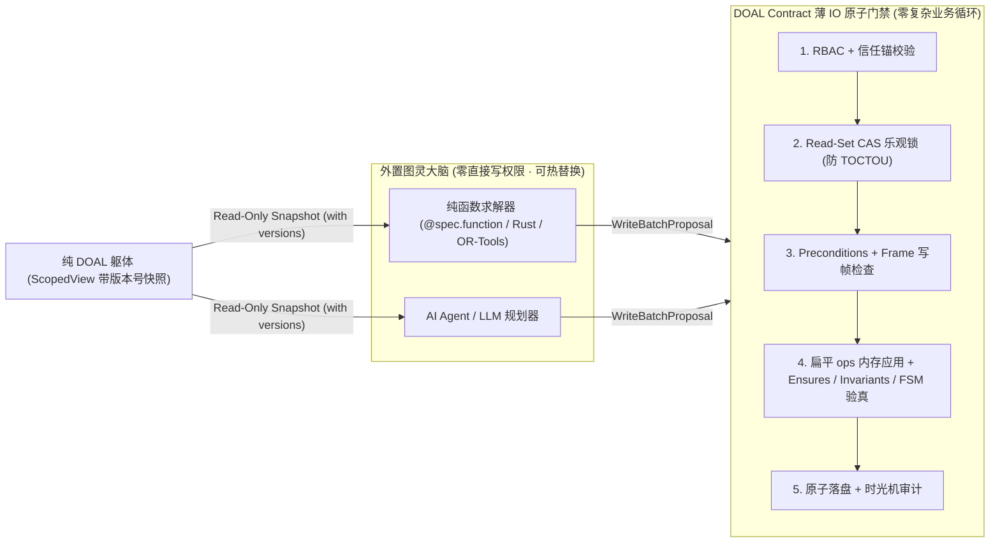

# DOAL v1.2 语言规范
## Decidable Ontology & Action Language Specification（可判定本体动作语言与 M2.5 外置大脑契约规范）

> **规范版本**：`v1.2.0`（2026-11-25，与 OpenOntology 仓库 `open_ontology/induction/dsl.py`、`open_ontology/induction/prover.py` 及 `Gate 6 / Gate 8` 保持 1:1 机器可对账）  
> **规范用语**：本文档中的 **`MUST` / `MUST NOT` / `SHOULD` / `MAY`** 遵循 RFC 2119 规范语义。  
> **核心定位**：`DOAL` 是 OpenOntology 世界模型的**可判定宪法与内核 ABI（Decidable Constitution & Kernel ABI）**——采用受限多排序一阶谓词 + 无循环有界过程语言，用于在百毫秒级由 SMT 求解器（Z3）给出**数学正确性证明**，作为 AI Agent 将自然语言编译为可执行企业契约的唯一目标语言，并在 **M2.5 架构**中确立“**纯 DOAL 躯体（无脑可独立运行） × 外置图灵大脑（零写句柄、经 Contract 接入）**”的严格边界。

---

## 1. 设计公理与认识论范围（Scope & Design Axioms）

### 1.1 为什么不是无限制一阶逻辑，也不是图灵完备 OAL？

`DOAL`（Decidable Ontology & Action Language）是对 1990s–2000s xtUML `OAL`（Object Action Language）、语义网 `OWL 2 Full` 以及传统 ERP“算写耦合”三条历史死胡同的显式修正：

1. **公理 A1（一阶谓词收束定理）**：无限制的一阶谓词逻辑（Unrestricted FOL）受邱奇定理约束不可判定。`DOAL` 的命题层严格收束为 **「封闭世界描述逻辑完整性公理（CWA-DL + UNA）+ 无量词线性算术（`QF_LIA / QF_LRA`）+ 有限关系表量词/聚合」**。
2. **公理 A2（反 xtUML 过程冻结定理）**：图灵完备过程语言受 Rice 定理与停机问题约束不可全自动判定。`DOAL` 的过程层**永久禁止** `while / for / for_each / recurse / modify_where / delete_where / exec / eval`，仅允许**有限顺序的、带守卫条件（`when`）的原子对象写操作**（`create / modify / delete`）。
3. **公理 A3（外置大脑与契约接入定理）**：真实企业仍有约 15%–25% 的复杂写算法（任意深度递归 BOM、FIFO 批次循环核销、非线性阶梯分摊、优化求解、AI 规划）客观需要图灵完备算力。`DOAL` **MUST NOT** 为吞并这 20% 而破坏自身可判定性：
   - **纯 DOAL 躯体（零大脑形态）**本身必须可独立运行（覆盖 75%–85% 确定性业务动作）；
   - **图灵完备算力（外置大脑）**应隔离在内核之外，通过声明式 **Contract（写帧 + 后置条件 + 并发版本锁 + 信任锚）** 接入（过渡态为契约化 `EditFunction`，目标态 M2.5 演进为零写句柄纯算 Planner + `WriteBatchProposal` 原子提交门禁，见第 9 章）。
4. **公理 A4（数学正确性 vs 物理正确性分离）**：
   - **`DOAL` + SMT 证明器只负责「数学正确性（Analytic Verification）」**——与外部世界无关，证明契约内部无死类、无 DL/LSP 违例、无死锁、无冗余废话、单步不变量保真、`when` 分支穷尽互斥且工作流状态机活性成立；
   - **「物理正确性（Empirical Corroboration）」**（模型是否符合真实老 ERP、物理产线、税法与管理意图）不属于本语言数学证明范围，需另由波普尔隐藏世界差分证伪、运行时独立 `observe` 同态回读与只读 M1 模型蓝图（`/blueprint`）人审承担。

### 1.2 DOAL 的五大管辖疆域（不止于 IO 门禁）

DOAL 不是单纯的“写前校验器”，而是覆盖整个世界模型可判定层的统一语言：

| 疆域 | 对应原语 | 职责 |
| :--- | :--- | :--- |
| **1. 世界本体 TBox** | `ObjectType` / `extends` / `RelationSpec` / `disjoint` / `FSM` | 定义合法物种、基数、互斥与生命周期状态图（PO-1） |
| **2. 认知投影与只读派生** | `Role` / `ScopedView` / `masked_roles` / 有限聚合查询表达式 | 决定人与外部大脑“能看见哪一片世界”，保障零越权读取 |
| **3. 外置大脑接口契约（ABI）** | `EditContractDecl` / `ContractAction`（`Read-Set CAS` + `Frame` + `ensures` + `trust_mode`） | 规定外部图灵完备大脑提交提案的合法规格（PO-4b / PO-5） |
| **4. IO 门禁与反射动作** | `Invariant` / `preconditions` / 75%–85% 无循环 `Rule` 动作 | 确定性低延迟反射写入与提交前硬红线拦停（PO-2 / PO-3 / PO-4a / PO-6 / PO-7） |
| **5. 单调演进协议** | `CustomerOverlaySpec` / `prove_upgrade_compatibility` | 保障标准库 `v1 → v2` 升级与客户二开叠合 0 回归破坏 |

---

## 2. 词法规则与抽象语法（Formal EBNF）

### 2.1 词法与安全标识符

```ebnf
Identifier     ::= [A-Za-z_] [A-Za-z0-9_]*       (* MUST NOT start with "__" *)
Version        ::= Digit+ "." Digit+ "." Digit+
ScalarType     ::= "str" | "int" | "float" | "bool"
RefRoot        ::= "obj" | "source_obj" | "param" | "actor"
                 | "before" | "after" | "target"
RefPath        ::= RefRoot ( "." Identifier )+
Literal        ::= String | Integer | Float | Boolean | Null | "[" LiteralList? "]"
LiteralList    ::= Literal ( "," Literal )*
```

- **规范条款 L1**：所有模型名、类型名、字段名、动作名、角色名、不变量名与 `edit_function` / `provider` 引用名 **MUST** 匹配 `Identifier` 且 **MUST NOT** 以双下划线 `"__"` 开头；违反者编译器 **MUST** 抛出 `INVALID_IDENTIFIER`。

### 2.2 本体与结构公理语法（TBox · CWA-DL + FSM）

```ebnf
Blueprint      ::= "blueprint" Identifier Version
                   ImportClause*
                   RoleDecl*
                   ObjectTypeDecl*
                   DisjointDecl*
                   InvariantDecl*
                   ActionDecl*
                   ViewDecl*
                   MigrationDecl*

ImportClause   ::= "import" Identifier
RoleDecl       ::= "role" Identifier String?

ObjectTypeDecl ::= "object" Identifier ("extends" Identifier)?
                   "{"
                     PrimaryKeyDecl
                     TitleDecl?
                     ModifierDecl*
                     FieldDecl*
                     RelationDecl*
                     FsmDecl?
                     VoucherRuleDecl*
                   "}"

PrimaryKeyDecl ::= "primary_key" Identifier
TitleDecl      ::= "title" Identifier
ModifierDecl   ::= "aggregate_root" | "append_only" | "owned" ("true" | OwnedFieldMap)

FieldDecl      ::= "field" Identifier ":" ScalarType
                   ("required")? ("auto_id")? ("owned")? ("non_negative")?
                   ("default" Literal)? ("masked_roles" RoleList)?

RelationDecl   ::= "relation" Identifier "->" Identifier
                   ("multiple")? ("required")? ("owned")?
                   ("min" NonNegInt)? ("max" NonNegInt)?

FsmDecl        ::= "fsm" Identifier
                   "initial" "[" StringList "]"
                   "transitions" "{" ( String "->" "[" StringList? "]" )* "}"

DisjointDecl   ::= "disjoint" "(" Identifier "," Identifier ")"
```

### 2.3 受限一阶谓词与值表达式语法（Sorted FOL + Arithmetic + Finite Aggregates）

```ebnf
Pred           ::= LogicPred | CompPred | QuantPred

LogicPred      ::= "(" "and" Pred Pred+ ")"
                 | "(" "or"  Pred Pred+ ")"
                 | "(" "not" Pred ")"

CompPred       ::= "(" CompOp Val Val ")"
CompOp         ::= "eq" | "ne" | "lt" | "le" | "gt" | "ge" | "in" | "not_in"

QuantPred      ::= "(" QuantOp Identifier QuantFilter? QuantCount? ")"
QuantOp        ::= "exists" | "not_exists" | "count_eq" | "count_ge" | "count_le"
QuantFilter    ::= "where" Pred        (* target root bound to iterated row of Identifier *)
QuantCount     ::= "value" Integer     (* REQUIRED iff QuantOp in count_eq | count_ge | count_le *)

Val            ::= Literal
                 | RefPath
                 | "(" ArithOp Val Val ")"
                 | "(" AggOp Identifier Identifier QuantFilter? ("default" Number)? ")"
                 | "(" "if_else" Pred Val Val ")"

ArithOp        ::= "add" | "sub" | "mul" | "div"
AggOp          ::= "sum" | "min" | "max"
```

- **规范条款 E1（机器算子锁）**：`open_ontology/induction/dsl.py` 的 `ALLOWED_EXPR_OPS` **MUST** 严格等于以下 **23 个算子**：
  - `LOGICAL_OPS`（3）：`and`, `or`, `not`
  - `COMPARISON_OPS`（8）：`eq`, `ne`, `lt`, `le`, `gt`, `ge`, `in`, `not_in`
  - `QUANTIFIER_OPS`（5）：`exists`, `not_exists`, `count_eq`, `count_ge`, `count_le`
  - `ARITHMETIC_OPS`（4）：`add`, `sub`, `mul`, `div`
  - `AGGREGATE_OPS`（3）：`sum`, `min`, `max`
  - 外加独立的值级条件分支节点 **`if_else`**（JSON 载体 `{"op": "if_else", "cond": <Pred>, "then": <Val>, "else": <Val>}`）。

### 2.4 同步不变量、有限过程动作与外置大脑契约语法

```ebnf
InvariantDecl  ::= "invariant" Identifier "code" Identifier "on" Identifier
                   ("when" Pred)?
                   "must_hold" Pred

ActionDecl     ::= "action" Identifier
                   "roles" RoleList
                   ("revert_roles" RoleList)?
                   ("affects_source" Boolean)?
                   "params" "{" FieldDecl* "}"
                   "preconditions" "{" PrecondDecl* "}"
                   ( "mutations" "{" MutationStmt* "}"
                   | "edit_function" Identifier EditContractDecl?
                   | "contract_gate" EditContractDecl )

EditContractDecl ::= ("trust_mode" ("untrusted_verifiable" | "attested_provider"))?
                     ("attested_providers" "[" IdentifierList "]")?
                     ("require_read_set_cas" Boolean)?
                     ("modifies" "[" FrameTargetList? "]")?
                     ("creates"  "[" IdentifierList? "]")?
                     ("deletes"  "[" IdentifierList? "]")?
                     ("ensures"  "{" PrecondDecl* "}")?

FrameTarget    ::= Identifier "." ( Identifier | "*" )

PrecondDecl    ::= "require" Identifier "code" Identifier "on" Identifier
                   ("id_param" Identifier)?
                   ("when" Pred)?
                   "must_hold" Pred

MutationStmt   ::= ("when" Pred)?
                   MutationOp Identifier
                   ("id_param" Identifier | "target_ref" RefPath)
                   "set" "{" ( Identifier ":=" Val )* "}"

MutationOp     ::= "create" | "modify" | "delete"
```

- **规范条款 S1（实现互斥律）**：每个 `ActionDecl` **MUST** 满足互斥：
  - 若声明 `edit_function` 或 `contract_gate`，则 `mutations` **MUST** 为空；
  - 若为声明式 `Rule`（`implementation_kind = "rule"`），则状态变换完全由 `mutations` 顺序表表达。
- **规范条款 S2（反 xtUML 永久禁词表）**：表达式算子集与 `MutationOp` **MUST NOT** 包含以下任何图灵完备或任意批量原语：
  `while`, `loop`, `for`, `for_each`, `foreach`, `modify_where`, `delete_where`, `recurse`, `exec`, `eval`, `call_python`, `lambda`。

### 2.5 单调客户演进与继承扩展语法（Monotonic Overlay）

```ebnf
Overlay        ::= "overlay" Identifier "on" Identifier Version
                   ( "add_roles" RoleList
                   | "add_object_types" ObjectTypeDecl+
                   | "derive_object_types" ObjectTypeDecl+     (* each MUST declare extends *)
                   | "add_disjoint_types" DisjointDecl+
                   | "add_fields" FieldExtensionMap
                   | "add_relations" RelationExtensionMap
                   | "update_transitions" TransitionNarrowingMap
                   | "add_actions" ActionDecl+
                   | "add_action_preconditions" PrecondExtensionMap
                   | "restrict_allowed_roles" RoleRestrictionMap
                   | "add_invariants" InvariantDecl+ )*
```

---

## 3. 静态语义与多排序类型系统（Static Semantics & Sorted Type System）

### 3.1 排序类型域（Sorts）

`DOAL` 是静态强类型的多排序系统，类型域 $\mathcal{T}$ 定义如下：

$$\tau \in \mathcal{T} ::= \mathsf{Str} \mid \mathsf{Int} \mid \mathsf{Float} \mid \mathsf{Bool} \mid \mathsf{Enum}(v_1, \dots, v_m) \mid \mathsf{Ref}(C) \mid \mathsf{Set}(\mathsf{Ref}(C))$$

其中 $C$ 为已注册的 `ObjectType` 名称。类型推导规则：

1. **数值提升**：`add / sub / mul / div` 的左右操作数 **MUST** 为 $\mathsf{Int}$ 或 $\mathsf{Float}$；两操作数皆为 $\mathsf{Int}$ 且运算为 `add / sub / mul` 时结果为 $\mathsf{Int}$，否则为 $\mathsf{Float}$。
2. **有序比较**：`lt / le / gt / ge` 的操作数 **MUST** 为可比数值或同序标量；`in / not_in` 右操作数 **MUST** 为字面量列表或集合引用。
3. **条件值**：`if_else(c, e_1, e_2)` 中 $c : \mathsf{Bool}$ 且 $e_1, e_2$ 类型兼容。
4. **多跳路径解引用**：对路径 $r.f_1.f_2.\dots.f_k$，除末段 $f_k$ 外，每段 $f_i$ **MUST** 为单值关系字段 $\mathsf{Ref}(C_i)$，静态检查器按 TBox 逐跳验证字段存在性。

### 3.2 引用根（`RefRoot`）上下文作用域

| 语法上下文 | 允许的 `RefRoot` 集合 | 允许访问跨表视图 (`exists / sum / count`) |
| :--- | :--- | :---: |
| **状态不变量** (`InvariantDecl`) | `obj`（外层）；`target`（量词/聚合 `where` 内） | ✅ |
| **跃迁不变量 / 契约 `ensures`** | `before`, `after`, `param`, `actor`（外层）；`target`（内层） | ✅ |
| **动作前置条件** (`PrecondDecl`) | `obj`, `source_obj`, `param`, `actor`（外层）；`target`（内层） | ✅ |
| **动作变迁守卫 `when` 与赋值 `set_fields`** | `obj`, `source_obj`, `param`, `actor`（外层）；`target`（内层） | ✅ |

### 3.3 CWA 关系基数规范化法则

对每个关系声明 `RelationSpec(field, target_type, multiple, required, min_cardinality, max_cardinality)`，其封闭世界有效基数区间 $[\text{eff\_min}, \text{eff\_max}]$ 定义为：

$$\text{eff\_min} = \max(\text{min\_cardinality},\; \mathbf{1}_{\text{required}})$$

$$\text{eff\_max} = \begin{cases} \text{max\_cardinality} & \text{if } \text{max\_cardinality} \neq \text{None} \\ 1 & \text{if } \neg\text{multiple} \land \text{max\_cardinality} = \text{None} \\ +\infty & \text{if } \text{multiple} \land \text{max\_cardinality} = \text{None} \end{cases}$$

编译器 **MUST** 在静态阶段拦截本地矛盾（$\neg\text{multiple} \land \text{max\_cardinality} > 1$ 或 $\text{eff\_min} > \text{eff\_max}$）。

### 3.4 AST 复杂度安全护栏

为防止异常或恶意生成的超深公式造成求值/编译退化，每个表达式 AST **MUST** 满足有界深度与节点预算。

---

## 4. 单调继承与行为子类型法则（Monotonic Inheritance & LSP Rules）

`DOAL` 中的继承 `C_sub extends C_parent` 与客户演进包 `Overlay` **绝不是面向对象的任意覆写（Override）**，而是严格遵循**单调逻辑合取**与**里氏替换原则（Liskov Substitution Principle, LSP）**：

$$\Phi(C_{\text{sub}}) \;=\; \Phi(C_{\text{parent}}) \;\land\; \Delta_{\text{sub}}$$

### 4.1 强制单调规则表

| 建模维度 | 子类 / Overlay 允许的操作（✅ 单调收紧） | 明文禁止的操作（❌ 必须静态报错） | 规范错误码 |
| :--- | :--- | :--- | :--- |
| **继承图结构** | 单亲/树状继承形成有向无环图（DAG） | 自身继承或任意长度继承环（$A \to \dots \to A$） | `INHERITANCE_CYCLE` |
| **主键 (`primary_key`)** | 原样继承父类主键 | 修改或重命名父类主键 | `LSP_VIOLATION` |
| **字段 (`fields`)** | 新增字段（客户扩展推荐 `x_` 前缀）；将可选改为必填；为数值字段追加 `non_negative` | 删除父类字段；更改父类字段基础类型；取消 `required` 或 `non_negative` | `LSP_VIOLATION` / `OVERLAY_BREAKS_STANDARD_CONTRACT` |
| **关系基数 (`relations`)** | 新增关系；收紧父类区间 $[\text{min}', \text{max}'] \subseteq [\text{min}, \text{max}]$ | 删除父类关系；改变目标类型；放松基数下界或上界 | `LSP_VIOLATION` |
| **状态机 (`fsm`)** | 保持父状态机，或将 `initial_statuses` 收窄为非空子集、将每个状态的 `transitions[s]` 收窄为子集 | 更改 `status_field`；引入父类未声明的非法状态或非法跃迁边；收窄为空初态集 | `LSP_VIOLATION` |
| **类互斥 (`disjoint`)** | 追加新的互斥对 $(A, B)$ | 声明自互斥 $(A, A)$；某类同时继承两个（直接或祖先）互斥类型 | `DL_DISJOINT_VIOLATION` |
| **动作与权限 (`actions`)** | 新增声明式动作；向现有动作追加 `preconditions`；收窄 `allowed_roles` 子集 | 删除标准动作；覆写标准 `EditFunction`；放松角色或删除已有前置条件 | `OVERLAY_BREAKS_STANDARD_CONTRACT` |
| **不变量 (`invariants`)** | 追加新的不变量（子类自动继承全部祖先不变量） | 删除或削弱任何标准库/父类不变量 | `OVERLAY_BREAKS_STANDARD_CONTRACT` |

### 4.2 运行时多态子类型语义

编译到宿主运行态（`OntologySpec`）后，声明式子类 `SubType extends ParentType` **MUST** 成为真实宿主子类（`issubclass(SubType, ParentType)`），使得所有作用于 `ParentType` 的同步不变量与多态动作自动对 `SubType` 实例生效。

---

## 5. 操作语义（Big-Step Operational Semantics · CWA + UNA）

### 5.1 世界状态假设

1. **封闭世界假设（Closed-World Assumption, CWA）**：在状态快照 $\sigma$ 中，凡未被显式记录的对象或关系链接均判定为**不存在**。
2. **唯一名称假设（Unique Name Assumption, UNA）**：同一类型（或同族继承层次）内不同主键 `id_1 != id_2` **MUST** 指向不同实体实例。

### 5.2 动作原子执行大步语义

设当前数据库状态为 $\sigma$，调用方身份为 $a$（`Actor`），参数绑定为 $\theta$，声明式动作 $A = \langle R, P, [M_1, \dots, M_n] \rangle$：

1. **RBAC 门禁**：若 $a.\text{role} \notin R$，立即拒绝（`PERMISSION_DENIED`），$\sigma$ 零变更。
2. **前置条件求值**：在只读视图 $\sigma$ 上依次求值所有 $p \in P$；任一不成立即拒绝（抛出 $p.\text{code}$），$\sigma$ 零变更。
3. **有限守卫变迁序列（在内存原子 `EditBatch` 中顺序执行）**：对 $i = 1 \dots n$，设 $M_i = (\text{when } c_i,\; op_i,\; \text{target}_i,\; \vec{f}_i := \vec{e}_i)$：

$$\frac{\llbracket c_i \rrbracket_{\sigma_{i-1}, a, \theta} = \text{false}}{\langle \sigma_{i-1}, M_i \rangle \Downarrow \sigma_{i-1}} \quad (\text{Skip-Guard})$$

$$\frac{\llbracket c_i \rrbracket_{\sigma_{i-1}, a, \theta} = \text{true} \qquad \sigma_i = \text{Apply}(op_i, \text{target}_i, \llbracket \vec{e}_i \rrbracket_{\sigma_{i-1}, a, \theta}, \sigma_{i-1})}{\langle \sigma_{i-1}, M_i \rangle \Downarrow \sigma_i} \quad (\text{Exec-Guard})$$

4. **提交前全量同步核验**：在候选终态 $\sigma_n$ 与前后态对 $(\sigma_0, \sigma_n)$ 上，M2 内核强跑全部状态机 FSM 合法边检验、状态不变量（含祖先链）、跃迁不变量、非负与凭证守恒公理；任一项失败即**原子回滚**，零脏写。

---

## 6. 形式化验证语义：Z3 七大证明义务与可判定性分级

`DOAL` 的形式化证明器（`open_ontology/induction/prover.py`）将蓝图编译为一阶 SMT 公式交由 Z3 求解，定义 **7 大标准证明义务（PO-1 ~ PO-7）**，覆盖类可满足性、动作可达性、规则冗余、全模型单步 Hoare 保真（Rule 精确 $wp$ + 外置契约 Assume-Guarantee）、反空真性、`when` 分支完备互斥与工作流多步终端可达性。

### 6.1 七大标准证明义务（Proof Obligations）

| 证明义务 | 形式化命题 | 判定目标与产物 |
| :--- | :--- | :--- |
| **PO-1 · 类可满足性与 DL/LSP 检验** (`prove_class_satisfiability`) | 对每个类型 $C$（含祖先链 $\text{Anc}(C)$），判定 $\text{SAT}(\text{Dom}(C) \land \text{FSM}(C) \land \bigwedge I)$ 并检验互斥公理、基数与 LSP | `UNSAT` → **`UNSATISFIABLE_CLASS`** + 最小 `unsat_core`；互斥/基数冲突 → **`DL_AXIOM_CONFLICT`**；放松父契约 → **`LSP_VIOLATION`** |
| **PO-2 · 动作全局与条件切片可达性** (`prove_action_reachability`) | 对每个动作 $A$（及切片 $S$），判定 $\text{SAT}(\text{Dom} \land \text{FSM} \land I_{\text{pre}} \land \bigwedge P_A \land S)$ | `UNSAT` → **`TOTAL_DEADLOCK` / `CONDITIONAL_DEADLOCK`** + 最小 `unsat_core` |
| **PO-3 · 冗余前置规则检出** (`prove_redundant_rules`) | 对动作 $A$ 中每条 $p_k \in P_A$，判定 $\text{UNSAT}(I_{\text{pre}} \land \bigwedge_{j \neq k} p_j \land \neg p_k)$ | `UNSAT` → **`REDUNDANT_RULE`** 预警 |
| **PO-4 · 全模型单步霍尔不变量保真** (`prove_invariant_preservation`) | ① **`Rule`（`exact_wp`）**：$\text{UNSAT}(P_A \land I_{\text{all}} \land \neg wp(M_1;\dots;M_n,\; I'_{\text{all}}))$；<br>② **契约化 `EditFunction` / `ContractGate`（`contract_assume_guarantee`）**：$\text{UNSAT}(P_A \land I_{\text{all}}(\text{before}) \land \text{Frame} \land \text{Ensures} \land \neg I_{\text{all}}(\text{after}))$ | `Rule` 过 → **`PROVED`**；契约过 → **`CONTRACT_PROVED`**；`SAT` → **`VIOLATED`** + 反例；无契约 → **`SKIPPED_UNCONTRACTED`** |
| **PO-5 · 契约可实现性检验（防空真）** (`Contract Realizability`) | 在 PO-4b 前 **MUST** 先判定 $\text{SAT}(P_A \land I_{\text{all}}(\text{before}) \land \text{Frame} \land \text{Ensures})$ | `UNSAT` → **`VACUOUS_CONTRACT`** + `unsat_core` 并强制 `report.ok = False` |
| **PO-6 · `when` 分支穷尽、可达与互斥检验** (`prove_when_branches`) | 对含 `when` 守卫的 `Rule` 动作检验：<br>① 每分支可达 $\text{SAT}(\text{Dom} \land P_A \land c_i)$；<br>② 全守卫动作或同目标多分支穷尽 $\text{UNSAT}(\text{Dom} \land P_A \land \neg\bigvee c_i)$；<br>③ 同目标同字段重叠写入互斥 $\text{UNSAT}(\text{Dom} \land P_A \land c_i \land c_j)$ | 死分支 → **`DEAD_BRANCH`**；缺口/静默 NO-OP → **`INCOMPLETE_WHEN_BRANCHES`** + 反例；重叠冲突 → **`OVERLAPPING_WHEN_BRANCHES`** + 反例；单一可选副作用 → **`CONDITIONAL_SIDE_EFFECT`**；全完备 → **`EXHAUSTIVE`** |
| **PO-7 · 工作流 FSM 活性与 Z3 多步终端可达** (`prove_workflow_liveness`) | ① **结构图活性**：检验初态非空、可达状态集（子类合法剪枝空终态单独标注 `pruned_inherited_states` 不误报）、终态存在与无活锁陷阱环；<br>② **Z3 多步动作串联（$k \le \text{max\_steps}$）**：沿抽象动作路径串联实体字段状态 $E_0 \xrightarrow{a_1} \dots \xrightarrow{a_m} E_m \in S_{\text{term}}$ | 孤立态 → **`UNREACHABLE_STATE`**；死循环 → **`TRAP_STATE`**；无终态 → **`NO_TERMINAL_STATE`**；抽象有链但跨步数据锁死 → **`ACTION_CHAIN_DEADLOCKED`**（`report.ok = False`）；证成 → **`LIVE`** + 见证轨迹；部分外源未建模边 → 诚实标注 **`GRAPH_LIVE_PARTIAL_ACTIONS`** |

### 6.2 Assume-Guarantee 信任边界与一致性 vs 完备性诚实声明

- **Assume-Guarantee 物理闭合**：契约化动作由 Z3 证明“只要提案/实现遵守 `(Frame, Ensures)`，全模型 100% 保持全部全局不变量”，运行期门禁在落盘前强制拦截 `CONTRACT_FRAME_VIOLATION` 与 `CONTRACT_ENSURES_VIOLATION` 并原子回滚。
- **诚实认识论边界**：即便全模型 100% 通过 PO-1 至 PO-7，它证明的是**强局部一致性、契约可实现性、单步归纳安全、分支完备互斥与有界多步工作流活性**（其中跨表聚合为 `BMC_BOUNDED(k)`、工作流多步为 `max_steps` 有界），**不自动等价于**无界全历史时序活性或业务需求完备性（如遗漏真实世界法规红线）。

### 6.3 含 `when` 守卫的精确最弱前置条件（$wp$）展开规则

对无循环有限序列 $M_1; \dots; M_n$，每步变迁 $M_i = (\text{when } c_i,\; \vec{x} := \vec{e}_i)$ 满足机械展开：

$$wp(\text{when } c \text{ do } (\vec{x} := \vec{e}),\; Z) \;=\; \big(c \implies Z[\vec{e}/\vec{x}]\big) \;\land\; \big(\neg c \implies Z\big)$$

SMT 编码等价采用单态赋值（SSA）线性规模 `ITE` 推进，避免路径指数爆炸。

### 6.4 逻辑片段与可判定性诚实分级

| `logic_fragment` 标识 | 对应数理逻辑片段 | 可判定性与完备性保证 |
| :--- | :--- | :--- |
| **`EXACT_QF_LIA`** | 无量词线性整数算术 + 布尔 + 有限枚举 + CWA-DL | **100% 完备可判定** |
| **`EXACT_QF_LRA`** | 无量词线性实数/混合算术 + 布尔 + 有限枚举 + CWA-DL | **100% 完备可判定** |
| **`EXACT_GRAPH`** | 有限状态机结构图拓扑可达与强连通/反向可达分析 | **100% 精确多项式判定** |
| **`BMC_BOUNDED(k=N)`** | 含跨表量词/聚合（`exists / count / sum / min / max`）或有界步长多步工作流 | **有界完备**（不宣称无穷表/无穷步完备） |
| **`QF_NIA_HEURISTIC`** | 含双未知整数变量乘除（非线性算术） | **半判定启发式** |
| **`UNKNOWN`** | 求解超时或超出求解器理论支持 | **拒绝放行（`report.ok = False`）** |

---

## 7. `NL → DOAL → Z3` 客户自助二次开发 Agent 契约

1. **规范条款 AG-1（零臆造算子）**：翻译 Agent **MUST** 仅输出第 2 节合法语法与算子，客户扩展字段优先加 `x_` 前缀。
2. **规范条款 AG-2（强制 Z3 闭环自愈）**：产出 `DOAL` 后 **MUST** 自动执行 `prove_draft_mathematics`（PO-1 ~ PO-7）；检出任意冲突时 **MUST** 基于 `unsat_core` 或反例向业务方清晰汇报，严禁静默绕过或删除基座红线。
3. **规范条款 AG-3（超界显式拒翻与升格）**：遇到任意深度图递归、运行时动态次数批量循环、非线性多变量优化或外部 API 协议时，**MUST** 拒绝伪造有损 `DOAL`，显式输出 `escalate_to_edit_function` / 外置大脑契约研发单。
4. **规范条款 AG-4（防翻译失真强制回译）**：发布前 **MUST** 通过确定性编译器将 `DOAL` 反向渲染为结构化中文条款，并经 `/blueprint` 蓝图与 `/sandbox` 沙盘确认。

---

## 8. JSON 线缆载体、可运行端到端范例与仓库一致性门禁

### 8.1 规范 JSON 载体映射

在 OpenOntology 实现中，抽象语法严格映射到 `open_ontology/induction/dsl.py` 的 `ConfigDict(extra="forbid")` Pydantic 模型：
- `Blueprint` ↔ `DeclarativeBlueprint`
- `ObjectTypeDecl` ↔ `ObjectTypeBlueprint`（含 `extends`）
- `RelationDecl` ↔ `RelationSpec`（含 `min_cardinality`, `max_cardinality`）
- `DisjointDecl` ↔ `DeclarativeBlueprint.disjoint_types` / `CustomerOverlaySpec.add_disjoint_types`
- `ActionDecl` ↔ `ActionBlueprint`（含 `modifies`, `creates`, `deletes`, `ensures`）
- `MutationStmt` ↔ `ActionMutationSpec`（`op ∈ {"create", "modify", "delete"}`，含 `when`）
- `Overlay` ↔ `CustomerOverlaySpec`（含 `derive_object_types`）

### 8.2 可运行端到端范例（由 Gate 8 自动提取校验）

以下 JSON 范例可直接通过 `CustomerOverlaySpec.model_validate(...)` 校验并无损叠合至标准企业世界模型经 Z3 全证通过：

```json
{
  "overlay_id": "client_export_v1",
  "base_model_id": "std_enterprise_world_model",
  "target_version": "1.0.0",
  "derive_object_types": [
    {
      "name": "ExportSalesOrder",
      "extends": "O2cOrder",
      "primary_key": "order_id",
      "fields": [
        { "name": "x_customs_no", "field_type": "str", "required": true, "owned": true },
        { "name": "x_risk_level", "field_type": "str", "default": "NORMAL", "owned": true }
      ],
      "initial_statuses": ["draft"],
      "transitions": {
        "draft": ["confirmed"],
        "confirmed": ["delivered"],
        "delivered": []
      }
    }
  ],
  "add_actions": [
    {
      "name": "classify_export_order_risk",
      "allowed_roles": ["sales_manager", "finance_director", "admin"],
      "affects_source": false,
      "params": [
        { "name": "order_id", "field_type": "str", "required": true }
      ],
      "preconditions": [
        {
          "name": "export_order_is_draft",
          "code": "EXPORT_ORDER_NOT_DRAFT",
          "target_type": "ExportSalesOrder",
          "id_param": "order_id",
          "must_hold": {
            "op": "eq",
            "left": { "ref": "obj.status" },
            "right": { "lit": "draft" }
          }
        }
      ],
      "mutations": [
        {
          "op": "modify",
          "object_type": "ExportSalesOrder",
          "id_param": "order_id",
          "when": {
            "op": "gt",
            "left": { "ref": "obj.amount_total" },
            "right": { "lit": 500000 }
          },
          "set_fields": { "x_risk_level": { "lit": "HIGH" } }
        },
        {
          "op": "modify",
          "object_type": "ExportSalesOrder",
          "id_param": "order_id",
          "when": {
            "op": "le",
            "left": { "ref": "obj.amount_total" },
            "right": { "lit": 500000 }
          },
          "set_fields": { "x_risk_level": { "lit": "NORMAL" } }
        }
      ]
    }
  ]
}
```

### 8.3 仓库自动化一致性门禁（Conformance Gates）

任何声称符合 `DOAL v1.2` 的实现 **MUST** 持续通过 `tests/test_wo36_static_completeness_and_conformance.py` 机器门禁：
1. **Gate 6（零核心污染）**：独立子进程导入 `open_ontology`、`open_ontology.spec`、`open_ontology.runtime` 时，`sys.modules` **MUST NOT** 加载 `open_ontology.induction.dsl`、`prover` 或 `z3`；
2. **Gate 8（反 xtUML 算子与原语锁）**：
   - `ALLOWED_EXPR_OPS` 严格等于第 2.3 节 23 个算子 + `if_else`；
   - 全部 12 个反 xtUML 禁词被 AST 校验器与 `ActionMutationSpec` 拒绝；
   - `ActionMutationSpec.op` 严格锁定为 `Literal["create", "modify", "delete"]`；
   - `OntologySpec.action` 永久退役（`not hasattr(OntologySpec, "action")`）；
   - S1 互斥律与全核心 Pydantic 模型 `extra="forbid"` 强制生效；
   - AST 静态扫描 `open_ontology/induction/dsl.py` 与 `prover.py` 零 `exec / eval / compile`；
3. **无 Z3 优雅降级**：未安装 `z3` 时编译与运行 100% 正常，证明入口返回规范 `ProverUnavailableError` / `PROVER_UNAVAILABLE`；
4. **文档活体同步**：直接从 `docs/DOAL_SPEC.md` 第 8.2 节提取 JSON 范例通过 `CustomerOverlaySpec.model_validate(...)` 校验。

---

## 9. M2.5 架构演进规范：外置图灵大脑与契约接入 ABI（External Brain & Contract-Gated Commit）

本章正式确立 OpenOntology 从“过渡态 `EditFunction` 黑盒”迈向 **M2.5“纯 DOAL 躯体 × 外置图灵大脑”** 的标准接口契约（目标在 `WO-37` 落地）。

### 9.1 第一性原理：消除算写耦合，把大脑严格隔离在内核之外

在传统 ERP 与当前过渡态 M2 中，`@spec.edit_function` 仍同时持有“图灵完备计算逻辑”与“事务内直接写库句柄 `ctx`”。`WO-35` 为其补签 `(modifies, creates, deletes, ensures)` 证明了契约化路线可行，但更彻底的架构是对齐操作系统与生物分层：

1. **纯 DOAL 躯体（无脑亦可独立存活）**：TBox + ScopedView + FSM + Invariants + 75%–85% 无循环 `Rule` 反射动作 + 薄原子 Runtime，零图灵完备代码即可独立运行且 100% 精确 Z3 可证明；
2. **外置图灵完备大脑（零直接写库句柄）**：所有递归 BOM、FIFO 阶梯冲账、按重量分摊、OR-Tools 排产、LLM Agent 规划与人类复杂决策，全部移至内核之外，以**纯只读快照 + 参数 → 结构化提案 `WriteBatchProposal`** 的纯函数形态运行；
3. **唯一合法写入通道（Contract-Gated Commit ABI）**：外置大脑只能向 DOAL 声明的 `ContractGate` 提交扁平 `WriteBatchProposal`，内核在一次极薄原子事务中完成并发锁、写帧、守恒后置条件与全部红线不变量验真后落盘。



### 9.2 `WriteBatchProposal` 线缆契约与 Read-Set CAS 并发协议

为彻底消除“纯算快照读”与“薄 IO 落盘写”之间的 **TOCTOU 并发竞态**，所有外置大脑提交的提案 **MUST** 遵循 `WriteBatchProposal` 线缆格式：

```json
{
  "proposal_id": "PROP-20261125-0001",
  "contract_name": "allocate_container_shipping_cost",
  "actor": { "actor_id": "u_cfo", "role": "finance_director", "clearance_tags": [] },
  "params": { "total_freight_cents": 120000, "order_ids": ["EXP-SO-001", "EXP-SO-002"] },
  "read_set": [
    { "object_type": "ExportSalesOrder", "object_id": "EXP-SO-001", "expected_version": 3 },
    { "object_type": "ExportSalesOrder", "object_id": "EXP-SO-002", "expected_version": 2 }
  ],
  "ops": [
    {
      "op": "modify",
      "object_type": "ExportSalesOrder",
      "object_id": "EXP-SO-001",
      "set_fields": { "x_allocated_freight_cents": 78000 }
    },
    {
      "op": "modify",
      "object_type": "ExportSalesOrder",
      "object_id": "EXP-SO-002",
      "set_fields": { "x_allocated_freight_cents": 42000 }
    }
  ],
  "attestation": null
}
```

**原子提交门禁强制执行顺序（All-or-Nothing，零业务循环）**：
1. **幂等与 RBAC 校验**：验证 `actor.role ∈ allowed_roles` 与 `proposal_id` 去重；
2. **信任锚校验（Trust Mode Check）**：若契约声明 `trust_mode = "attested_provider"`，验证 `attestation` 来自白名单受审纯算提供方（违例抛 `UNTRUSTED_PROPOSAL_PROVIDER`）；
3. **Read-Set CAS 乐观锁核验**：逐条校验 `read_set` 中每个对象的当前版本号严格等于 `expected_version`；任一对象在计算期间已被并发修改，立即拒绝并抛出 **`CONCURRENCY_CONFLICT`**（零脏写），由外置大脑拉取新快照重算；
4. **动作前置条件校验**：校验 `preconditions`；
5. **写帧边界（Frame）校验**：`ops` 中所有 `op` 严格限于 `create / modify / delete`，修改字段全部属于 `modifies`、新建/删除类型全部属于 `creates / deletes`（越界抛 **`CONTRACT_FRAME_VIOLATION`**）；
6. **内存应用与全量后置/红线验真**：在内存 `EditBatch` 顺序应用 `ops`，同步核验 `ensures`（含守恒聚合如 `sum == total`、`debit == credit`，违例抛 **`CONTRACT_ENSURES_VIOLATION`**）、全量状态不变量（含祖先链）、跃迁不变量、FSM 合法边与非负/只追加铁律；
7. **原子落盘或原子回滚**：全部通过则递增受影响对象版本号、原子提交并写入时光机审计账本（记录 `proposal_id` 与外置大脑来源）；任一步失败全量回滚、零脏写。

### 9.3 两类外置大脑的安全信任分级（防薄 IO 沦为裸写漏洞）

薄 IO 门禁 **MUST NOT** 无条件信任外部大脑传入的任意计算结果。每个 `ContractGate` **MUST** 显式声明其 `trust_mode`：

| 信任分级 | `trust_mode` | 数学机理 | 典型业务场景 | 准入策略 |
| :--- | :--- | :--- | :--- | :--- |
| **Class A · 免信任可验真大脑** | `untrusted_verifiable` | **NP-Verifiable**：求解复杂，但 DOAL `ensures + Invariants` 可低成本 100% 验真解的守恒/平衡/约束 | 运费按重量分摊（`sum == total` + 非负）、复式记账过账（借贷平衡 + 期间开放）、多级 BOM 展算建单、产能排产 | **允许任意外部大脑**（Python / Rust / OR-Tools / AI Agent）直提提案，由 DOAL 门禁硬兜底 |
| **Class B · 权威公式/预言机大脑** | `attested_provider` | **Oracle / Policy**：DOAL 仅能表达安全包络（如 `0 < rebate <= customs_value`），无法在 `QF_LIA` 内重算完整税则/计薪表 | 法定出口退税核定、法定个税计薪、银行授信评分、外部权威清关核税 | **严禁裸数字直写**：仅接受白名单受审 `@spec.function` / 可信计算服务签发的 `attestation` 提案（或由门禁同步调用受审只读函数交叉复核） |

### 9.4 零破坏分阶段演进路线（`WO-36 → WO-37`）

- **`WO-36`（静态验证完备化 + 规范入库与门禁锁定）**：
  - 实现 **PO-6（`when` 分支穷尽/死分支/重叠）** 与 **PO-7（工作流 FSM 结构活性 + Z3 多步动作终端可达）**；
  - 修复 M1 AI 本体论专家的 `CONTRACT_PROVED` 过滤噪声并暴露 `EditFunction` 契约详情；
  - 上线 `tests/test_wo36_static_completeness_and_conformance.py`，将 Gate 6、Gate 8 与本规范第 8.2 节 JSON 范例纳入持续自动化校验。
- **`WO-37`（M2.5 外置大脑与 `WriteBatchProposal` 契约提交门禁）**：
  - 在引擎层落地 `WriteBatchProposal`、`Read-Set CAS`、`trust_mode`（`untrusted_verifiable` / `attested_provider`）与 `apply_contract_proposal(...)` 统一薄 IO 提交口；
  - 将企业与华美模型中的代表性 `EditFunction`（Class A：`allocate_container_shipping_cost`、`explode_multilevel_substitute_bom`；Class B：`apply_export_tax_rebate_claim`）重构示范为 **零写句柄 `@spec.function` 纯算 Planner + DOAL Contract Gate**（旧 `EditFunction` 调用保留兼容薄壳，确保现有 M0/M1/ERP 零回归）；
  - 开放 AI 数字管家向 Class-A Contract 直接提交 `WriteBatchProposal`（经沙盘与 Z3 契约门禁双保险）。
