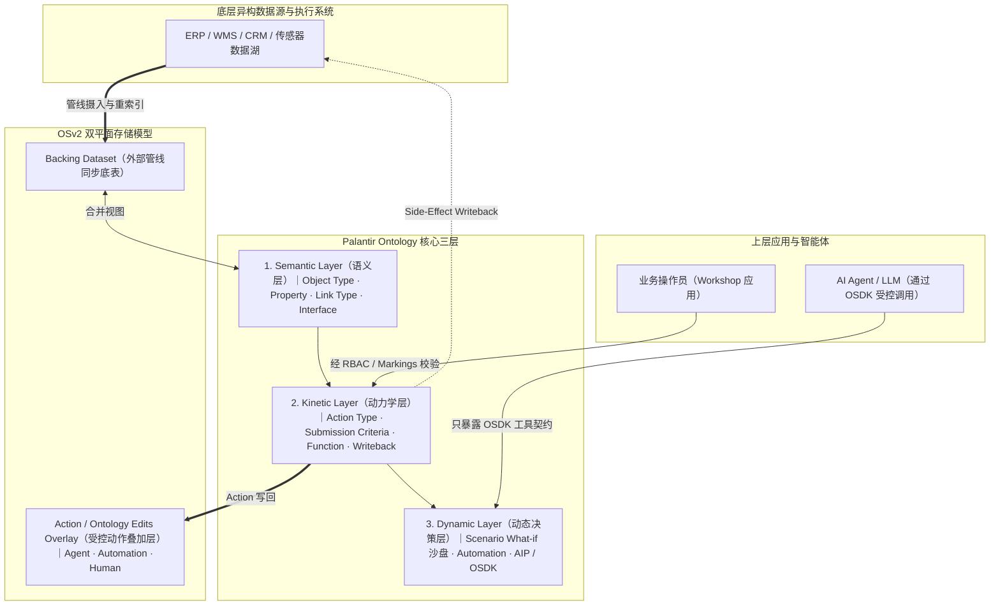

# Palantir 原理与 OpenOntology 架构对比（优势与不足）

> 本文档面向架构师与领域建模开发者，从 **Palantir Foundry（OSv2）与 AIP 的底层第一性原理**出发，对照分析 **OpenOntology** 的工程映射、核心创新优势以及当前的客观局限与演进方向。平台元模型宪法见 [ARCHITECTURE.md](ARCHITECTURE.md)。

---

## 0. 为什么企业系统与 AI Agent 需要 Ontology？

传统企业软件以 **数据库表 + CRUD 接口** 为中心构建，这种范式在人类点击表单的时代尚可运转，但在引入 AI Agent 与跨系统协同后，会集中暴露出四类结构性矛盾：

1. **IT 碎片化与语义鸿沟**：客户、订单、库存分散在 CRM、ERP、WMS 的几十张技术表里（例如 Odoo 的 `res.partner`、`sale.order`、`stock.picking`），LLM 或业务人员面对的是一堆表名与外键，而非清晰的业务语义。
2. **裸 CRUD 破坏业务不变量**：传统 API 往往只校验单接口字段类型，无法守住跨对象的全局法则（如“欺诈分 ≥ 70 或超 30 天退货期禁止退款”、“入库数量不得突破仓库剩余库容”）。
3. **数据源与决策叠加态冲突**：外部 ERP/CRM 定时同步刷新底表时，容易覆盖掉分析人员或 AI 刚刚标注的风险评级、处置备注与人工覆写值。
4. **概率性大模型直接操作生产系统的风险**：如果把 REST API 或 SQL 直接交给 Agent 调用，一旦发生幻觉参数、网络重试重复提交、并发抢占或越权访问，就会直接污染生产账本，且缺乏事后精确冲正手段。

**Ontology（企业数字孪生本体）** 的本质，就是在所有底层 IT 系统与上层调用方（人类/AI Agent）之间，构建一层 **“带语义图谱、受控动力学动作、安全门禁与沙盘推演能力的决策操作系统”**。

---

## 一、 Palantir（Foundry OSv2 & AIP）的核心原理

Palantir Foundry 与 AIP 围绕 **Semantic（语义）· Kinetic（动力学）· Dynamic（动态决策）** 三位一体构建：

### 1.1 数字孪生三层架构
* **Semantic Layer（语义层）**：用领域语言将底层数据集映射为 **`ObjectType`（实体对象）**、**`DatatypeProperty` / `AutoID`（数据属性与系统编号）**、**`ObjectProperty`（OWL 对象属性）** 与 **`InterfaceType`（跨类型多态接口）**，把“物理表”统一投影为“业务对象图”。
* **Kinetic Layer（动力学层）**：彻底废除裸 CRUD，一切状态变更必须封装为 **Action（具名业务动作）**。Action 内置 **Submission Criteria（准入/不变量条件）**、只读推演 **Function** 与 **Action Log（因果账本）**，保证每一次变化都知道“谁、何时、基于什么前提、改了哪些对象”。
* **Dynamic Layer（动态决策层）**：在确定性的对象与动作之上，允许人类或 AI 启动 **Scenario（平行沙盘推演）**、配置事件驱动的 **Automation（自动化条件反射）**，并通过 **OSDK（Ontology SDK）** 让大模型安全参与决策。

### 1.2 OSv2 双平面存储模型（Backing Dataset + Action / Ontology Edits）
Palantir Object Storage v2 最核心的工程设计之一，是将 **外部数据源同步层（Backing Dataset）** 与 **Ontology 受控动作叠加层（Action / Ontology Edits）** 分离：
> **术语演进注记**：Palantir 在早期面向人工分析师的文档中将该层称为 `User Edits`；但在 AI 原生场景（AIP / OpenOntology）下，该层的高频写入主力实为 **Agent Edits（智能体决策写入）**，辅以确定性自动化规则（Automation）与人类兜底裁决（Human）。三者在内核中统一抽象为 `Actor`，其核心边界不在于“人还是机器”，而在于**“必须经由受控 Action 写入、主权归属本体的决策叠加态”**（即 OpenOntology 的 `ontology_overlay`）。
* 外部 ERP/CRM 数据更新时，同步管线重刷 Backing Dataset；
* 经受控 Action 修改的业务属性（涵盖 Agent 推演提交、自动化条件反射与人工审批）或本体自有对象保存在叠加层中，查询时自动合并投影，从而保证“外部快照重刷不冲掉本体决策状态”，并支持在冲突时进行精细化裁决（Reindexing / Conflict Resolution）。

### 1.3 安全与因果治理（Markings + RBAC + Action Log）
* **行级安全标签（Markings / Classification）**：权限不只管“能不能进菜单”，而是跟随对象实例的字段标签走（例如 `region:north`、`clearance:secret`），调用方不具备对应标签则对象在查询中不可见。
* **确定性准入铁笼**：无论前端按钮还是后台 AI，调用 Action 都必须经过 RBAC 角色检查、参数 Schema 检查与 Submission Criteria 业务规则校验。

### 1.4 AIP 的核心哲学：用确定性本体关住概率性大模型
Palantir AIP 不相信仅靠 Prompt 就能约束大模型。它的哲学是分工隔离：
* **LLM 负责“概率性理解与方案生成”**：读取 OSDK 暴露的强类型函数与动作 Schema，理解上下文并提出候选项；
* **Ontology 负责“100% 确定性的校验与执行”**：所有业务计算（Function）、What-if 模拟（Scenario）、权限检查（RBAC/Markings）和物理落库（Action）全部在确定性代码中完成。

---

## 二、 Palantir 与 OpenOntology 的核心概念映射

OpenOntology 完整继承了 Palantir Foundry/AIP 的核心原理，并将其精简为一个 **10 模块 Pure Runtime 微内核（`open_ontology/`，支持 SQLite + PostgreSQL 16 双底座与可插拔生产运行壳）** 架构：

| 哲学维度 | Palantir Foundry / AIP 原语 | OpenOntology 对应实现 | 所在模块 |
|---|---|---|---|
| **领域模型与业务世界** | Ontology Metadata / Workspace | `OntologySpec`（M1 世界法则容器）+ 隔离 `World / 世界状态`（代码兼容别名 `Workspace`） | [spec.py](file:///Users/guci/work/open-ontology/open_ontology/spec.py)、[workspaces.py](file:///Users/guci/work/open-ontology/open_ontology/workspaces.py) |
| **语义层（TBox）** | Object Type / Object Property / Interface | `ObjectType`（Pydantic 基类）、`ObjectProperty`、`AutoID`、`InterfaceType` | [spec.py](file:///Users/guci/work/open-ontology/open_ontology/spec.py) |
| **动力学层（Behavior）** | Function / Action / Automation | 动力学三分法：`FunctionDef`（`@spec.function` 只读）、`EditFunctionDef`（`@spec.edit_function` 纯变更内核）、`ActionDef`（`spec.declare_action` 治理外壳）、`AutomationDef`（条件反射） | [spec.py](file:///Users/guci/work/open-ontology/open_ontology/spec.py) |
| **集合代数与遍历** | ObjectSet / SearchAround / Aggregate | `ObjectSet`（去重保序集合代数）、`pivot`、`aggregate` | [query.py](file:///Users/guci/work/open-ontology/open_ontology/query.py) |
| **OSv2 双平面与双底座存储** | Backing Dataset + Action / Ontology Edits + Multi-Process Persistence | `SnapshotIngestionDriver` + `ontology_objects` / `ontology_overlay`；支持单机 SQLite（[schema.sql](file:///Users/guci/work/open-ontology/open_ontology/schema.sql)）与多进程 **PostgreSQL 16**（`open_postgres_runtime` + [schema_pg.sql](file:///Users/guci/work/open-ontology/open_ontology/schema_pg.sql)） | [ingestion.py](file:///Users/guci/work/open-ontology/open_ontology/ingestion.py)、[postgres_backend.py](file:///Users/guci/work/open-ontology/open_ontology/postgres_backend.py) |
| **沙盘先行与变更集** | Scenarios / Edits | `EditBatch` 内存沙箱 + 可逆 `ObjectDiff`（`simulate_action` 与 `submit_action` 同路径） | [sandbox.py](file:///Users/guci/work/open-ontology/open_ontology/sandbox.py) |
| **安全、并发、核销与协同铁笼** | Markings / RBAC / Column Masking / OCC / 同态结算 | 六大 `aspects.py` 切面 + `HomomorphicSettlementAspect`（纯同步核销）+ M1 `WorkCard`（`$t_1$` 重算审批/分工） | [aspects.py](file:///Users/guci/work/open-ontology/open_ontology/aspects.py)、[settlement.py](file:///Users/guci/work/open-ontology/open_ontology/settlement.py) |
| **多外设总线与写后失联保护** | Data Connection / External Writeback Recovery | `DeviceDriverRegistry`（`CROSS_DEVICE_WRITE_FORBIDDEN`）+ `SagaReconciler`（**Observe-Before-Retry** 先回读物理终态再提交/回滚） | [drivers.py](file:///Users/guci/work/open-ontology/open_ontology/drivers.py)、[reconciliation.py](file:///Users/guci/work/open-ontology/open_ontology/reconciliation.py) |
| **写防线与因果账本** | No-CRUD Guardrail + Action Log | `ontology_write_gate` 触发器（SQLite / PG16 PL/pgSQL 同构 6 表）+ `ontology_action_runs` 追加式账本（仅 `COMMITTED / REVERTED / REJECTED`） | [schema.sql](file:///Users/guci/work/open-ontology/open_ontology/schema.sql)、[schema_pg.sql](file:///Users/guci/work/open-ontology/open_ontology/schema_pg.sql) |
| **AI 工具、MCP 与渐进自治** | OSDK + AIP Agent + MCP + Autonomy Ramp + Evals | `export_llm_tools`、`AIPAgentExecutor`、`OntologyMCPServer`（stdio + Streamable HTTP `POST /mcp`）、`AutonomyRampController`（`SHADOW`/`COPILOT_ESCALATE`/`AUTO_UNDER_CEILING`）、`run_eval_suite` | [osdk.py](file:///Users/guci/work/open-ontology/open_ontology/osdk.py)、[mcp_server.py](file:///Users/guci/work/open-ontology/open_ontology/mcp_server.py)、[autonomy.py](file:///Users/guci/work/open-ontology/open_ontology/autonomy.py) |
| **Design-Time 编译、单调覆层与外挂 MDM** | Schema Compiler / Entity Resolution | 零 `exec` 声明式投影（`export_spec_blueprint`）、单调 `apply_overlay_to_spec`（支持 `overlay.json + custom_edits.py`）、L0–L4 `CrosswalkTable` + `MDMSidecarPlugin`、`open_ontology.design check \| verify` | [dsl.py](file:///Users/guci/work/open-ontology/open_ontology/induction/dsl.py)、[design.py](file:///Users/guci/work/open-ontology/open_ontology/design.py)、[mdm_plugin.py](file:///Users/guci/work/open-ontology/open_ontology/mdm_plugin.py) |
| **动态世界模型推演（按需扩展）** | 多步 Scenario 推演 | `runtime.fork()` 纯内存反事实沙盘 + 显式扩展 `open_ontology.mcts`（`OntologyMCTSPlanner`）与 `open_ontology.mpc`（`ClosedLoopMPCController`） | [runtime.py](file:///Users/guci/work/open-ontology/open_ontology/runtime.py)、[mcts.py](file:///Users/guci/work/open-ontology/open_ontology/mcts.py)、[mpc.py](file:///Users/guci/work/open-ontology/open_ontology/mpc.py) |

---

## 三、 OpenOntology 的核心优势

相比重型商业套件或普通 Agent 框架，OpenOntology 在保留 Palantir 灵魂的同时形成了 6 项独特优势：

### 3.1 极致轻量的“Pure Runtime（Java 式微内核）”与双存储底座
* Palantir Foundry 依赖庞大的分布式集群（Spark、Flink、Cassandra、Phonograph 与重型控制面）；而 OpenOntology 将 Pure Runtime（`import open_ontology`）严苛收口为 **10 个模块 / 8,781 行**，其中核心执行引擎 [runtime.py](file:///Users/guci/work/open-ontology/open_ontology/runtime.py) 仅 **1,328 行**（硬预算 `<= 1,335` 行），底层固定为同构的 **6 张表**（单机 SQLite [schema.sql](file:///Users/guci/work/open-ontology/open_ontology/schema.sql) 与多进程 PostgreSQL 16 [schema_pg.sql](file:///Users/guci/work/open-ontology/open_ontology/schema_pg.sql)），通过 **Gate 6 零例外** 与 `Design-Time`、生产运行壳及规划器物理隔绝。
* 开发期支持 `:memory:` 与本地 `.sqlite3` 毫秒级启动；生产期可直接切换至 PostgreSQL 16（[postgres_backend.py](file:///Users/guci/work/open-ontology/open_ontology/postgres_backend.py) · PL/pgSQL 物理写门禁 + 跨连接 OCC），同时保持 `runtime.fork()` 对状态瞬间降落为无锁内存沙盘。

### 3.2 原生支持 `runtime.fork()` 平行宇宙与 MCTS / MPC 闭环规划
* OpenOntology 将确定性本体直接作为 **Symbolic World Model（符号世界模型）**：借助 SQLite 原生 `Connection.backup()` 实现的 `runtime.fork()`，可以在毫秒内克隆出与主库 100% 物理隔离的内存平行宇宙（`world_mode="counterfactual"`、`source_bridge=None`）。
* 上层业务与控制面可按需显式导入 [mcts.py](file:///Users/guci/work/open-ontology/open_ontology/mcts.py) 的 `OntologyMCTSPlanner` 与 [mpc.py](file:///Users/guci/work/open-ontology/open_ontology/mpc.py) 的 `ClosedLoopMPCController` 执行多步前瞻树搜索与滚动时域闭环重算，而 Pure Runtime 自身保持零反向依赖。

### 3.3 清晰的“寄居吸纳 → 平滑接管 → 一键拔插头（SaaS Unplug）”主权演进路径
* 针对企业“不愿一次性推翻旧 CRM/ERP”的现实痛点，OpenOntology 通过类级 `__owned__` 声明与 `SecurityAndAuthorityAspect` 强制校验 `source`（外部同步）与 `ontology`（本体自有）两个主权平面，配合 `DeviceDriverRegistry` 单写设备红线、L0–L4 `CrosswalkTable` 跨系统主数据对齐，以及纯同步 `APPROVAL_REQUIRED_*` 前置守卫 + M1 `WorkCard`（`$t_1$` 重算落库）。
* 企业可先作为“外挂增强层”挂载多台外部设备驱动，逐步叠加坡道自有规则与字段；待业务闭环成熟后，只需将 `__owned__` 晋升为 `True`，即可物理断开外部 SaaS（参考 [real_crm_unplug_demo.py](file:///Users/guci/work/open-ontology/examples/real_crm_unplug_demo.py)），上层 `ActionDef` 与 Agent 代码一行不改独立运行。

### 3.4 多外设同态总线、标准 MCP + 生产安全双壳与双异构 ERP × 国产模型实证
* 运行期通过 [drivers.py](file:///Users/guci/work/open-ontology/open_ontology/drivers.py) 的 `DeviceDriverRegistry` 统一管理多台外设驱动，并与四大生产壳紧密协作：**[mcp_server.py](file:///Users/guci/work/open-ontology/open_ontology/mcp_server.py)**（`OntologyMCPServer`）提供标准 stdio / Streamable HTTP `POST /mcp` 服务与服务端角色钉死；**[autonomy.py](file:///Users/guci/work/open-ontology/open_ontology/autonomy.py)**（`AutonomyRampController`）提供 `SHADOW / COPILOT_ESCALATE / AUTO_UNDER_CEILING` 影子爬坡；**[reconciliation.py](file:///Users/guci/work/open-ontology/open_ontology/reconciliation.py)**（`SagaReconciler`）在写后超时失联时先只读 `observe` 再决断提交/冲正；**[mdm_plugin.py](file:///Users/guci/work/open-ontology/open_ontology/mdm_plugin.py)**（`MDMSidecarPlugin`）零内核污染协调跨库主数据。
* 设计期 `python -m open_ontology.design check | verify` 扮演离线裁判：已实证完成**欧亚双异构真实开源 ERP（欧洲 Odoo 19 + 中国华夏 ERP `jshERP`）× 国产可用模型（`deepseek-v4.1-flash`）**零提示盲考反编译及隐藏世界证伪；全栈双企 B2B 实验室（[live_b2b_steel_trade_lab.py](file:///Users/guci/work/open-ontology/examples/live_b2b_steel_trade_lab.py)）已验证华夏 ERP + Odoo 19 + BottleCRM + PG16 + 双端隔离 `hermes` 仅经 5 原语 REA 常识信封跨企协同。

### 3.5 被拒审计、精确逆向冲正与无 LLM 裁判的确定性评测
* **被拒企图完整入账**：Agent 因违反不变量（或触发 `APPROVAL_REQUIRED_*` 前置拦截）被拒的尝试，不会悄无声息消失，而是由 `RejectionAuditAspect` 记入 `ontology_action_runs (status='REJECTED')`，为安全审计和模型调优留下完整证据。
* **可逆因果冲正**：每次落库记录精确的 `ObjectDiff` 与版本前后值，通过 `runtime.revert_action` 可带 `revert_roles` 与冲突检测地逆向冲正历史动作。
* **确定性 AIP Eval**：[osdk.py](file:///Users/guci/work/open-ontology/open_ontology/osdk.py) 的 `run_eval_suite` 直接对比 Agent 产出的 `ObjectDiff` 与预期终局差集，无需引入不稳定的 “LLM-as-a-Judge”。

### 3.6 工程纪律固化为 8 道零例外自动化架构门禁（Gate 1 – Gate 8）
* 仓库在 [test_architecture_boundaries.py](file:///Users/guci/work/open-ontology/tests/test_architecture_boundaries.py) 与 [test_docs_consistency.py](file:///Users/guci/work/open-ontology/tests/test_docs_consistency.py) 固化 **Gate 1 – Gate 8** 及文档防漂移门禁：Pure Runtime 严守 `10` 模块白名单与 `runtime.py <= 1,335` 行（现 `1,328` 行），对 Design-Time/生产壳/Workshop/`console_server`/MCTS/MPC 零耦合；M1/M2/厂商词双向零污染；SQLite 与 PG16 6 表纯同步无 M2 挂起态；**Gate 7** 锁死标准域模块仅依赖常识细腰、零横向互耦；**Gate 8** 永久锁定 `FunctionDef` / `EditFunctionDef` / `ActionDef` 动力学三分法正交隔离与声明式 DSL 反 xtUML 纯洁性。

---

## 四、 OpenOntology 当前的不足与边界

从生产级工程视角审视，OpenOntology 已补齐 PostgreSQL 16 多进程并发、MCP 接入、自治度爬坡、写后失联 Saga 对账、外挂 MDM 插件及双异构真实 ERP 全栈实证，但以下边界与待补项依然客观存在：

### 4.1 面向控制面与核心账本，非 PB 级分布式数据湖引擎
* **现状**：当前已支持 SQLite 单机与 **PostgreSQL 16**（`open_postgres_runtime` + `schema_pg.sql` 跨连接并发 OCC 与 PL/pgSQL 物理写门禁）双持久化底座。
* **不足**：定位于核心交易账本与智能体决策控制面，依然无法替代 Palantir Foundry 面向 **PB 级海量数据湖、Flink/Spark 流式数仓或万节点批处理图计算** 的基础设施。

### 4.2 国内企微 / 飞书组织树同步与岗位动态行权尚待补齐（`WO-23` 推进中）
* **现状**：当前 `Actor(actor_id, role, clearance_tags)` 与 M1 `WorkCard` 已完备支持静态角色授权与职责分离（SoD），并在演示服务中对接过飞书卡片交互。
* **不足**：面向国内企业真实落地的**企业微信 / 飞书通讯录组织树增量同步、部门层级隶属鉴权及岗位动态委派/行权规则**尚待产品化闭环，列为 **`WO-23`** 核心交付。

### 4.3 `runtime.fork()` 基于全库备份拷贝，超大规模状态图下分叉成本上升
* **现状**：`runtime.fork()` 通过 SQLite 原生 `Connection.backup()` 或从 PostgreSQL 16 读取后克隆到 `:memory:` 实例，并非操作系统内存页级 Copy-on-Write（CoW）。
* **不足**：当工作空间中累计了大量历史 `ontology_action_runs` 或十万级以上对象时，MCTS 搜索中高频调用 `fork()` 会带来线性增长的内存占用与拷贝延迟，需要定期归档或控制分叉频率。

### 4.4 查询层在 Python 内存侧过滤与聚合，缺少索引下推与分布式图查询
* **现状**：`query_objects` 先将目标类型行加载反序列化，再在 Python 侧逐行校验 `actor.has_access`、应用 `filters` 谓词和列脱敏。
* **不足**：当单个 `ObjectType` 实例规模达到数十万行时，缺乏 SQL 谓词下推（JSON 索引 / 生成列索引）、分页游标与多跳原生图查询优化，全量加载会成为读性能瓶颈。

### 4.5 单 Runtime 绑定单模型，历史实例数据在线 Schema 迁移工具链仍薄
* **现状**：规范明确当前 `OntologyRuntime` 只绑定单个 `OntologySpec`；尽管设计期已具备声明式蓝图组合（`compose_blueprints`）、单调 `CustomerOverlay` 与快照字段重命名/默认值 `migrations`，线上大库存量实例的分布式零停机 Schema Backfill 编排器仍待加强。
* **不足**：暂不支持单引擎内联邦挂载多个隔离 `OntologySpec`，复杂跨模型工作流仍需多 Runtime/工作空间或跨企常识信封协同。

### 4.6 写门禁属于“同进程工程护栏”，复杂定制 Action 仍需 Python 宿主进程隔离
* **现状**：`ontology_write_gate` 触发器防范的是同一连接内的误写（Accidental-CRUD Guardrail），而非隔离同进程恶意特权代码的操作系统级沙箱；虽然单调 Overlay 与标准规则已采用零 `exec` 安全谓词 AST（`dsl.py`），但复杂图灵完备 `ActionDef` 处理器与 `AutomationDef.condition` 仍为 Python 函数。
* **不足**：高安全多租户运行不可信第三方定制动作代码时，仍需配合容器或独立子进程级隔离（例如类似对 AI-FDE 选手采用的只读目录权限 + 外部裁判模式）。

### 4.7 大规模商业 SaaS / CDC 流式连接器开箱即用生态仍有限
* **现状**：虽然现行架构已补齐通用多外设总线 `DeviceDriverRegistry`、`DeclarativeSQLiteDriverBridge`、`design.py` 自动化探库验证以及 AI-FDE 自主反编译 Odoo 19 / 华夏 ERP（`jshERP`）/ BottleCRM 外部系统的闭环，另有 `camel-sync/` 示范对接。
* **不足**：相比 Palantir Foundry 开箱即用的数百种商业 SaaS / Kafka CDC 流式实时连接器与 PB 级血缘编排面板，面向企业级海量异构 SaaS（如 SAP RFC、Oracle、Salesforce Streaming API）的生产级声明式连接器市场仍需持续积累。

---

## 五、 总结与选型对照

| 维度 | Palantir Foundry / AIP | OpenOntology |
|---|---|---|
| **定位** | 企业级重型全栈数据与决策操作系统 | 轻量级、嵌入式、AI 原生微内核本体引擎 |
| **基础设施门槛** | 高（分布式集群、Spark/Flink、商业授权） | 极低到生产弹性（Pure Runtime 零中间件 SQLite `:memory:` 秒启，亦支持一键切换 PostgreSQL 16 多进程底座） |
| **强项** | PB 级多源数据融合、大规模 BI/应用编排、海量连接器生态 | MCTS 世界模型树搜索、SaaS 平滑拔插头（`__owned__`）、标准 MCP + 影子爬坡、Saga 先回读对账、外挂 MDM 插件、确定性 Diff 评测 |
| **适用场景** | 大型集团跨几十套系统的重资产数字化底座 | 垂直领域核心决策系统、AI Agent 受控执行中枢、遗留 SaaS 渐进替换、高可靠自动化工作流 |
