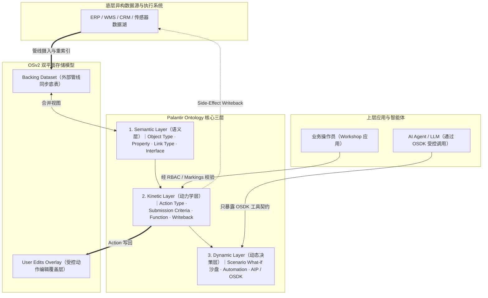

# Palantir 原理与 OpenOntology 架构对比（优势与不足）

> 本文档面向架构师与领域建模开发者，从 **Palantir Foundry（OSv2）与 AIP 的底层第一性原理**出发，对照分析 **OpenOntology** 的工程映射、核心创新优势以及当前的客观局限与演进方向。平台元模型宪法见 [ARCHITECTURE.md](ARCHITECTURE.md)。

---

## 0. 为什么企业系统与 AI Agent 需要 Ontology？

传统企业软件以 **数据库表 + CRUD 接口** 为中心构建，这种范式在人类点击表单的时代尚可运转，但在引入 AI Agent 与跨系统协同后，会集中暴露出四类结构性矛盾：

1. **IT 碎片化与语义鸿沟**：客户、订单、库存分散在 CRM、ERP、WMS 的几十张技术表里（例如 Odoo 的 `res.partner`、`sale.order`、`stock.picking`），LLM 或业务人员面对的是一堆表名与外键，而非清晰的业务语义。
2. **裸 CRUD 破坏业务不变量**：传统 API 往往只校验单接口字段类型，无法守住跨对象的全局法则（如“欺诈分 ≥ 70 或超 30 天退货期禁止退款”、“入库数量不得突破仓库剩余库容”）。
3. **数据源与决策叠加态冲突**：外部 ERP/CRM 定时同步刷新底表时，容易覆盖掉分析人员或 AI 刚刚标注的风险评级、处置备注与人工覆写值。
4. **概率性大模型直接操作生产系统的风险**：如果把 REST API 或 SQL 直接交给 Agent 调用，一旦发生幻觉参数、网络重试重复提交、并发抢占或越权访问，就会直接污染生产账本，且缺乏事后精确冲正手段。

**Ontology（企业数字孪生本体）** 的本质，就是在所有底层 IT 系统与上层调用方（人类/AI Agent）之间，构建一层 **“带语义图谱、受控动力学动作、安全门禁与沙盘推演能力的决策操作系统”**。

---

## 一、 Palantir（Foundry OSv2 & AIP）的核心原理

Palantir Foundry 与 AIP 围绕 **Semantic（语义）· Kinetic（动力学）· Dynamic（动态决策）** 三位一体构建：

### 1.1 数字孪生三层架构
* **Semantic Layer（语义层）**：用领域语言将底层数据集映射为 **Object（实体对象）**、**Property（属性）**、**Link（有向关系边）** 与 **Interface（跨类型多态接口）**，把“物理表”统一投影为“业务对象图”。
* **Kinetic Layer（动力学层）**：彻底废除裸 CRUD，一切状态变更必须封装为 **Action（具名业务动作）**。Action 内置 **Submission Criteria（准入/不变量条件）**、只读推演 **Function** 与 **Action Log（因果账本）**，保证每一次变化都知道“谁、何时、基于什么前提、改了哪些对象”。
* **Dynamic Layer（动态决策层）**：在确定性的对象与动作之上，允许人类或 AI 启动 **Scenario（平行沙盘推演）**、配置事件驱动的 **Automation（自动化条件反射）**，并通过 **OSDK（Ontology SDK）** 让大模型安全参与决策。

### 1.2 OSv2 双平面存储模型（Backing Dataset + User Edits）
Palantir Object Storage v2 最核心的工程设计之一，是将 **外部数据源同步层（Backing Dataset）** 与 **Ontology 动作编辑层（User Edits）** 分离：
* 外部 ERP/CRM 数据更新时，同步管线重刷 Backing Dataset；
* 通过 Action 修改的业务属性或自有对象保存在 Edit 覆盖层中，查询时自动合并投影，从而保证“外部快照重刷不冲掉本体决策状态”，并支持在冲突时进行精细化裁决（Reindexing / Conflict Resolution）。

### 1.3 安全与因果治理（Markings + RBAC + Action Log）
* **行级安全标签（Markings / Classification）**：权限不只管“能不能进菜单”，而是跟随对象实例的字段标签走（例如 `region:north`、`clearance:secret`），调用方不具备对应标签则对象在查询中不可见。
* **确定性准入铁笼**：无论前端按钮还是后台 AI，调用 Action 都必须经过 RBAC 角色检查、参数 Schema 检查与 Submission Criteria 业务规则校验。

### 1.4 AIP 的核心哲学：用确定性本体关住概率性大模型
Palantir AIP 不相信仅靠 Prompt 就能约束大模型。它的哲学是分工隔离：
* **LLM 负责“概率性理解与方案生成”**：读取 OSDK 暴露的强类型函数与动作 Schema，理解上下文并提出候选项；
* **Ontology 负责“100% 确定性的校验与执行”**：所有业务计算（Function）、What-if 模拟（Scenario）、权限检查（RBAC/Markings）和物理落库（Action）全部在确定性代码中完成。

---

## 二、 Palantir 与 OpenOntology 的核心概念映射

OpenOntology 完整继承了 Palantir Foundry/AIP 的核心原理，并将其精简为一个纯 Python + SQLite 的微内核架构（`open_ontology/`）：

| 哲学维度 | Palantir Foundry / AIP 原语 | OpenOntology 对应实现 | 所在模块 |
|---|---|---|---|
| **领域模型与业务世界** | Ontology Metadata / Workspace | `OntologySpec`（M1 世界法则容器）+ 隔离 `World / 业务世界`（代码兼容别名 `Workspace`） | [spec.py](file:///Users/guci/work/open-ontology/open_ontology/spec.py)、[workspaces.py](file:///Users/guci/work/open-ontology/open_ontology/workspaces.py) |
| **语义层（TBox）** | Object Type / Link Type / Interface | `ObjectType`（Pydantic 基类）、`LinkType`、`InterfaceType` | [spec.py](file:///Users/guci/work/open-ontology/open_ontology/spec.py) |
| **动力学层（Behavior）** | Function / Action / Automation | `FunctionDef`（只读）、`ActionDef`（受控写）、`AutomationDef`（条件反射） | [spec.py](file:///Users/guci/work/open-ontology/open_ontology/spec.py) |
| **集合代数与遍历** | ObjectSet / SearchAround / Aggregate | `ObjectSet`（去重保序集合代数）、`pivot`、`aggregate` | [query.py](file:///Users/guci/work/open-ontology/open_ontology/query.py) |
| **OSv2 双平面与摄入** | Backing Dataset + User Edits + Reindex | `SnapshotIngestionDriver`（`load_snapshot` / `load_mdo_snapshots`）+ `ontology_objects` + `ontology_overlay` | [ingestion.py](file:///Users/guci/work/open-ontology/open_ontology/ingestion.py)、[schema.sql](file:///Users/guci/work/open-ontology/open_ontology/schema.sql) |
| **沙盘先行与变更集** | Scenarios / Edits | `EditBatch` 内存沙箱 + 可逆 `ObjectDiff`（`simulate_action` 与 `submit_action` 同路径） | [sandbox.py](file:///Users/guci/work/open-ontology/open_ontology/sandbox.py) |
| **安全、并发与审批铁笼** | Markings / RBAC / Column Masking / OCC / Approvals | 七大系统调用切面：`ColumnMaskingAspect`、`SecurityAndAuthorityAspect`、`IdempotencyAndOCCAspect`、`ApprovalGateAspect`、`RejectionAuditAspect`、`AutomationReflexAspect`、`IdleAwareCallbackAspect` | [aspects.py](file:///Users/guci/work/open-ontology/open_ontology/aspects.py) |
| **写防线与因果账本** | No-CRUD Guardrail + Action Log | `ontology_write_gate` 触发器（5 张业务表 + 1 张门禁表）+ `ontology_action_runs` 追加式账本 | [schema.sql](file:///Users/guci/work/open-ontology/open_ontology/schema.sql) |
| **AI 工具与评测** | OSDK + AIP Agent + AIP Evals | `export_llm_tools` + `AIPAgentExecutor` + 基于 `ObjectDiff` 的确定性评测 `run_eval_suite` | [osdk.py](file:///Users/guci/work/open-ontology/open_ontology/osdk.py) |
| **动态世界模型推演** | 多步 Scenario 推演 | `runtime.fork()` 平行沙盘 + `OntologyMCTSPlanner` 蒙特卡洛树搜索规划器 | [runtime.py](file:///Users/guci/work/open-ontology/open_ontology/runtime.py)、[mcts.py](file:///Users/guci/work/open-ontology/open_ontology/mcts.py) |

---

## 三、 OpenOntology 的核心优势

相比重型商业套件或普通 Agent 框架，OpenOntology 在保留 Palantir 灵魂的同时形成了 6 项独特优势：

### 3.1 极致轻量的“操作系统式微内核”与零重型依赖
* Palantir Foundry 依赖庞大的分布式集群（Spark、Flink、Cassandra、Phonograph 与重型控制面）；而 OpenOntology 将整个内核收束在不足 **1400 行**的微内核（[runtime.py](file:///Users/guci/work/open-ontology/open_ontology/runtime.py) 当前 1388 行）与同构的 **6 张 SQLite 表**（[schema.sql](file:///Users/guci/work/open-ontology/open_ontology/schema.sql)）中。
* 支持 `:memory:` 与本地 `.sqlite3` 无缝同构，模型即 Python 代码模块（Pydantic + 装饰器），无需 Kafka 或外部 RDF/OWL 图数据库即可单进程秒级拉起完整治理环境，非常适合嵌入式控制面、边缘业务与敏捷团队落地。

### 3.2 原生支持 `runtime.fork()` 平行宇宙与 MCTS 世界模型树搜索
* OpenOntology 将确定性本体直接作为 **Symbolic World Model（符号世界模型）**：借助 SQLite 原生 `Connection.backup()` 实现的 `runtime.fork()`（[runtime.py](file:///Users/guci/work/open-ontology/open_ontology/runtime.py#L164-L175)），可以在毫秒内克隆出与主库 100% 物理隔离的内存平行宇宙。
* 结合 [mcts.py](file:///Users/guci/work/open-ontology/open_ontology/mcts.py) 的 `OntologyMCTSPlanner`，Agent 可以像 AlphaGo 一样执行 `Selection (PUCT) → Expansion（InvariantError 自动剪枝）→ Rollout → Backpropagation` 多步前瞻搜索，选出全局最优动作序列后再原子提交回主空间。这是传统 ERP 与大多数 Agent 工具框架完全不具备的能力。

### 3.3 清晰的“寄居吸纳 → 平滑接管 → 一键拔插头（SaaS Unplug）”主权演进路径
* 针对企业“不愿一次性推翻旧 CRM/ERP”的现实痛点，OpenOntology 通过类级 `__owned__` 声明与 `SecurityAndAuthorityAspect` 强制校验 `source`（外部同步）与 `ontology`（本体自有）两个主权平面，配合 `post_approval` 两段式审批追加机制。
* 企业可先作为“外挂增强层”吸纳外部软件快照（支持多源按列 MDO 拼接与时间戳/自有优先冲突裁决）并叠加 AI 治理属性；待业务闭环成熟后，只需将 `__owned__` 晋升为 `True`，即可物理断开外部 SaaS（参考 [real_crm_unplug_demo.py](file:///Users/guci/work/open-ontology/examples/real_crm_unplug_demo.py)），上层 `ActionDef` 与 Agent 代码一行不改独立运行。

### 3.4 符号主义（OpenAPI）与联结主义（A2A Agent Card）双标准设备统一治理
* 传统架构往往只把数据库/API 当数据源。OpenOntology 在 M2 架构中将 **符号主义设备（OpenAPI Schema）** 与 **联结主义设备（A2A Agent Card，如 CodeBuddy / OpenCode 宿主）** 平等抽象为外围 `Device`。
* 外部概率性智能体的任何产出与回执，均经 `ExecutionFabric` 织入观察并通过 `IdleAwareCallbackAspect` 忙闲感知防吞调度，最终必须经过确定性 `ActionDef` 的 `InvariantError` 验收门禁才允许进入 ABox。

### 3.5 被拒审计、精确逆向冲正与无 LLM 裁判的确定性评测
* **被拒企图完整入账**：Agent 因违反不变量被拒的尝试，不会悄无声息消失，而是由 `RejectionAuditAspect` 记入 `ontology_action_runs (status='REJECTED')`，为安全审计和模型调优留下完整证据。
* **可逆因果冲正**：每次落库记录精确的 `ObjectDiff` 与版本前后值，通过 `runtime.revert_action` 可带冲突检测地逆向冲正历史动作。
* **确定性 AIP Eval**：[osdk.py](file:///Users/guci/work/open-ontology/open_ontology/osdk.py) 的 `run_eval_suite` 直接对比 Agent 产出的 `ObjectDiff` 与预期终局差集，无需引入不稳定的 “LLM-as-a-Judge”。

### 3.6 工程纪律固化为自动化架构门禁（Architectural Fitness Functions）
* 仓库将微内核行数预算（`runtime.py <= 1400`）、切面零反向依赖、通用 UI 零领域字段泄漏、核心词典零业务膨胀、六表纯洁性与无损预检全部固化在 `pytest` 门禁测试中，防止系统在快速迭代中退化为泥球架构。

---

## 四、 OpenOntology 当前的不足与局限

从生产级工程视角审视，OpenOntology 面向“轻量、确定性、强治理的业务控制面”做了极致权衡，也因此存在以下 6 项客观不足与边界：

### 4.1 单机 SQLite 的写吞吐与水平扩展局限
* **现状**：当前 `OntologyRuntime(spec, db_path)` 绑定单个 SQLite 存储（WAL 模式），全部核心事实与审计账本落在一份单机库中。
* **不足**：虽然非常契合中小规模核心状态机与控制面决策（数千至数万级核心业务对象），但无法像 Palantir Foundry 那样横向扩展到 **PB 级海量数据湖、高并发高吞吐 OLTP 写流（每秒上万并发修改）或多地域分布式集群**。

### 4.2 `runtime.fork()` 基于全库备份拷贝，超大规模状态图下分叉成本上升
* **现状**：`runtime.fork()` 通过 SQLite 原生 `Connection.backup()` 将整库复制到 `:memory:` 实例中（[runtime.py](file:///Users/guci/work/open-ontology/open_ontology/runtime.py#L164-L175)），并非操作系统内存页级 Copy-on-Write（CoW）。
* **不足**：当工作空间中累计了大量历史 `ontology_action_runs` 或十万级以上对象时，MCTS 搜索中高频调用 `fork()` 会带来线性增长的内存占用与拷贝延迟，需要定期归档或控制分叉频率。

### 4.3 查询层在 Python 内存侧过滤与聚合，缺少索引下推与分布式图查询
* **现状**：从 [runtime.py](file:///Users/guci/work/open-ontology/open_ontology/runtime.py#L574-L595) 可见，`query_objects` 先通过 `load_all(object_type)` 将该类型所有行加载并反序列化，再在 Python 侧逐行校验 `actor.has_access`、应用 `filters` 谓词和列脱敏。
* **不足**：当单个 `ObjectType` 实例规模达到数十万行时，缺乏 SQL 谓词下推（JSON 索引 / 生成列索引）、分页游标与多跳原生图查询优化，全量加载会成为读性能瓶颈。

### 4.4 单 Runtime 绑定单模型，且缺少在线 Schema 演进（Migration）工具链
* **现状**：规范明确当前 `OntologyRuntime` 只绑定单个 `OntologySpec`，模型随 Python 代码发布；`ontology_objects` 以 JSON 序列化属性存盘（[schema.sql](file:///Users/guci/work/open-ontology/open_ontology/schema.sql#L39-L49)）。
* **不足**：当业务模型发生字段重命名、必填字段新增或类型变更时，目前缺乏声明式的历史存量对象自动迁移（Schema Migration / Backfill）与版本共存框架，需要应用层自行编写数据清洗脚本；同时尚不支持单个引擎内动态热插拔/多模型联邦查询。

### 4.5 写门禁属于“同进程工程护栏”，且 Python 闭包逻辑难以跨语言静态校验
* **现状**：`ontology_write_gate` 触发器防范的是同一连接内的误写（Accidental-CRUD Guardrail），而非隔离同进程恶意特权代码的操作系统级沙箱；同时 `ActionDef` 的 `handler`、`approval_rule`、`AutomationDef.condition` 均为 Python 函数/闭包。
* **不足**：业务逻辑无法像纯声明式 DSL/OWL 那样直接跨语言序列化给前端/外部网关做静态推理或可视规则编排，仍依赖 Python 运行时执行；多租户运行不可信第三方插件代码时，仍需配合进程/容器级隔离。

### 4.6 外部系统双向同步仍依赖编写适配器（PSM），缺少海量标准化连接器生态
* **现状**：虽然 `ingestion.py` 提供了 MDO 多源拼接与冲突裁决驱动，但对接具体外部系统（如 Odoo、BottleCRM 或企业自研 WMS）的 API 拉取与已提交运行写回，仍需按领域编写 Python 适配器（如 [odoo_o2c_adapter.py](file:///Users/guci/work/open-ontology/examples/odoo_o2c_adapter.py)）。
* **不足**：相比 Palantir Foundry 开箱即用的数百种商业 SaaS / CDC 流式连接器、可视化 Data Lineage 血缘与低代码 Pipeline Builder，OpenOntology 目前面向开发者代码集成，无代码可视化接数能力较弱。

---

## 五、 总结与选型对照

| 维度 | Palantir Foundry / AIP | OpenOntology |
|---|---|---|
| **定位** | 企业级重型全栈数据与决策操作系统 | 轻量级、嵌入式、AI 原生微内核本体引擎 |
| **基础设施门槛** | 高（分布式集群、Spark/Flink/专用存储、商业授权） | 极低（纯 Python + SQLite，零重型中间件，毫秒级单测与 `:memory:` 启动） |
| **强项** | PB 级多源数据融合、大规模 BI/应用编排、海量连接器生态 | MCTS 世界模型树搜索、SaaS 平滑拔插头（`__owned__`）、确定性 Diff 评测、A2A Agent 统一治理 |
| **适用场景** | 大型集团跨几十套系统的重资产数字化底座 | 垂直领域核心决策系统、AI Agent 受控执行中枢、遗留 SaaS 渐进替换、高可靠自动化工作流 |
