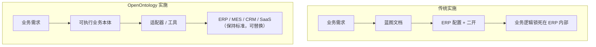
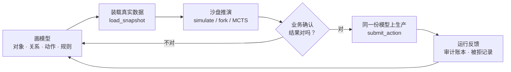
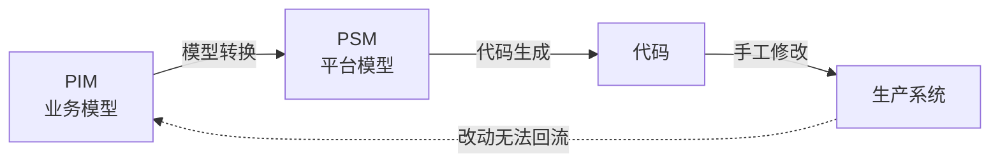
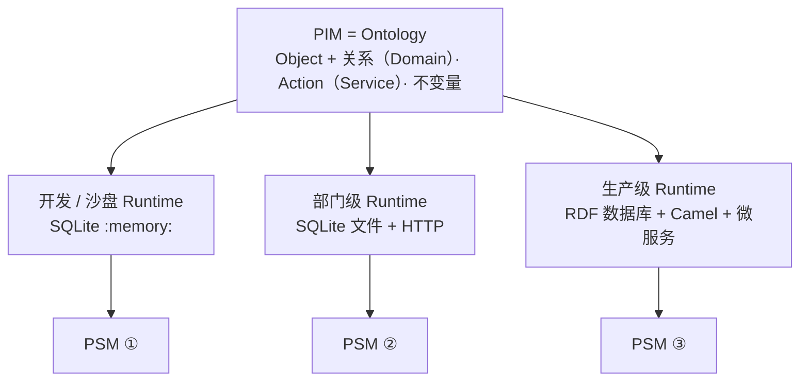
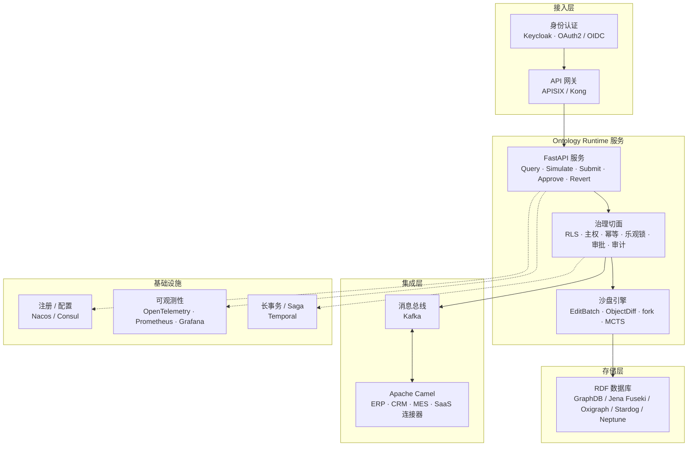
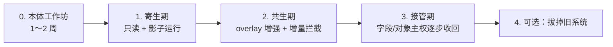

# 从“实施”视角看 OpenOntology 的使用场景

> 企业信息化真正的痛点很少是“软件功能不够”，更多是**实施**：需求说不清、二开改不完、数据迁不动、上线切不过去、上线后没人用、顾问走了没人懂。
> 本文从实施痛点出发，回答一个问题：**OpenOntology 能让实施变得更容易吗？在哪些场景里？**

---

## 一、企业信息化实施的十大痛点

| # | 痛点 | 典型症状 |
|---|---|---|
| 1 | **需求翻译失真** | 业务说不清，顾问听不懂；蓝图文档几百页，签字时没人细看，上线才发现“不是我要的” |
| 2 | **二开泛滥** | 标准产品不贴合，大量二开；版本锁死，升级等于重新实施 |
| 3 | **主数据困境** | 散码不敢合并、部门口径冲突、清完又脏、跨系统身份断裂；“先清洗再上线”导致项目无限延期（详见第六节） |
| 4 | **大爆炸切换** | 新旧系统一刀切，失败回不去；上线周末全员通宵 |
| 5 | **集成烟囱** | 点对点接口 N×N；接口一出问题，几个厂商互相甩锅 |
| 6 | **需求变化快** | 实施周期 1～2 年，上线时业务已经变了；变更单（CR）无休止扯皮 |
| 7 | **推行阻力** | 一线员工嫌录入麻烦，系统外再跑一套 Excel |
| 8 | **验收扯皮** | 验收标准模糊，“能用”与“好用”之间无法量化 |
| 9 | **知识流失** | 顾问撤场后配置没人懂，文档与系统早已不一致 |
| 10 | **厂商锁定** | 系统换不掉，信创替换、并购整合时代价巨大 |

传统方法论（如“项目准备 → 蓝图设计 → 系统实现 → 上线准备 → 上线支持”）的根本问题是：**把业务逻辑直接实现进某个具体系统**。业务逻辑与系统绑死，于是需求、二开、迁移、切换、锁定所有问题都连在一起。

---

## 二、OpenOntology 的解法：把“业务逻辑”从“系统”里剥离出来



核心转变：

1. **蓝图即系统**：本体（对象、关系、规则、动作）本身可运行，不再是只能“读”的文档——这就是**可执行 UML**，沙盘推演就是模型验证（详见第三节）。
2. **ERP 回归标准**：差异化逻辑放在本体层，ERP 尽量零二开。
3. **寄生而不是替换**：先在老系统上“长”出来，再逐步收回主权，而不是一刀切。
4. **规则即验收**：业务规则是可执行的不变量，验收可以自动化、可量化。

---

## 三、可执行 UML：沙盘推演就是可执行建模

> 实施最大的浪费，是**蓝图设计阶段画的模型不能运行**。UML 类图、状态图、BPMN 流程图画了几百页，要等系统开发完才能验证对错，那时改动代价已经是最高的。
> OpenOntology 的沙盘推演，本质上就是**可执行 UML（Executable UML）**：模型画出来就能跑，在沙盘里用真实数据推演，确认无误后**同一份模型**直接上生产。

### 3.1 可执行 UML 是什么，为什么当年没成

可执行 UML（xtUML、Shlaer-Mellor、OMG fUML/Alf、MDA）的理想是：

- 用**类图**描述业务结构，用**状态机**描述生命周期，用**动作语言**描述行为，用 **OCL 约束**描述规则；
- 模型本身可执行、可测试，与平台无关（**PIM**）；
- 再通过模型编译器生成具体平台实现（**PSM**）。

理想很好，但在企业信息化中基本没有落地，原因是：

| 失败原因 | 说明 |
|---|---|
| 模型脱离真实数据 | 模型只能在玩具数据上跑，无法接入现有 ERP 的真实存量 |
| 模型编译器太难 | PIM → PSM 的代码生成复杂、难调试，生成的代码没人敢改 |
| 模型与生产两张皮 | 上线后开发直接改代码，模型很快过期 |
| 工具链昂贵封闭 | 建模工具专业、昂贵，业务人员无法参与 |
| 动作语言小众 | Alf、OAL 等专用语言表达力受限，工程师不愿学 |
| 没有治理语义 | 模型能执行，但没有权限、审批、审计、回滚，进不了生产 |

### 3.2 表达能力：Object + 关系 = Domain，Action = Service

OpenOntology 的建模原语只有两类，**但表达能力已经足够**：

| OpenOntology | 软件工程中的对应 | 说明 |
|---|---|---|
| **Object + 关系** | **Domain（领域模型）** | 业务世界的结构：有哪些东西、它们怎么关联 |
| **Action** | **Service（领域服务 / 应用服务）** | 业务世界的行为：允许发生哪些改变、按什么规则改变 |

这正是企业应用架构中最经典、最成熟的组合（Fowler《企业应用架构模式》中的 Domain Model + Service Layer，DDD 中的实体/聚合 + 领域服务）。几十年的企业系统实践证明，**Domain + Service 足以表达任何企业业务**。

与 DDD 概念的对应：

| DDD 概念 | OpenOntology |
|---|---|
| 实体 / 值对象 | `ObjectType` 及其属性 |
| 聚合根 | 聚合根对象（`workspace_id / object_type / object_id` 寻址） |
| 关联 | `ObjectProperty` / `LinkType` |
| 领域服务 / 应用服务 | `Action` |
| 不变量 | `InvariantError`，在 `simulate` 与 `submit` 两条路径强制执行 |
| 仓储（Repository） | Runtime + `ObjectSet` 查询 |
| 领域事件 | 动作审计记录 + `Automation` |
| 限界上下文 | Model / World（多模型、多世界隔离） |
| 防腐层 | 适配器 + overlay（外部系统数据进入领域前被翻译和隔离） |
| 工作单元 | `EditBatch` + 单事务原子提交 |

#### 为什么用 Python 内生 DSL，而不是另造建模语言

当年的可执行 UML 要发明专门的动作语言（Alf、OAL 等），表达能力受限、工具链封闭、没人会写。OpenOntology 选择 **Python 内生 DSL（internal DSL）**：

- **结构是声明式的**：`ObjectType`（pydantic 模型）、`ObjectProperty`、`@spec.action(...)` 的元数据都是声明，可被运行时**静态分析和导出**——自动推导表单、生成 LLM 工具 Schema、绘制关系拓扑。
- **行为是图灵完备的**：Action 体就是普通 Python 函数，循环、条件、递归、调用任意计算逻辑都可以，**任何业务规则都写得出来**。
- **图灵完备但不失控**：Action 只能操作 `EditBatch` 沙箱，不能直接写库；无论逻辑多复杂，产出都是一个可审查、可模拟、可回滚的 `ObjectDiff`。**表达能力无上限，副作用有边界。**

```python
# 示意：Domain（对象 + 关系）
class Customer(ObjectType):
    id: str
    credit_limit: int

class SalesOrder(ObjectType):
    id: str
    customer: ObjectProperty[Customer]   # 关系
    amount: int
    status: str = "draft"

# 示意：Service（Action）
@spec.action(
    name="confirm_order",
    params=ConfirmParams,
    allowed_roles=["sales", "ai_agent"],                      # 权限
    approval_rule=lambda p, actor: p.amount > 1_000_000,      # 大额需审批
)
def confirm_order(ctx, p: ConfirmParams):
    order = ctx.get(SalesOrder, p.order_id)
    if order.status != "draft":                               # 状态机即普通 Python
        raise InvariantError("只能确认草稿订单", code="BAD_STATE")
    if exposure(ctx, order.customer) + order.amount > credit_limit(ctx, order.customer):
        raise InvariantError("超出信用额度", code="CREDIT_EXCEEDED")
    ctx.modify(order, status="confirmed")
```

这样带来的实施优势：

| 维度 | 专用建模语言 | Python 内生 DSL |
|---|---|---|
| 表达能力 | 受限，复杂规则写不出来 | 图灵完备，任何规则都能写 |
| 学习成本 | 专门培训 | 会 Python 即可 |
| 生态 | 封闭 | 可直接复用 Python 全生态（数值计算、优化求解、规则引擎、机器学习） |
| 工程化 | 弱 | IDE、类型检查、pytest、Git、代码评审全部可用 |
| AI 协作 | 大模型几乎不会写 | **大模型最擅长写 Python**，AI 生成模型、生成 Action 成本最低 |
| 可分析性 | 好 | 结构部分声明式，同样可导出、可可视化 |

> **结论**：不需要发明新的建模语言，也不需要 UML 的十几种图。**Object + 关系表达 Domain，Action 表达 Service，Python 提供图灵完备的行为表达**，再由运行时提供沙盘、治理与审计——这就是一个完整的可执行建模体系。

### 3.3 OpenOntology 如何让可执行 UML 真正落地

**不生成代码，模型本身就是运行时。**

| 可执行 UML 概念 | OpenOntology 对应 |
|---|---|
| 类图（Class） | `ObjectType` + 属性（TBox） |
| 关联（Association） | `ObjectProperty` / `LinkType`，自动同步关系三元组并校验引用完整性 |
| 接口 / 泛化 | `Interface` |
| 状态机（State Machine） | 对象状态字段 + Action 中的状态前置判断；无需专门构件，Python 可表达任意状态机 |
| 动作语言（Action Language） | **Python 本身**（图灵完备）；`Action` 函数在 `EditBatch` 上操作，读得到自己的暂存修改 |
| OCL 约束 | 业务不变量（`InvariantError`）、主权边界校验 |
| 派生属性 / 查询 | `Function` + `ObjectSet` 集合代数（`pivot` / `aggregate`） |
| 事件 / 触发 | `Automation` 自动化反射 |
| 模型执行 / 仿真 | `simulate_action` 单步干跑；`fork()` 平行世界；MCTS 多步推演 |
| 对象实例图 | 世界状态（ABox）：真实对象 + 关系 + overlay |
| PIM（平台无关模型） | **Ontology 本身**（详见第四节） |
| PSM（平台相关模型） | **Ontology 在某个 Runtime 上运行起来**：存储 + 集成适配器 + 部署配置 |
| 模型编译器 | **不需要**：不根据 PIM 开发 PSM，生产级 Runtime 直接执行 PIM |

对“当年失败原因”的逐条回应：

| 当年的问题 | OpenOntology 的解法 |
|---|---|
| 模型脱离真实数据 | `load_snapshot` 寄生读取真实 ERP 数据，**沙盘里跑的就是生产数据的副本** |
| 模型编译器太难 | 不生成代码，模型即运行时 |
| 动作语言表达力弱、没人会写 | Python 内生 DSL，图灵完备，工程师与大模型都熟悉 |
| 模型与生产两张皮 | 沙盘和生产是**同一份模型、同一条执行路径**（`simulate_action` 与 `submit_action` 同路径） |
| 工具链昂贵封闭 | Python + SQLite 单文件运行；指挥台可视化，业务人员可直接操作 |
| 没有治理语义 | 写门禁、审批、乐观锁、审计、回滚内建 |

### 3.4 沙盘推演 = 模型验证



沙盘推演的三个层次：

| 层次 | 机制 | 回答的问题 |
|---|---|---|
| **单步干跑** | `simulate_action` | “执行这个动作，会改哪些对象？会不会违反规则？需要谁审批？” |
| **剧本推演** | `fork()` 平行世界中连续执行一串动作 | “按这个流程走一遍月结 / 一张订单的全生命周期，结果对不对？” |
| **自动搜索** | MCTS 在平行世界中枚举动作序列，剪掉违规分支 | “达到这个目标，有哪些合法路径？哪条最优？” |

每次推演都输出确定性的 `Before → After` Diff，**业务人员看的是自己熟悉的单据和数字，而不是 UML 图**。

### 3.5 对实施的意义

| 传统蓝图设计 | 可执行建模（沙盘推演） |
|---|---|
| 交付物是文档 | 交付物是**可运行的模型** |
| 业务签字时看的是图和文字 | 业务签字时看的是**用自己的真实数据跑出来的结果** |
| 错误在开发完成、UAT 时才暴露 | 错误在**建模当天**就暴露 |
| 蓝图 → 开发存在二次翻译 | **零翻译**：沙盘里验证过的模型就是生产模型 |
| 变更要走“改文档 → 改代码 → 回归” | 变更在 `fork` 世界里先推演，确认后发布 |
| 上线后模型过期 | 模型就是系统，永不过期 |
| 验收靠演示 | 验收靠推演剧本 + 确定性 Diff |

典型用法：

- **蓝图工作坊**：顾问和业务骨干现场建模，当场导入一部分真实数据，推演“一张订单从下单到开票”，业务当场指出哪里不对。
- **主数据归并预演**：在 `fork` 世界中试运行散码归并方案，看成本、采购、财务三方对账是否恒等，确认后再正式提交（见第六节）。
- **流程变更评审**：变更前在沙盘中跑过去一个月的业务，比较新旧规则的差异。
- **上线彩排**：切换前在平行世界中按真实数据完整演练，替代通宵的上线周末。
- **AI 生成模型的验证**：AI 根据访谈纪要生成的本体草案，先在沙盘里推演，人确认后才进入生产。

> **一句话**：可执行 UML 失败于“模型跑不了真实世界”；OpenOntology 让模型**寄生在真实世界上运行**，沙盘推演就是建模、验证与上线的同一个动作。

---

## 四、MDA：Ontology 即 PIM，运行时即 PSM

### 4.1 传统 MDA 的路线与问题

OMG 的模型驱动架构（MDA）把系统分为两层：

- **PIM（Platform Independent Model，平台无关模型）**：只描述业务，不涉及技术平台；
- **PSM（Platform Specific Model，平台相关模型）**：绑定具体数据库、中间件、框架后的模型。

传统路线是 **PIM →（模型转换）→ PSM →（代码生成）→ 代码**：



问题在于：

| 问题 | 后果 |
|---|---|
| 每个平台都要写一套转换规则 | 转换器本身成为最难维护的软件 |
| 生成的代码需要手工修改 | 改完就和模型脱节，模型变成一次性文档 |
| PIM 不能直接运行 | 业务正确性要等代码生成、部署后才能验证 |
| 换平台要重新生成、重新改 | MDA 承诺的“平台无关”在实践中落空 |

### 4.2 OpenOntology 的路线：不转换，不生成，直接运行

**Ontology 就是 PIM。我们不根据 PIM 开发 PSM，而是构造一个生产级 Runtime——Ontology 在某个 Runtime 上运行起来，就是 PSM。**



| 维度 | 传统 MDA | OpenOntology |
|---|---|---|
| PIM 的形态 | UML 图 / XMI 文件 | Python 内生 DSL（可执行） |
| PIM → PSM | 模型转换 + 代码生成 | **无转换**：Runtime 直接解释执行 PIM |
| PSM 是什么 | 生成出来的平台模型和代码 | **PIM × Runtime 绑定**（存储 + 集成 + 部署配置） |
| 平台相关的工作 | 每个项目都要做 | **只做一次**：沉淀进 Runtime，所有业务模型复用 |
| 业务变更 | 改 PIM → 重新转换 → 重新合并手改代码 | 改 PIM → 沙盘验证 → 直接发布 |
| 换平台 | 重写转换器、重新生成 | 换 Runtime，PIM 一行不改 |

一句话：**PSM 不是开发出来的，是运行出来的。** 平台工程的投入集中在 Runtime 上，一次构建、所有 Ontology 复用，这是对 MDA 理想的一次工程化兑现。

### 4.3 Runtime 分级：同一份 PIM，多种 PSM

| 级别 | 存储 | 集成 | 部署 | 适用 |
|---|---|---|---|---|
| **L0 沙盘** | SQLite `:memory:` | 无 / Mock | 单进程 | 建模、推演、单元测试、AI 生成模型的验证 |
| **L1 部门级**（当前实现） | SQLite 文件 | Python 适配器 + Quarkus/Camel 工程 | 单机 HTTP 服务 | 试点、部门系统、边缘场景 |
| **L2 生产级**（可选，规划） | RDF 数据库 | Apache Camel 集成总线 | 微服务集群（Spring Cloud 对应的 Python 技术栈） | 集团级、高可用、多系统集成 |

`fork()` 出的平行世界始终可以落在 L0 上，因此**生产环境也能随时开沙盘**。

### 4.4 可选的生产级 Runtime 技术栈



#### ① 存储：SQLite → RDF 数据库

Ontology 本身就是 TBox / ABox、对象与三元组关系，**RDF 是它最自然的存储形态**：

| Ontology 概念 | RDF / 语义网映射 |
|---|---|
| `ObjectType` | `owl:Class` / `rdfs:Class` |
| 普通属性 | `owl:DatatypeProperty` |
| `ObjectProperty` / 关系三元组 | `owl:ObjectProperty`，`ontology_links` 本来就是三元组 |
| `Interface` / 泛化 | `rdfs:subClassOf` |
| 结构性不变量 | **SHACL** Shapes（基数、类型、取值范围）；复杂业务规则仍由 Python Action 表达 |
| 字段主权：source-backed / overlay | **命名图（Named Graph）分离**：源系统快照图 vs Ontology 自有图，重刷只替换源图 |
| 审计账本 | 追加写的审计命名图，用 **PROV-O** 描述“谁、何时、因何改变了什么” |
| RLS 安全标签 | 按命名图 / 安全标签过滤的 SPARQL 查询改写 |
| 查询 / `pivot` / `aggregate` | SPARQL 1.1（属性路径、聚合） |
| `describe_tbox` | 直接导出 OWL + SHACL，可被其他语义系统消费 |
| `fork()` 平行世界 | 数据集快照 / 命名图拷贝；或沙盘仍在 L0 内存中运行 |

候选：GraphDB、Apache Jena Fuseki（TDB2）、Oxigraph（Rust 实现，有 `pyoxigraph` 绑定）、Stardog、Virtuoso、Amazon Neptune；Python 侧用 `rdflib` / `SPARQLWrapper` / `pyshacl` 访问与校验。

额外收益：企业本体可以复用行业标准词汇（如 schema.org、FIBO 金融本体、GS1 供应链），跨组织数据交换天然语义对齐。

#### ② 集成：Apache Camel

- 沿用现有 Quarkus + Camel 工程方向，作为 ERP / CRM / MES / SaaS 的统一连接层；
- Camel 拥有数百个现成组件，弥补“每接一个系统都要写适配器”的短板；
- Runtime 与 Camel 之间通过 HTTP / Kafka 交互：Camel 负责协议与格式，**Runtime 负责业务语义与治理**。

#### ③ 微服务基础设施：Spring Cloud 对应的 Python 技术栈

| Spring Cloud 组件 | 职责 | Python 对应 |
|---|---|---|
| Spring Boot / WebFlux | Web 服务框架 | **FastAPI** + Uvicorn（异步、自动 OpenAPI） |
| Spring IoC | 依赖注入 | FastAPI `Depends` / `dependency-injector` |
| Spring Cloud Gateway | API 网关 | APISIX / Kong / Envoy（语言无关） |
| Eureka / Nacos Discovery | 服务注册发现 | Nacos / Consul（`nacos-sdk-python`、`python-consul`） |
| Spring Cloud Config | 配置中心 | Nacos / Apollo / etcd + `pydantic-settings` |
| OpenFeign | 声明式服务调用 | `httpx` + 生成的 OpenAPI 客户端 / gRPC |
| Resilience4j / Hystrix | 熔断、重试、限流 | `tenacity`、`pybreaker`、网关限流 |
| Spring Cloud Stream | 消息驱动 | Kafka（`aiokafka` / `confluent-kafka`）、FastStream |
| Sleuth / Micrometer | 链路追踪与指标 | **OpenTelemetry** Python SDK + Prometheus |
| Spring Security OAuth2 | 认证授权 | Keycloak + `Authlib`，映射为 Ontology `Actor` |
| Seata / Saga | 分布式事务 | **Temporal** Python SDK（跨系统长事务、补偿） |
| Spring Scheduler / Batch | 定时与批处理 | Celery / APScheduler |
| — | 统一 sidecar（可选） | Dapr（状态、发布订阅、服务调用与语言无关） |

部署：容器化 + Kubernetes；Runtime 无状态横向扩展，状态全部在 RDF 数据库与消息总线中。

### 4.5 关键设计约束：换 Runtime，不换语义

生产级 Runtime 必须**行为等价**于当前实现，否则“同一份 PIM”就是空话：

| 约束 | 要求 |
|---|---|
| **存储抽象（SPI）** | Runtime 内核通过存储接口访问数据，SQLite 与 RDF 是两种实现，Ontology 代码不感知 |
| **写门禁等价** | 当前依赖 SQLite 触发器物理拦截；RDF 侧需改为：只有 Runtime 服务账号持有写权限 + 写操作必须经治理管线 + 数据库级访问控制 |
| **事务与乐观锁** | 单次提交的对象、关系、审计必须原子；`read_versions` 校验语义不变 |
| **审计不可篡改** | 审计图只追加，数据库层禁止删除 |
| **一致性测试（TCK）** | 同一套 pytest 用例在 L0 / L1 / L2 上全部通过，作为 Runtime 合规的准入标准 |

> [!NOTE]
> 当前仓库实现的是 L0 / L1（SQLite + Python 适配器 + Quarkus/Camel 工程）。架构文档明确现阶段不引入外部 RDF/OWL 存储；L2 生产级 Runtime 是可选的演进方向，需要先完成存储 SPI 抽象与写门禁的等价实现。

### 4.6 对实施的意义

| 实施问题 | MDA 视角下的回答 |
|---|---|
| 试点用轻量技术，推广要重写？ | 不用：L1 试点验证过的 PIM 原样部署到 L2 |
| 客户 IT 标准不同（有的要 Java 体系、有的要国产数据库）？ | 只需适配 Runtime 的存储 / 集成实现，业务模型不动 |
| 实施商每个项目都要搭技术平台？ | 平台工程沉淀在 Runtime，项目只做 PIM 建模 + 连接器配置 |
| 技术栈过时怎么办？ | 技术栈是 Runtime 的事，换 Runtime 不影响业务资产 |
| 业务资产是什么？ | **PIM 就是企业的业务资产**，独立于任何厂商、任何技术平台 |

> **一句话**：传统 MDA 想靠“生成代码”跨越平台，失败在转换器与手改代码；OpenOntology 让 PIM 直接在不同等级的 Runtime 上运行——**模型只写一次，平台随需替换**。

---

## 五、痛点 → 机制 对照

| 实施痛点 | OpenOntology 机制 | 效果 |
|---|---|---|
| 需求翻译失真 | 可执行 UML：模型即运行时，沙盘中用真实数据推演；指挥台可视化拓扑；AutoID / ObjectProperty 自动推导表单 | 调研第一周就能拿可操作的原型和业务对话，**零二次翻译** |
| 二开泛滥 | 差异化字段放 overlay（`__owned__`），差异化逻辑放 Action | ERP 保持标准，升级不受影响 |
| 主数据困境 | `load_snapshot` 直接读老数据；overlay 归并脏数据而不改源表 | **不用先清洗再上线**，边用边治 |
| 大爆炸切换 | 寄生 → 共生 → 接管，字段级逐步收回主权；`simulate` 干跑；`revert` 回滚 | 每一步都可回退，切换风险被切碎 |
| 集成烟囱 | 本体作为语义中枢，外部系统通过适配器接入；透明切面统一审计溯源 | N×N 变 N×1，问题可追到具体调用 |
| 需求变化快 | 规则声明式修改；`fork` 平行世界先验证变更影响 | 变更从“改代码”变成“改模型 + 回归” |
| 推行阻力 | 自动导出 Agent 工具，一线用自然语言/IM 操作，背后照样受治理 | 降低录入负担，减少“系统外 Excel” |
| 验收扯皮 | 业务场景脚本 + 确定性 `ObjectDiff` + 被拒记录 | 验收标准写成可运行用例 |
| 知识流失 | `describe_tbox` / `describe_behavior` 导出即文档；审计账本记录每次变更 | 模型就是文档，永不过期 |
| 厂商锁定 | 业务蓝图不依赖具体系统，换系统 = 换适配器 | 信创替换、并购整合代价可控 |

---

## 六、主数据困境：实施失败的第一根源

> 几乎所有 ERP / MES / CRM 项目延期、上线后数据对不上、报表算不准，追到最后都是**主数据**问题。主数据不是一个“清洗任务”，而是一组结构性的死结。

### 6.1 五个死结

#### 死结 1：存量脏码不敢合并
- 采购为了签合同、开发票，同一种物料随手建了好几个编码；销售为了报价，同一个客户建了好几个档案。
- 这些码**已经挂着历史凭证、发票、库存和财务账**。合并 = 改历史，财务不同意、审计不同意、系统也不支持。
- 结果：明知是重复的，也只能放着，越积越多。

#### 死结 2：多视角口径冲突，一维编码装不下
- 同一批物料，**采购按规格管、生产按厂家管、财务按开票名目管、销售按客户料号管**。
- 传统做法是“统一编码”：选一个视角做主键，其他视角被迫降维。
- 降维是**有损**的：例如某厂家同时供应一级品和二级品，MES 按厂家报工后回传 ERP，就分不清消耗的是哪个规格，成本被平均化，**算歪了**。
- 部门之间为“到底按谁的口径编码”争论不休，主数据项目变成部门政治。

#### 死结 3：清完又脏，增量失控
- 花半年清洗完，业务为了赶单继续随手建码；或者绕开 MDM 系统直接在 ERP 里建。
- 主数据质量是一个**持续流入**的问题，一次性清洗注定失败。

#### 死结 4：跨系统身份断裂
- 同一个客户/供应商/物料在 CRM、ERP、MES、财务系统里有不同 ID，靠人工维护映射表。
- 映射表一旦过期，跨系统流程（订单 → 生产 → 发货 → 开票）就在某个环节断链。

#### 死结 5：传统 MDM 的悖论
传统 MDM 软件的标准路线是：


- 每一步都要先完成才能进入下一步，**前置条件太重**，项目周期以年计；
- MDM 本身变成又一个需要集成的烟囱；
- 最终管不住源头：只要业务系统还能自己建码，MDM 就会被绕过。

### 6.2 OpenOntology 的破局思路

**核心观念转变：编码 ≠ 实体。不追求“一物一码”，而追求“一码一归属”。**

| 传统思路 | 本体思路 |
|---|---|
| 把所有编码合并成一个“黄金记录” | 编码（业务名目）和实体（物理规格、法人主体）建模为**不同对象**，用关系连接 |
| 选一个视角做主编码，其他视角降维 | **多视角共存**：一个高维对象同时挂多条正交关系，各部门保留自己的口径 |
| 先清洗，后上线 | **先止血，后清洗**：增量先管住，存量边用边归并 |
| 改源系统数据 | **源系统零改动**：归并关系写在 overlay，财务账、发票原封不动 |
| MDM 是一个独立系统 | 主数据规则是本体的一部分，**在业务动作发生时就生效** |

#### 机制 1：存量 → overlay 寄生归并
- 每个老散码作为 source-backed 对象原样保留，归并关系（“这个码属于哪个标准规格/哪个法人”）作为 Ontology 自有字段写入 overlay。
- 源系统每天全量重刷，overlay 依然存活（`load_snapshot` 重新覆盖）；会导致孤儿的重刷直接拒绝并回滚。
- 财务账、发票、历史凭证**一个字都不动**，合并风险为零；归并错了可 `revert_action` 撤回。

#### 机制 2：多视角 → 高维对象 + 正交关系
- 在业务流转的关键节点（如入库口）截留完整信息，构建高维对象（如“批次”），同时锁住**规格、厂家、发票名目、价格**多条关系。
- 下游即使只按单一视角操作（如车间只按厂家报工），本体也能沿关系边**无损还原**其他视角：
  - 成本视角：按厂家汇总；
  - 采购视角：按规格拆分；
  - 财务视角：按开票名目对账；
  - **三方总量、总金额恒等**。
- 各部门不需要统一口径，也就不需要打架。

#### 机制 3：增量 → Action 硬护栏
- 新建编码必须走 Action：不绑定标准实体的野码、属性与规格不符的错配，**当场拦截**，并以 `REJECTED` 记入审计账本。
- 真正的新品种（全厂首次采购的新规格、新客户主体）自动挂起 `PENDING_APPROVAL`，由主数据管理员签批后生效。

#### 机制 4：防旁路 → 三把锁
| 锁 | 作用 |
|---|---|
| **写门禁锁** | SQLite 触发器物理拦截一切绕过运行时的写入，包括 AI 与脚本 |
| **下游卡位锁** | 源系统里偷偷新建、未经治理的码，在进入下游流程（入库、领料、开票）时被识别为“黑户”并卡住 |
| **源头收权锁** | 逐步收回源系统中人工建码的权限，统一走本体 Action |

前两把锁让旁路**没有意义**（建了也用不了），第三把锁让旁路**没有机会**。

#### 机制 5：跨系统身份 → 关系而非映射表
- CRM 客户、ERP 客户、财务开票主体都是对象，“是同一主体”是一条有版本、有审计的关系；
- 通过 `pivot` 在关系上跳转，跨系统流程不再依赖人工维护的映射表。

### 6.3 这种结构在各行业普遍存在

| 行业 | 多视角冲突 | 存量脏码 |
|---|---|---|
| **钢铁 / 冶金** | 采购按规格、生产按厂家、财务按开票名目 | 同一种焦炭、矿粉多个散码 |
| **医药流通** | 通用名 / 商品名 / 厂家 / 规格 / 批号 | 同一药品多家供应商多个编码 |
| **汽配** | OE 号 / 品牌件号 / 互换件 | 一件多码、一码多件 |
| **快消零售** | 内部 SKU / 条码 / 渠道料号 / 促销组合装 | 渠道各自建码 |
| **装备制造** | 设计 BOM / 工艺 BOM / 采购料号 | 设计变更后新旧码并存 |
| **客户主数据** | 集团 / 法人 / 开票主体 / 收货地址 | 同一客户多个档案 |
| **供应商主数据** | 集团 / 工厂 / 贸易商 / 代理商 | 一个供应商多个账户 |

### 6.4 实施收益

| 维度 | 传统 MDM 项目 | 本体化主数据治理 |
|---|---|---|
| 前置条件 | 统一标准 + 历史清洗 | 无，直接寄生在现有系统上 |
| 对源系统的影响 | 改造各系统、改历史数据 | 零改动 |
| 部门口径冲突 | 必须统一，部门博弈 | 多视角共存，由关系推导对账 |
| 增量质量 | 依赖流程与自觉，容易被绕过 | Action 硬护栏 + 三把锁 |
| 归并出错 | 难以撤销 | 可回滚、可审计 |
| 见效周期 | 以年计 | 先止血、先算清关键成本，以周计（目标） |

> **一句话**：传统 MDM 试图“消灭”混乱；本体允许混乱存在于源系统，但让它**在业务层被正确解释**，并阻止新的混乱产生。

---

## 七、新的实施方法论：寄生 → 共生 → 接管



| 阶段 | 做什么 | 对业务的影响 | 风险 |
|---|---|---|---|
| **0. 本体工作坊** | 业务骨干 + 建模师一起做可执行建模，导入部分真实数据，当场沙盘推演典型业务 | 无 | 极低 |
| **1. 寄生期** | 读取老系统快照；Ontology 影子运行，对比结果但不写回 | 无，老系统照常 | 极低 |
| **2. 共生期** | 新字段、新规则只写 overlay；增量数据过 Action 门禁；存量脏数据靠 overlay 归并 | 部分新流程走本体 | 低，可 revert |
| **3. 接管期** | 按字段、按对象类型把主权从老系统收回本体（`__owned__`） | 核心流程迁入 | 中，按字段切碎 |
| **4. 拔除期（可选）** | 老系统降为只读归档或直接下线 | 完成替换 | 前面已验证充分 |

**关键差异**：传统项目在“上线日”承担全部风险；这里风险被摊到每一个字段、每一个 Action 上，每一步都有回退路径。

---

## 八、实施视角下的典型场景

### 场景 1：ERP 上线前的“先行本体”
- **问题**：选型阶段就要拍板几百万的系统，但业务需求还没理清。
- **做法**：先花几周把核心业务建成本体并跑起来（SQLite 即可），业务在原型上反复确认。
- **价值**：选型从“比功能清单”变成“看谁接本体最顺”；后续选型错了也只是换适配器。

### 场景 2：ERP 二开“外置化”
- **问题**：现有 ERP 二开堆积，大版本升级不敢做。
- **做法**：新增二开需求一律放本体层（自有字段走 overlay、校验与审批走 Action），存量二开逐步迁出。
- **价值**：ERP 回归标准版，升级成本大降；差异化逻辑集中、可测、可审计。

### 场景 3：信创 / 国产化替换
- **问题**：SAP、Oracle 等要换成国产系统，业务逻辑散落在几十年的配置和二开里。
- **做法**：先寄生在老系统上，把业务逻辑沉淀到本体；新系统作为新适配器接入，两边并行对比；主权逐步迁移。
- **价值**：替换的不再是“业务”，只是“工具”；业务契约零改动，可分模块、分组织切换。

### 场景 4：主数据项目“不清洗也能上线”
- **问题**：主数据项目常卡在“历史数据清洗”，一年清不完。
- **做法**：存量用 overlay 做归并映射（源表不动、财务账不动），增量用 Action 硬护栏拦截新脏数据，多视角用高维对象无损对账，存量边用边治（机制详见第六节）。
- **价值**：止血优先，先阻止数据继续变脏；清洗从前置条件变成持续过程。

### 场景 5：集团管控与并购整合
- **问题**：子公司系统五花八门，统一系统要好几年，集团报表和管控等不起。
- **做法**：不换子公司系统，先建集团统一本体，各子公司系统作为数据源挂载；集团管控规则（审批、额度、合规）在本体层统一执行；RLS 隔离各子公司数据。
- **价值**：“先统一语义，后统一系统”，管控当月可用。

### 场景 6：集成平台 / ESB 的升级版
- **问题**：ESB 只搬数据、不懂业务，接口出错难定位，业务规则散落各处。
- **做法**：以本体为语义中枢，外部系统通过适配器接入；跨系统业务动作走 Action，带审批与审计。
- **价值**：集成从“数据管道”升级为“业务中枢”，跨系统问题能追溯到具体业务动作。

### 场景 7：数据治理项目“从报告到落地”
- **问题**：数据治理常常只产出标准文档和质量报告，规则管不到实际录入。
- **做法**：把数据标准写成 Action 不变量，录入时就拦截，被拒记录可统计。
- **价值**：治理规则从“文档”变成“闸门”，质量问题有数据可查。

### 场景 8：企业 AI 项目从 PoC 走向生产
- **问题**：大模型 PoC 很多，但一到生产就卡在权限、审计、数据口径、出错责任上。
- **做法**：本体作为 AI 的落地底座，Agent 只能调用受治理的动作，高风险操作人工签批，全部可回滚。
- **价值**：AI 项目不再需要每个都单独解决安全与合规，实施复用同一套底座。

### 场景 9：实施商的行业资产沉淀
- **问题**：实施商每个项目从零开始，靠顾问人天堆，利润薄、经验无法复用。
- **做法**：把行业经验沉淀为**行业本体模板**（钢铁、汽配、医药流通、快消……），新项目只需配置差异和接适配器。
- **价值**：实施从“手工作坊”走向“产品化交付”，类似 Palantir 前线部署工程师（FDE）的模式。

### 场景 10：上线后的持续运营
- **问题**：上线即巅峰，之后需求无人响应，系统逐渐被绕开。
- **做法**：规则调整在 `fork` 世界验证后再发布；审计账本暴露哪些动作常被拒、哪些流程卡审批，驱动持续优化。
- **价值**：系统从“一次性项目”变成“可持续演化的模型”。

---

## 九、AI 加持：实施本身也可以被 Agent 化

本体是结构化、可执行的，这让很多实施工作可以交给 AI：

| 实施环节 | AI 可以做什么 |
|---|---|
| 需求调研 | 从访谈纪要、单据、现有表结构中**抽取本体草案** |
| 系统映射 | 根据本体和 ERP 元数据**生成适配器**与字段映射 |
| 数据迁移 | 识别重复/脏主数据，**提出 overlay 归并建议**，人工审批后生效 |
| 测试验收 | 根据规则**自动生成场景用例**，用 `ObjectDiff` 确定性判定 |
| 培训推行 | 自动导出 Agent 工具，员工直接对话操作 |
| 运维支持 | 基于审计账本回答“这张单为什么被拒、谁改的” |

> 有了治理底座，AI 生成的东西出错也能被拦截、被回滚，这是 AI 参与实施的前提。

---

## 十、价值度量：可以向客户承诺什么

| 指标 | 传统实施 | 本体化实施（目标） |
|---|---|---|
| 第一次看到可操作原型 | 蓝图设计后（数月） | 工作坊后（1～2 周） |
| ERP 二开量 | 高 | 接近标准版 |
| 上线前数据清洗 | 必须完成 | 非必须，边用边治 |
| 切换方式 | 一刀切 | 按字段/对象/组织逐步迁移 |
| 回退能力 | 基本没有 | 每个动作可撤回 |
| 验收方式 | 人工演示 + 签字 | 可运行用例 + 确定性 Diff |
| 顾问撤场后的可维护性 | 依赖个人 | 模型即文档 |
| 换系统成本 | 重新实施 | 换适配器 |
| 换技术平台 | 重新开发 | 换 Runtime，业务模型（PIM）不变 |

---

## 十一、坦诚的边界

OpenOntology 能降低实施的**技术**风险，但解决不了以下问题：

- **组织与流程变革**：部门利益、流程再造、权责调整仍需要管理层推动；
- **业务本身没想清楚**：本体能让问题更快暴露，但不能替业务做决定；
- **适配器工作量**：每接一个外部系统都要写适配器，主流国产 ERP/MES 的适配器生态还需要建设；
- **建模能力**：需要培养懂业务又懂建模的“本体建模师”，这是新角色；
- **性能与规模**：当前 Runtime 基于 SQLite，适合沙盘、试点与部门级；集团级需要第四节所述的生产级 Runtime（RDF + Camel + 微服务），这部分尚待建设。即便如此，定位仍是“治理与行动层”，而不是替代数仓或核心交易库。

---

## 十二、一句话总结

> **传统实施是把业务“装进”系统；OpenOntology 是把业务“提出来”，让系统变成可替换的工具。**
> 业务模型是**可执行 UML**，在沙盘里用真实数据推演验证后直接上生产；实施风险因此从一次性的上线日，变成可切碎、可验证、可回退的连续过程。
