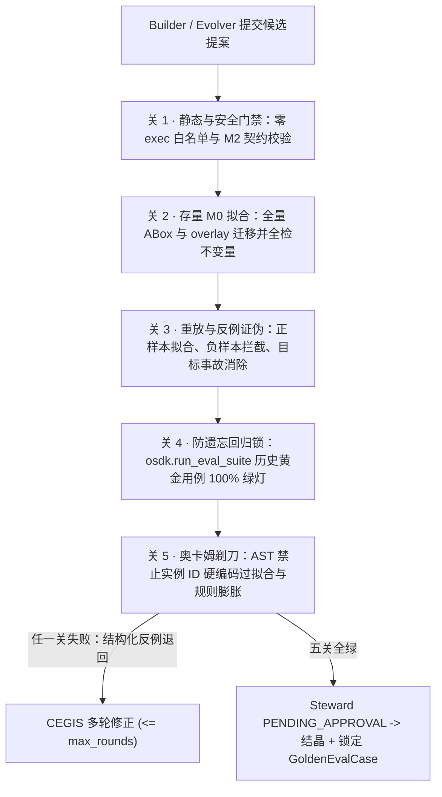

# 神经符号归纳设计：LLM 溯因提议 + 符号沙箱证伪结晶（Ontology Builder & Evolver）

> **元层次定位（OMG MOF）**：
> * **演绎（Deduction, `M1 → M0`）**：由既有的 `OntologyRuntime`、`EditBatch`、`OntologyMCTSPlanner`、`LatentSpace` 与 `ClosedLoopMPCController` 承载，用确定的 M1 世界法则推演与治理 M0 世界状态。
> * **归纳（Induction, `M0 → M1`）**：由本文设计的内核外围 M2 通用模块 `open_ontology/induction.py` 承载，通过「概率性 LLM 溯因提议 + 100% 确定性符号沙箱证伪 + 人类架构师审批结晶」闭环，将混沌外部现象与生产运行摩擦沉淀为受控的 M1 领域模型。
>
> **平台宪法边界**：零改动 `open_ontology/runtime.py`（守住 `<= 1400` 行预算）、零改动 `open_ontology/schema.sql`（守住 6 表纯洁性）、零改动 `open_ontology/ui_display.json`。

---

## 1. 核心架构红线（拟人化不可逾越的边界）

将归纳流程拟人化为 **Ontology Builder（本体建造师）** 与 **Ontology Evolver（本体进化师）** 时，必须强制执行三条工程铁律：

1. **提议权与裁判权物理分离**：`Builder` 与 `Evolver` 均属于概率性溯因提议者（Abductive Proposers），只能输出候选蓝图或差异补丁，无权自我验证，更无权直写生产 M1。证伪裁判必须由**非拟人化、100% 确定性的符号熔炉（`SymbolicCrucible`）**担任，杜绝 LLM-as-a-Judge。
2. **L1 零 `eval/exec` 安全边界**：所有线上沙箱热证伪的候选模型与补丁，必须编译自受限的声明式 JSON/AST 规约（`DeclarativeBlueprint` / `EvolutionPatch` + 白名单谓词树 `PredicateExpr`），严禁在宿主进程对 LLM 生成的任意 Python 代码执行 `eval`/`exec`。复杂 Python 行为变更归入 L2 冷路径（隔离进程回归 + 人工 PR 评审）。
3. **元自举治理（Meta-Dogfooding）**：提案生命周期、证伪报告、黄金回归用例与结晶审批本身由一个标准 6 表 `OntologyRuntime` 治理（`InductionGovernanceService`），`Builder`、`Evolver`、`Crucible`、`Steward` 全员以显式 `Actor` 身份受 RBAC、`PENDING_APPROVAL`、不可变凭证（`__append_only__`）与时光机回滚约束。

---

## 2. 角色矩阵（两动 · 一铁 · 一印）

| 角色 | 系统 `Actor` 身份 | 归纳对标 | 职责与权限边界 |
|---|---|---|---|
| **Ontology Builder** 本体建造师 / 测绘创世官 | `agent:ontology-builder` `role="ontology_builder"` | **0 → 1 冷启动** （对标自监督学习） | 读取外部现象采样（表结构、OpenAPI、历史事件日志、SOP 文档），把概念对齐到商业原型（`MasterEntity` / `BalanceLedger` / `ProcessDocument` / `EventVoucher`），提纯 `ObjectProperty` 与 `AutoID`，猜想初始状态机与不变量，并附带对抗负样本。 |
| **Ontology Evolver** 本体进化师 / 业务法医 | `agent:ontology-evolver` `role="ontology_evolver"` | **1 → N 闭环演化** （对标强化学习 RLHF/RLVR） | 只消费经 `FrictionCollector` 聚类去噪后的生产摩擦证据包（`DEVICE_STATE_MISMATCH`、`REVERTED`、`PENDING_APPROVAL` 人工判例、高频 `REJECTED`、MCTS/MPC 死局），提出原子化 `EvolutionPatch`、存量 M0 迁移映射与新增回归用例。 |
| **Symbolic Crucible** 符号证伪熔炉（铁面机器） | `system:symbolic-crucible` `role="falsifier"` | **确定性 CEGIS 裁判** | 零 LLM 参与。在完全隔离的 `:memory:` 沙箱执行五道确定性关卡，向生产库保持零写入，产出不可篡改的 `FalsificationReport`；任一关失败即携带精确反例退回提议者修正。 |
| **Ontology Steward** 本体大法官 / 架构师 | `human:ontology-steward` `role="steward"` | **最终结晶印章** | 审阅五关全绿的提案 Diff、反例消除证明与迁移影响；批准 `PENDING_APPROVAL` 后经 `post_approval` 原子结晶为新 M1 版本并将反例永久追加进 `GoldenEvalCase`；必要时执行回滚。 |

---

## 3. 符号证伪熔炉（`SymbolicCrucible`）五道硬关卡

1. **关 1 · 静态与安全门禁**：校验 JSON Schema、白名单表达式操作符、`ObjectProperty` 引用完整性、`ActionDef` 目标类型与参数存在性；无任何 `eval`/`exec`。
2. **关 2 · 存量 M0 拟合与迁移校验**：提取既有世界状态的全部对象、连边与 overlay，应用声明的 `FieldMigrationSpec`（字段新增默认值/重命名），加载至挂载候选 M1 的 `:memory:` 沙箱并全量运行 `validate_invariants()`，确保新宪法不会把存量合法世界判死。
3. **关 3 · 历史重放与反例证伪**：
   * Builder（创世）：历史合法事件流重放通过率达标 **且** 对抗负样本拦截率达标（杜绝 `return True` 空壳规则）。
   * Evolver（演化）：在沙箱中复现触发本次演化的 `REVERTED` / `DEVICE_STATE_MISMATCH` / `APPROVAL_PRECEDENT` 现场，验证候选 M1 精确消除目标反例。
4. **关 4 · 防灾难性遗忘回归锁**：复用 `open_ontology.osdk.run_eval_suite`，执行历史上每次结晶累积的全部 `GoldenEvalCase`，要求 **100% 通过**。
5. **关 5 · 奥卡姆剃刀防过拟合**：遍历全部 `PredicateExpr` AST，拦截对主键或 `*_id` 字段与具体实例字面量比对（或命中当前世界/反例真实对象 ID 集合）的特判作弊（`OVERFITTING_INSTANCE_ID`），并限制 AST 深度与单次补丁规则数量。

---

## 4. 模块与自举元本体规划

* **核心 M2 模块**：`open_ontology/induction.py`
  * L1 零 `exec` 声明式蓝图/补丁模型与安全编译器：`DeclarativeBlueprint`、`EvolutionPatch`、`PredicateExpr`、`compile_blueprint`、`apply_evolution_patch`、`migrate_m0_snapshot`
  * M0 摩擦采集与防噪聚类：`FrictionCollector`、`FrictionEvidence`、`FrictionClusterSummary`
  * 确定性五关证伪熔炉：`SymbolicCrucible`、`GateResult`、`CrucibleReport`
  * 元自举治理服务：`InductionGovernanceService`（内置元对象 `FrictionCluster`、`ModelProposal`、`FalsificationReport`、`GoldenEvalCase`、`CrystallizedModelVersion`）
  * 拟人化智能体编排：`OntologyBuilderAgent`、`OntologyEvolverAgent`、`AbductionBackend`（支持离线确定性/回调后端与标准库 HTTP 的 Gemini / OpenAI 兼容后端）
* **端到端演示**：`examples/o2c_induction_demo.py`（`--offline` 确定性运行，完整呈现 Builder 0→1 创世打回修正 + 生产单点噪声过滤 + Evolver 过拟合被关 5 拦截 → 过严被关 4 拦截 → 三轮修宪五关全绿 → Steward 审批结晶）。
* **自动化测试**：`tests/test_induction.py`（覆盖安全编译器、噪声过滤、5 关独立正反断言、生产库零污染指纹校验、RBAC 权责分离、审批/回滚与端到端三幕剧验收）。
